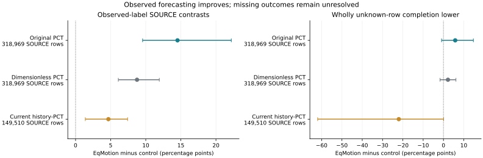
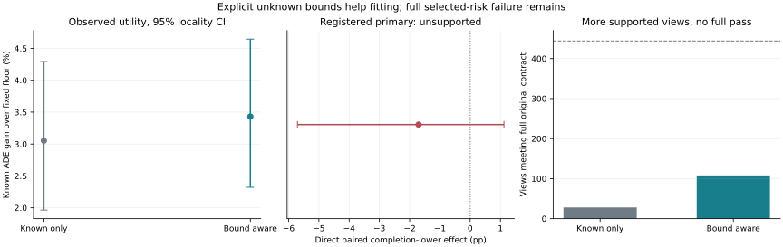

# M3W: Real-World Multimodal Agent-Scene World Model

M3W is my research project on top-down multi-agent world modeling. I study
when a neural forecast adds value over a strong motion baseline, and how to
keep the cases that the baseline already handles well from getting worse.

The long-term aim is a useful agent-scene world model. The current work is
narrower: causal trajectory forecasting, learning intervention gain and harm,
and deciding when a neural prediction should replace a physical baseline.
Combining JEPA, Transformer and other modules is not, by itself, a contribution.

## Current Result

I completed nine fixed-budget EqMotion forecasting fits on the EuropeanSquares
SOURCE data, using three real training seeds and the same observations, labels
and training exposure as the registered PCT controls. This is a fixed-head K=1
adaptation of an existing public method, not a new architecture or reproduction
of published best-of-20 scores.

On observed labels, EqMotion improves available-label ADE relative to CV by
17.21% on the original SOURCE population. The stronger PCT controls matter:

|Comparator|SOURCE target windows|EqMotion minus control, known gain pp [95% CI]|
|---|---:|---:|
|Original PCT, registered primary|318,969|+14.52 [+9.55, +22.19]|
|Dimensionless agent-track PCT|318,969|+8.75 [+6.09, +11.93]|
|Current history-detector PCT|149,510|+4.68 [+1.39, +7.41]|

The last comparison uses the unchanged controller whitelist: EqMotion gains
10.81% versus CV there, compared with 6.14% for current PCT. The two populations
are not pooled. Differences are percentage points using a common known CV
denominator within locality, not percent error reduction relative to each PCT.
Intervals use 3,000 locality resamples after producer-fold and seed averaging.

All prescribed forecasts and 216 primary/secondary metric groups replay.
However, these are exposed SOURCE crossfit results, not independent final tests.
All missing-outcome lower intervals cross zero, and locality 082 loses to the
current PCT on known labels. **I have not upgraded deployment or claimed a new
safe world model from this result.** It provides a stronger proposal for the
next admission experiment.



[Complete forecasting comparison](outputs/publication_readiness_2026_09/european_eqmotion_v1/readout.md),
[stronger controls](outputs/publication_readiness_2026_09/european_eqmotion_v1/strong_controls/readout.md),
[model/data card](outputs/publication_readiness_2026_09/european_eqmotion_v1/model_data_card.md)
and [failure analysis](outputs/publication_readiness_2026_09/european_eqmotion_v1/failure_analysis.md).

## What Has Not Worked

Better forecasting, better cost fitting and safe admission are different tests.
The existing controller improves average observed error but does not satisfy
the complete recording-level risk requirements. Three recent controls narrow
the explanation without turning it into a success:

- Eighteen matched cost forests fail the registered paired lower contrast and
  complete risk contract. Reference sharing and projection slightly help on
  SOURCE; the fitting gap is already present before the decoder.
- Doubling the neural critic width reduces its full SOURCE fitting objective
  by only 0.43%. Its registered lower contrast is -0.636 pp, and only 9/252
  required recording/pipeline views pass. It is not deployed.
- The completed 102-recording calibration experiment finds no common risk
  multiplier that satisfies the original complete contract. Empty selected
  reference support is not counted as a measured safe zero.

The current contract retains the 2% all/easy positive-harm and signed easy-net
requirements in every required recording, with finite support. A favorable
global mean or one easy-error statistic does not replace that contract.

The [results ledger](README_RESULTS.md) contains the full numerical record.
The [previous front page](README_RESEARCH_HISTORY_2026_11_03.md) is archived
verbatim; its pending states and proposed next steps are historical, not current.

## Protocol And Limits

The main observation protocol is **8 observed steps and 12 requested steps**.
The European-source experiment uses a stride of 12 raw frames. Historical
raw-frame `t+50` scores are a separate task and are not mixed into these results.

Future targets are supervision and evaluation only. Future endpoints, central
velocity, test-endpoint goals, future-validity masks and test normalization do
not enter inference. Producer, preprocessing and teacher exposure follow the
same data-role boundaries. Calibration private arrays, final confirmation and
DroneCrowd remain closed for the current experiments.

The project remains a **2.5D multi-agent trajectory/world-state research system**,
not true 3D or a foundation world model. The new forecasting control is 2D
image-plane geometry with time, not depth. Pixel/dataset-local coordinates are
not metric without verification; raw frames are not seconds. Detector/tracker,
inferred and self-audited labels are not human gold. Harm diagnostics are not
physical-safety guarantees. Stage5C execution and SMC remain disabled.

Earlier Stage35/37/43/44 results have recording, teacher-exposure or selection
limitations. They remain exploratory; new split names do not make them
independent evidence. The stronger SOURCE forecaster is a positive component
result, not yet a submission-ready M3W method.

## Running And Reading

Use native arm64 `.venv-pytorch` on Apple Silicon, not x86 Conda under Rosetta.
The completed study uses four CPU compute threads, one inter-op thread and no
DataLoader workers, with atomic checkpoints, heartbeat and resume. It completes
36,000 primary updates, a 4,000-update full refit and a 200-update recovery pilot.
Training/refit takes 3.58 h; complete primary inference replay takes 2.10 h.
These are real Torch runs, not NumPy fallback. MPS success is not claimed.

Public scalar reports can be rebuilt without rereading raw label arrays:

```sh
.venv-pytorch/bin/python scripts/report_m3w_european_eqmotion.py
.venv-pytorch/bin/python scripts/report_m3w_european_eqmotion_controls.py
```

The full pipeline entry points are in the experiment protocol/readout. Completed
stage receipts are immutable: resume incomplete work and do not delete results
to manufacture a fresh run. Full execution still requires verified upstream
data and private checkpoints; anonymous cold-start reproduction remains a gap.
The focused suite has 75 passing tests and one optional Metal-parity skip.
The unrelated legacy suite is not presented as a clean read-only smoke test.

|Record|Purpose|
|---|---|
|[Results ledger](README_RESULTS.md)|Detailed outcomes and negative results|
|[Research state](research_state.json)|Current status and next action|
|[Working paper](outputs/publication_readiness_2026_09/evidence_manuscript_v9/README.md)|Evidence draft, not submission-ready|
|[Data-role contract](outputs/publication_readiness_2026_09/experiment_contract/implementation_and_limits.md)|Role and exposure boundaries|
|[Local/CREATE guide](outputs/publication_readiness_2026_09/local_create_runbook_zh.md)|Runtime and recovery guidance|
|[Historical lineage audit](outputs/publication_readiness_2026_09/recording_lineage_audit.md)|Limits of earlier claims|

Raw datasets, feature/history/latent caches, large checkpoints, videos,
third-party images and local virtual environments stay out of Git.

## Next Question

Can the stronger frozen proposal support useful, reliable admission rather
than another increase in critic width? Three completed SOURCE experiments
narrow that question. The negative 082 slice and missing futures stay in the
analysis; none of these results changes deployment.

The [first amplitude experiment](outputs/publication_readiness_2026_09/european_eqmotion_amplitude_v1/readout.md)
is complete: all 1,440 policy evaluations replay exactly. The prespecified
quarter-amplitude EqMotion gains 6.28% over the fixed causal floor, but 0/444
recording views satisfy the full risk contract. Fixed support removes undefined
reference denominators; it does not remove actual easy harm or uncertainty from
missing futures. Even amplitude .001 fails six views of the same recording,
while gaining only 0.027%. No grid point is chosen for deployment.

The [causal label-support probe](outputs/publication_readiness_2026_09/european_source_label_support_v1/readout.md)
is also complete. On excluded SOURCE sites, past detector history raises AUROC
from 0.602 to 0.706; the paired feature effect is +0.104 [0.060, 0.162]. AUPRC
is 0.144 versus equal-locality unknown prevalence 0.042. Eighteen full forests,
real recovery/full refit, all probability arrays and 144 metric groups replay.
Training takes 267.97 s with 4.51 GB peak RSS. Future masks are targets only.
Calibration remains weak on the critical scene, and some scenes do not improve.
This is a release-label-process result, not physical visibility or neural dynamics.

The [matched bound-aware cost experiment](outputs/publication_readiness_2026_09/european_bound_aware_cost_v1/readout.md)
is complete: 36 real Torch heads, 116,160 primary updates, 4,000 full-refit and
1,200 recovery-pilot updates. Both fitting stages exclude each evaluation site;
all cost/amplitude arrays and 72 metric groups replay exactly. Training takes
378.71 s with 9.24 GB peak RSS. Explicit unknown-row targets lower their own
fitting objective from 4.884 to 1.489, but the direct paired primary is
**-1.70 pp [-5.71, +1.12]**, not a supported improvement. Known utility differs
by +0.38 pp [-1.48, +1.95], also inconclusive.

Full-risk support improves from 28/444 to 108/444 repeated recording views,
while known-all violations increase. Neither policy passes. In the worst
signed easy-net view, predicted easy risk is 0.060% but observed easy positive
harm is 57.76%. The [failure analysis](outputs/publication_readiness_2026_09/european_bound_aware_cost_v1/failure_analysis.md)
separates target-fitting progress from this selected-risk failure. I will next
decompose harm and reference errors on identical selected sets, on fitting and
excluded SOURCE sites, before choosing another cost-learning repair. No new
threshold will be selected from exposed calibration or final-confirmation data.

The [same-set cost diagnostic](outputs/publication_readiness_2026_09/european_bound_cost_decomposition_v1/protocol.md)
is now registered: frozen-model inference on fitting and doubly excluded sites,
separating predicted harm from reference/support error. It makes no optimizer
updates and does not change the failed parent result. Real execution is next.



The larger goal remains useful neural dynamics backed by reproducible,
independent evidence. More stages or a lower training loss are not substitutes.
