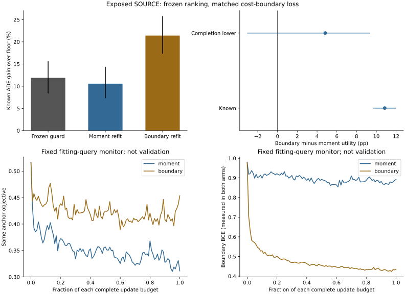

# Two-Sided Boundary Learning: Complete Result

## Evidence Scope

fresh_run: 36 real Torch cost fits, two exact complete refits, all 72 original groups and separate full inference/action-score replay.
cached_verified: original forecasts, TDEF ranking, normalizers, 462 causal fields, own-choice warm weights and complete original controls.
not_run: new trajectory/JEPA/Transformer training, independent roles, deployment or submission.
All results are exposed SOURCE fitting/resubstitution. Cost seeds17/29/43 share forecaster43.

Both arms keep the same architecture, initial state, complete draws, fixed-initial-choice query loss and full budget.
Only the boundary arm adds a unit log-ratio BCE on the original all/easy 2% boundary. It does not predict a best-expert class.
The auxiliary reference is detached; reference regression and the shared encoder still train. The outputs are not calibrated event probabilities.

|Arm|Fits|Updates|Initial anchor objective|Final anchor objective|Initial boundary BCE|Final boundary BCE|
|---|---:|---:|---:|---:|---:|---:|
|moment|18|104160|+0.516649|+0.311329|+0.979314|+0.892041|
|boundary|18|104160|+0.516649|+0.453420|+0.979314|+0.435365|

Monitor values are fitting losses, not held-out performance or checkpoint selection. No unknown observed-cost targets are supplied.

## Full Policy And Required Safety

|Policy|Known ADE gain % [conditional 95% CI]|Full-roster FDE gain|Completion-lower utility pp|Risk-supported recording views|Known all/easy violations|Undefined easy support|Worst known easy degradation %|Switch rate|
|---|---:|---:|---:|---:|---:|---:|---:|---:|
|moment_guarded|+10.578407 [+7.301811,+14.381653]|not_estimable|+5.743171 [-1.241255,+11.525470]|20/444|121/240|17|+5.769174|+0.329792|
|boundary_guarded|+21.425949 [+17.343145,+25.776462]|not_estimable|+11.220648 [-3.031204,+20.914761]|0/444|388/417|6|+40.472291|+0.704122|
|frozen_tdef_guarded|+11.890200 [+8.375710,+15.619766]|not_estimable|+5.976829 [-2.295324,+12.323042]|18/444|87/206|20|+4.090044|+0.185120|
|frozen_own_joint|+14.150457 [+10.130050,+18.382176]|not_estimable|+4.159293 [-10.170747,+13.992780]|10/444|226/343|12|+12.154390|+0.246201|
|tdef_raw|+25.213369 [+21.642368,+29.232823]|not_estimable|+12.512548 [-1.523568,+22.476104]|0/444|429/440|1|+95.988832|+0.849969|
|floor|+0.000000 [+0.000000,+0.000000]|not_estimable|+0.000000 [+0.000000,+0.000000]|0/444|0/0|444|+0.000000|+0.000000|

Floor-only has no interventions; an undefined selected-risk field is not evidence that the floor causes harm, nor a learned intervention success.

## Registered Contrasts

Primary: boundary minus moment FULL completion-lower utility. Secondary or matched-count results cannot replace it.

|Contrast|Scope|Known pp [conditional 95% CI]|Completion-lower pp [conditional 95% CI]|
|---|---|---:|---:|
|boundary_minus_moment|full|+10.847543 [+9.699275,+11.991599]|+4.830476 [-3.072394,+9.335094]|
|boundary_minus_moment|matched|not_estimable|not_estimable|
|boundary_minus_frozen_guard|full|+9.535749 [+8.128308,+10.898344]|+4.727428 [-1.495463,+8.613226]|
|boundary_minus_frozen_guard|matched|not_estimable|not_estimable|
|boundary_minus_frozen_joint|full|+7.275492 [+6.125951,+8.379232]|-1.356305 [-12.011441,+4.835929]|
|boundary_minus_frozen_joint|matched|not_estimable|not_estimable|

Paired lower bounds use disagreement on unknown outcomes, not subtraction of individual lower bounds.
Count matching is utility only. Required empty views stay not estimable, not safely zero. Missing outcomes are uncertainty, not measured harm.

## Registered Two-Sided Diagnostic

|Arm|Pointwise blocked views|Singleton joint obstruction views|Rejected safe easy actions|Rejected beneficial safe easy actions|Admitted unsafe actions|
|---|---:|---:|---:|---:|---:|
|moment|9|6|498455|466569|173754|
|boundary|5|5|144757|121127|563612|

Action occurrences repeat candidates, contexts and seeds. Realized-cost errors are not a unique proof of conditional calibration failure.
Future labels identify these errors only after causal choices are fixed. No oracle-filtered policy is evaluated as a deployable model.

## Compute And Checks

Actual 400-update pilot: PID 61758, 29.261527 s, peak RSS 9,822,683,136 B.
Formal training including full refits: PID 62953, 1355.435961 s, peak RSS 11,165,057,024 B.
Complete policy evaluation: PID 65863, 174.347063 s, peak RSS 11,248,467,968 B.
Separate numerical replay: PID 67210, 170.763235 s, peak RSS 11,660,214,272 B.

Native arm64 CPU4/inter-op1/workers0; atomic 50-update checkpoints, heartbeat, explicit resume. No speed-based budget reduction.

## Fitting Gates

- complete36fits72groups: pass
- matched_capacity_initial_draws_budget: pass
- complete_query_coverage: pass
- original_controls_exact: pass
- predicted_original_guard_pass: pass
- primary_boundary_minus_moment_full_lower_CI_positive: fail
- boundary_minus_frozen_full_lower_CI_positive: fail
- boundary_floor_lower_CI_positive: fail
- all_original_recording_risk: fail

Fitting advancement: False. Independent confirmation: false. Deployment changed: false.

The original 149,510 targets, 74 recordings and 12 localities remain. Intervals average repeated views within locality before 3,000 bootstrap draws.
They are conditional development evidence, not independent confirmation. Full-roster FDE stays not estimable where final endpoints are unavailable.
EuropeanSquares detector-silver/oblique local-image, obs8/pred12/stride12 raw frames. No SDDt+50, metric/seconds, human-gold, true3D, foundation, new dynamics or physical-safety claim.
Stage5C execution and SMC remain off.
