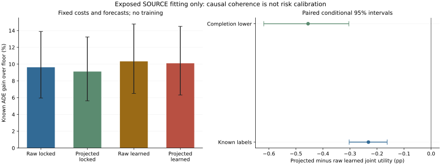

# Zero-Step Coherent-Cost Control: Complete SOURCE Readout

## Material Passport

fresh_run:causal cost projection,complete72-group allocation/readout,and separate full inference/frozen-action verification.
cached_verified:all36previously trained cost endpoints,seven forecasts,462causal fields,normalizers,labels and both original full-joint policies.
not_run:new cost/forecaster/JEPA/Transformer/residual training,independent calibration/confirmation or deployment.
All present outcomes are exposed SOURCE fitting/resubstitution,not independent test evidence.

## Controlled Change

Equal-average predicted R/R_easy over causally available candidates per agent;cap B at shared R. H/H_easy and all trajectories stay unchanged.
No target,label availability,future endpoint,test goal,manual reference maximum,new action or no-op anchor enters projection.
The sequential reference/benefit projection is not the closest joint projection of all five moments and is not new neural training.
Reference MSE can fall by averaging alone. Only actual policy effects and recording risk address the research question.

## Registered Primary And Controls

Primary:projected learned joint minus original unprojected learned joint FULL completion-lower ADE utility.
Locked projection and joint-minus-independent are secondary,not replacement primaries. Original2%requirements are unchanged.

|Contrast|Scope|Known pp [conditional95%CI]|Completion-lower pp [conditional95%CI]|Completion-upper pp [conditional95%CI]|
|---|---|---:|---:|---:|
|learned_projection|full|-0.231901 [-0.303124,-0.162510]|-0.455097 [-0.618925,-0.304167]|-0.008706 [-0.138479,+0.174990]|
|learned_projection|matched|not_estimable|not_estimable|not_estimable|
|locked_projection|full|-0.505051 [-0.726493,-0.311334]|-0.858106 [-1.251291,-0.511211]|-0.151997 [-0.414275,+0.142223]|
|locked_projection|matched|not_estimable|not_estimable|not_estimable|
|projected_joint_minus_independent|full|+1.627091 [+0.892532,+2.407216]|+1.014536 [+0.426580,+1.678899]|+2.239646 [+1.219677,+3.299799]|
|projected_joint_minus_independent|matched|not_estimable|not_estimable|not_estimable|

Paired known-minus-lower uncertainty penalty:+0.223195pp. Not measured harm.
Original-versus-projected matched rows are trimmed per query by each own utility. These controls are utility-only,not safety policies.
The allocator also retains separate projected locked/learned common-count controls;those are a different secondary comparison.
Empty matched comparisons stay not_estimable. Never turn empty selected easy support into a safety pass.

|Policy|Known ADE gain over floor (%)|Known FDE gain (%)|Own completion-lower pp|Record-risk views supported|Known all/easy risk violations|Undefined selected easy|Selected/unknown views|
|---|---:|---:|---:|---:|---:|---:|---:|
|locked_independent|+7.408245 [+4.535347,+10.981995]|not_estimable|+1.396179 [-7.097477,+7.656244]|5/444|228/360|13|437377/7866|
|locked_joint|+9.116695 [+5.624068,+13.232630]|not_estimable|+2.938007 [-6.043168,+9.493208]|5/444|330/384|13|437377/8340|
|locked_matched|+8.624254 [+5.207061,+12.706772]|not_estimable|+3.251093 [-4.530049,+9.263549]|10/444|316/369|16|371070/7320|
|learned_independent|+8.470570 [+5.293003,+12.155128]|not_estimable|+2.899376 [-4.473897,+8.743148]|11/444|229/327|10|399380/7357|
|learned_joint|+10.097661 [+6.317607,+14.495635]|not_estimable|+4.375998 [-3.433555,+10.669076]|9/444|309/360|10|399380/7696|
|learned_matched|+9.539220 [+5.795714,+13.924277]|not_estimable|+4.404743 [-2.913980,+10.359621]|9/444|311/356|16|371070/7237|
|raw_locked_joint|+9.621747 [+5.958598,+13.892016]|not_estimable|+3.356410 [-5.688878,+10.053233]|5/444|336/384|12|440715/8401|
|raw_learned_joint|+10.329562 [+6.503952,+14.779442]|not_estimable|+4.535264 [-3.298350,+10.917652]|9/444|317/369|9|401460/7708|
|floor|+0.000000 [+0.000000,+0.000000]|not_estimable|+0.000000 [+0.000000,+0.000000]|0/444|0/0|444|0/0|

## Cost Coherence

Counts repeat source/context/cost-seed views. Excess tolerance1e-12in frozen causal-scale units.

|Costs|Legal action views|B>R|Negative implied ADE|R differs across candidates|R_easy differs across candidates|
|---|---:|---:|---:|---:|---:|
|raw_locked|5369850|136156|93505|894975|894898|
|raw_learned|5369850|251929|169709|894975|894767|
|projected_locked|5369850|0|0|0|0|
|projected_learned|5369850|0|0|0|0|

Zero contradictions are structural properties of this postprocessor,not proof of risk calibration or trajectory quality.
Negative implied ADE describes predicted cost moments,not negative measured trajectory errors.

## Five Cost Errors

Normalized SOURCE fitting MSE. Columns are B,H,R,R_easy,H_easy;not independent calibration.

|Moment|Raw locked|Projected locked|Raw learned|Projected learned|
|---|---:|---:|---:|---:|
|0|+0.264401 [+0.138958,+0.424284]|+0.316344 [+0.166436,+0.507749]|+0.267517 [+0.142116,+0.431118]|+0.274885 [+0.144850,+0.444403]|
|1|+0.090470 [+0.068126,+0.117099]|+0.090470 [+0.068126,+0.117099]|+0.095654 [+0.073170,+0.122462]|+0.095654 [+0.073170,+0.122462]|
|2|+0.351355 [+0.262367,+0.436969]|+0.346204 [+0.257041,+0.432009]|+0.191049 [+0.116591,+0.283589]|+0.185460 [+0.110874,+0.277859]|
|3|+0.484916 [+0.292808,+0.700229]|+0.477396 [+0.289000,+0.687002]|+0.335499 [+0.169982,+0.545153]|+0.323636 [+0.162954,+0.525557]|
|4|+0.124488 [+0.053272,+0.230523]|+0.124488 [+0.053272,+0.230523]|+0.112226 [+0.042600,+0.216960]|+0.112226 [+0.042600,+0.216960]|

H/H_easy predictions remain identical;selected bias can nevertheless change because a different action is chosen.
Per-group selected cost sums/bias are in the scalar archive. Supplementary pooled normalized bias is descriptive over repeated views,not a calibration guarantee.
Negative bias means the cost is underpredicted on observed selected actions. Frequencies alone do not measure the size of a risk violation.

|Policy|Known selected row views|Normalized B bias|H bias|R bias|R_easy bias|H_easy bias|H underprediction views|H_easy underprediction views|
|---|---:|---:|---:|---:|---:|---:|---:|---:|
|raw_locked_joint|432314|+0.082363|-0.008134|+0.076521|-0.083295|-0.009589|65918|25958|
|raw_learned_joint|393752|+0.102728|-0.012030|-0.048036|-0.088254|-0.008340|62573|22827|
|locked_joint|429037|+0.053719|-0.008076|+0.059274|-0.076977|-0.009305|65342|25827|
|learned_joint|391684|+0.069986|-0.011828|-0.058249|-0.086202|-0.007910|61233|21731|

## Easy Tails

|Policy|Known easy defined|Worst known net degradation (%)|Views above2%|Worst completion-upper bound (%)|
|---|---:|---:|---:|---:|
|locked_independent|444/444|+16.036100|18|+14190.466093|
|locked_joint|444/444|+16.356054|21|+14190.466093|
|locked_matched|444/444|+16.747522|17|+10981.477318|
|learned_independent|444/444|+6.084431|13|+10088.333244|
|learned_joint|444/444|+14.745066|20|+10088.333244|
|learned_matched|444/444|+14.068426|16|+10088.333244|
|raw_locked_joint|444/444|+18.657640|22|+14190.466093|
|raw_learned_joint|444/444|+17.170690|22|+10088.333244|
|floor|444/444|+0.000000|0|+0.000000|

Completion-upper values bound missing outcomes;they are not observed catastrophic errors.
Net easy degradation and selected positive-harm/reference risk have different numerators/denominators;both original requirements remain.

|Known-label subset|Raw learned joint|Projected learned joint|
|---|---:|---:|
|hard|+11.912005|+11.501076|
|easy|+8.677657|+9.057563|

## Compute And Reproduction

Actual resource/recovery probe PID28401:21.154319s,peakRSS9830825984B.
Full readout PID29594:1815.196780s,peakRSS11202265088B.
Separate verification PID33094:158.400952s,peakRSS11719557120B.
Complete allocation:112596repeated query views,273360solver calls. No new optimizer updates.
The actual18-query interruption/resume check is exact. Final verification re-infers costs and scores frozen actions,not timed MILP reoptimization.
Every original full/record score and raw cost error is exact. Original cost weights and forecasts are unchanged.
Nonoptimal/invalid solves keep the declared feasible independent parent. Solver reason counts are public.
Native arm64CPU4/interop1/workers0,query checkpoints250,heartbeat and explicit resume. No speed-based reduction.

## Interaction And Tail Diagnostics

Pair contraction is over query targets only,not all visible agents or a collision certificate.

|Policy|Mean pair contraction/frozen scale|Maximum record p95 ADE|
|---|---:|---:|
|raw_learned_joint|+0.201348|+149.109072|
|learned_joint|+0.195704|+151.162401|
|raw_locked_joint|+0.207756|+156.353008|
|locked_joint|+0.196149|+160.027003|
|floor|+0.000000|+178.960477|

## Fitting Gates

- complete72original_groups: pass
- original36weights_and_full_record_controls_exact: pass
- forecast_labels_harm_and_availability_unchanged: pass
- projected_moments_coherent: pass
- primary_projection_full_lower_CI_positive: fail
- projected_own_floor_lower_CI_positive: fail
- all_original_recording_risk: fail

Fitting advancement:False. Deployment and independent roles unchanged.

## Evidence Limits

All149,510unique targets,74recordings,72groups and12exposed localities remain.3,000paired locality bootstrap draws average repeated contexts/cost seeds first.
These are nominal SOURCE fitting intervals. Cost seeds17/29/43share forecaster43,not three whole forecast pipelines.
Overlapping windows are not independent samples. Full-roster FDE stays not_estimable without requested endpoints;no earlier substitution or fabricated interior labels.
Label-aware pointwise support is diagnostic,not model utility,and its failure alone does not prove query pooling infeasible.
EuropeanSquares oblique-camera detector-silver/local-image,obs8/pred12/rawstride12. Not SDDt50,meters,seconds,human gold,true3D or foundation.
Stage5C and SMC remain disabled. This experiment alone cannot establish world dynamics,independent generalization or CCF-A submission readiness.
