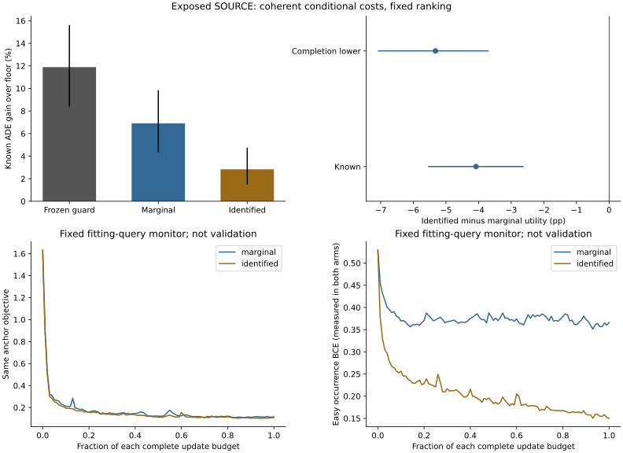

# Coherent Conditional Cost Identification

## Material Passport

fresh_run:36real Torch cost fits,two exact complete refits,full72-group readout and separate full moment/probability inference/action-score replay.
cached_verified:all current forecast paths,TDEF ranking,462causal fields,normalizers,warm encoder and original complete controls.
not_run:new trajectory/JEPA/Transformer training,independent role access,calibration certification or deployment.
This is exposed SOURCE fitting/resubstitution. Three cost seeds share forecaster43.

## Controlled Change

Both31,381-parameter models share the same conditional-cost factorization,encoder,initial fitting priors,draws and complete budget.
The identified arm additionally supervises easy occurrence and conditional B/H/R magnitude,without tying an event probability to a mean-harm ratio.
This adapts the old easy-hurdle idea to the full current bank,not a new hurdle method or exact old-critic continuation.
The predicted event factor is not the realized future easy label. Unknown labels stay NaN and are never inference inputs.

|Arm|Fits|Updates|Initial anchor|Final anchor|Initial occurrence BCE|Final occurrence BCE|Initial conditional MSE|Final conditional MSE|
|---|---:|---:|---:|---:|---:|---:|---:|---:|
|marginal|18|104160|+1.631770|+0.115738|+0.529263|+0.366042|+0.483321|+0.127004|
|identified|18|104160|+1.631770|+0.108436|+0.529263|+0.149985|+0.483321|+0.098434|

These are fixed fitting-query monitors,not validation or checkpoint selection. Auxiliary components are only diagnostic in the marginal arm.

## Complete Policies

|Policy|Known ADE gain % [conditional95%CI]|FDE gain % (not estimable if incomplete)|Completion-lower utility pp|Supported record views|Known all/easy violations|Undefined selected easy|Worst known easy degradation %|Switch rate|
|---|---:|---:|---:|---:|---:|---:|---:|---:|
|marginal_guarded|+6.909619 [+4.352138,+9.843419]|not_estimable|+5.338788 [+2.807704,+8.449012]|15/444|181/293|15|+6.250110|+0.358374|
|identified_guarded|+2.830236 [+1.481975,+4.750233]|not_estimable|+2.089047 [+0.617314,+4.169821]|55/444|71/150|38|+1.264269|+0.179344|
|frozen_moment_guarded|+10.578407 [+7.301811,+14.381653]|not_estimable|+5.743171 [-1.241255,+11.525470]|20/444|121/240|17|+5.769174|+0.329792|
|frozen_boundary_guarded|+21.425949 [+17.343145,+25.776462]|not_estimable|+11.220648 [-3.031204,+20.914761]|0/444|388/417|6|+40.472291|+0.704122|
|frozen_tdef_guarded|+11.890200 [+8.375710,+15.619766]|not_estimable|+5.976829 [-2.295324,+12.323042]|18/444|87/206|20|+4.090044|+0.185120|
|frozen_own_joint|+14.150457 [+10.130050,+18.382176]|not_estimable|+4.159293 [-10.170747,+13.992780]|10/444|226/343|12|+12.154390|+0.246201|
|tdef_raw|+25.213369 [+21.642368,+29.232823]|not_estimable|+12.512548 [-1.523568,+22.476104]|0/444|429/440|1|+95.988832|+0.849969|
|floor|+0.000000 [+0.000000,+0.000000]|not_estimable|+0.000000 [+0.000000,+0.000000]|0/444|0/0|444|+0.000000|+0.000000|

Floor abstention has no selected denominator. That is not evidence the floor causes harm or a positive learned-intervention result.

## Registered Contrasts

|Contrast|Scope|Known pp [conditional95%CI]|Completion-lower pp [conditional95%CI]|
|---|---|---:|---:|
|identified_minus_marginal|full|-4.079383 [-5.548596,-2.623124]|-5.321489 [-7.088381,-3.692526]|
|identified_minus_marginal|matched|not_estimable|not_estimable|
|identified_minus_frozen_guard|full|-9.059964 [-11.474939,-6.562493]|-14.756675 [-19.487662,-10.778887]|
|identified_minus_frozen_guard|matched|not_estimable|not_estimable|
|identified_minus_frozen_joint|full|-11.320221 [-14.384480,-8.202034]|-21.012984 [-31.004347,-14.174565]|
|identified_minus_frozen_joint|matched|not_estimable|not_estimable|

Primary:identified-minus-marginal FULL completion-lower. Empty required common-count views are not_estimable,not safe0.
Count matching is utility only. Paired completion bounds use unknown-row path disagreement,not subtraction of individual lower bounds.
Uncertainty about missing outcomes is not measured hidden harm. Original recording risks remain required.

## Fitting-Cohort Diagnostic Scores

|Quantity|Marginal [conditional95%CI]|Identified [conditional95%CI]|Paired identified-minus-marginal|
|---|---:|---:|---:|
|Easy occurrence Brier|+0.109240 [+0.087243,+0.130226]|+0.037867 [+0.019673,+0.058165]|-0.071372 [-0.082236,-0.059916]|
|B cost-scale normalized MSE|+0.072576 [+0.041673,+0.110906]|+0.066884 [+0.037319,+0.103714]|-0.005692 [-0.007454,-0.003942]|
|H cost-scale normalized MSE|+0.212650 [+0.161565,+0.272929]|+0.181976 [+0.131276,+0.242276]|-0.030674 [-0.034819,-0.026729]|
|R cost-scale normalized MSE|+0.631342 [+0.385977,+0.910996]|+0.539928 [+0.305152,+0.820367]|-0.091414 [-0.123623,-0.062319]|
|ER cost-scale normalized MSE|+0.001203 [+0.000655,+0.001843]|+0.001046 [+0.000524,+0.001624]|-0.000157 [-0.000319,+0.000025]|
|EH cost-scale normalized MSE|+0.007582 [+0.003407,+0.012379]|+0.006306 [+0.002482,+0.010699]|-0.001276 [-0.002175,-0.000533]|

MSE/Brier are fitting-cohort diagnostics,not independent calibration or an actual-risk guarantee. Lower is better here.

|Arm|Pointwise blocked views|Singleton joint obstruction views|Rejected safe easy actions|Rejected beneficial safe easy actions|Admitted unsafe actions|
|---|---:|---:|---:|---:|---:|
|marginal|10|5|389742|364680|265601|
|identified|26|5|524628|492385|139550|

These repeat candidates,contexts and seeds. Labels diagnose error only after the causal choices are frozen;no oracle-filtered policy is deployed.

## Compute And Reproduction

Actual400-update pilot:PID71731,23.196583s,peakRSS9,819,979,776B.
Formal training and exact full refits:PID72912,754.069219s,peakRSS10,604,593,152B.
Complete72readout:PID75028,165.378655s,peakRSS11,593,695,232B.
Separate numerical replay:PID76396,165.724376s,peakRSS11,568,758,784B.

Native arm64CPU4/inter-op1/workers0. Atomic50-update checkpoints,heartbeat,explicit resume. No speed-based budget reduction.

## Fitting Gates

- complete36fits72groups: pass
- matched_capacity_initial_draws_budget: pass
- complete_query_coverage: pass
- original_controls_exact: pass
- coherent_predictions_and_original_guard: pass
- primary_identified_minus_marginal_full_lower_CI_positive: fail
- identified_minus_frozen_full_lower_CI_positive: fail
- identified_floor_lower_CI_positive: pass
- all_original_recording_risk: fail

Fitting advancement:False. Independent confirmation:false. Deployment changed:false.

## Limits

All149,510targets/74recordings/12localities/72groups remain.3,000locality resamples first average repeated context and cost-seed views.
These SOURCE intervals are conditional development evidence. No three-forecaster,independent-selection/calibration/test or whole-pipeline OOF claim.
The factorization targets known-label conditional costs,not unobserved outcome identification or a missing-at-random assumption.
EuropeanSquares detector-silver/oblique local-image,obs8/pred12/stride12rawframes. Not SDDt+50,metric/seconds,human-gold,true3D,foundation,new dynamics or physical safety.
Stage5C and SMC remain off.
