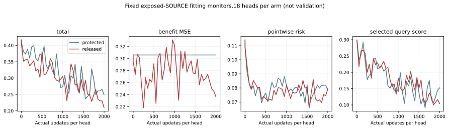

# Coupled-head training evidence

## Material Passport

fresh_run:36 neural fits,72,000 primary updates and two2,000-update complete exact refits.
cached_verified:original input/features,forecasts,normalizers,draw rules and protected model controls.
This report contains fixed fitting monitors,not policy outcomes,validation,test,calibration or deployment evidence.
PID96568:333.204713s from runtime_ready,peakRSS10978426880B;initial admission is outside that phase timer.
All18 protected model controls are exact;both modes have the same30,857 parameters and draw hashes.

|Mode|Fixed fitting monitor|Initial median|Final median|Decreased heads|
|---|---|---:|---:|---:|
|protected_benefit|total|0.416924699|0.248730235|18/18|
|protected_benefit|benefit_MSE|0.306023788|0.306023788|0/18|
|protected_benefit|pointwise_risk|0.114094603|0.078215335|15/18|
|protected_benefit|selected_query_score|0.295757026|0.152469851|16/18|
|released_benefit|total|0.416924699|0.209359279|18/18|
|released_benefit|benefit_MSE|0.306023788|0.236459099|18/18|
|released_benefit|pointwise_risk|0.114094603|0.079480324|17/18|
|released_benefit|selected_query_score|0.295757026|0.104151487|16/18|

The total is0.5*(benefit+pointwise risk+selected-query score);the protected benefit term is constant with zero gradient.
Do not compare stochastic batch losses as if they were the same fixed examples. Curves below use each head fixed fitting monitor.
No monitor selects a checkpoint or changes settings. All heads complete exactly2,000 updates.

Unknown outcomes remain context rows and have zero supervised loss. Repeated draws are not independent samples.
This is cost-head training,not a new trajectory forecast/world-dynamics model. No independent roles,Stage5C or SMC.
