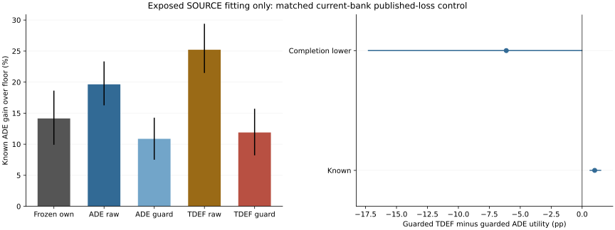

# Current-Bank ADE Regression Versus Published Deferral

## Material Passport

fresh_run:36real Torch fits,complete72-group policy readout and separate new-score/action-score verification.
cached_verified:seven current forecasts,462causal fields,normalizers,warm encoder and original own-choice risk critic/controls.
not_run:new trajectory/JEPA/Transformer/residual training,independent model selection/calibration/confirmation and deployment.
All results are exposed SOURCE fitting/resubstitution. Three cost seeds share forecaster43.

## Controlled Comparison

Same30,726active parameters,initial encoder and zero outputs,query draws,full budgets and canonical continuous expert labels.
Expected-ADE softplus MSE versus the reused Mao/Mohri/Zhong ICML2024Eq3logistic surrogate. No one-hot best-action labels.
The architecture/floor pooling is an application adapter,not their original experimental reproduction or a bounded-loss theorem verification.
Raw scores select independently. The guarded version filters by the frozen own critic's original two2%pointwise predicted constraints and positive gain.
No new threshold,calibration,integer solver or logit-as-native-utility substitution. No future label/validity enters decisions.
The previous31,119parameter critic is a different head family;the new two-loss control has exactly matched capacity internally.

|Loss|Fits|Updates|Initial monitor loss|Final monitor loss|Unknown contextual row draws|
|---|---:|---:|---:|---:|---:|
|ade|18|104160|+3.892695|+0.479116|219368|
|tdef|18|104160|+204.216835|+203.900577|219368|

Loss magnitudes have different objectives and are not a cross-loss performance ranking. Full endpoint budgets are fixed,not validation-selected checkpoints.
Every query receives at least four visits. Unknown labels stay NaN;unknown rows retain causal contextual roles but no supervised cost.
All208,320primary updates plus14,336full-refit updates complete. Actual interrupted/direct and full-refit scientific states are exact,excluding wall time.

## Registered Contrasts

Primary:TDEF_guarded minus ADE_guarded FULL completion-lower utility. No raw/component/seed substitutes for it.
|Contrast|Scope|Known pp [conditional95%CI]|Completion-lower pp [conditional95%CI]|Completion-upper pp [conditional95%CI]|
|---|---|---:|---:|---:|
|guarded_tdef_minus_ade|full|+1.015483 [+0.603912,+1.541241]|-6.128112 [-17.313596,+0.021076]|+8.159078 [+2.142824,+19.067768]|
|guarded_tdef_minus_ade|matched|not_estimable|not_estimable|not_estimable|
|guarded_tdef_minus_frozen|full|-2.260257 [-3.160157,-1.465769]|-8.618524 [-17.032188,-3.672715]|+4.098010 [-1.087561,+13.275051]|
|guarded_tdef_minus_frozen|matched|not_estimable|not_estimable|not_estimable|
|raw_tdef_minus_ade|full|+5.574024 [+4.372858,+6.650644]|-11.043445 [-33.947795,+1.552525]|+22.191493 [+9.509764,+45.440955]|
|raw_tdef_minus_ade|matched|+4.823052 [+3.835628,+5.804390]|-2.411792 [-7.585155,+1.266942]|+12.057896 [+8.305217,+17.579158]|
|tdef_guarded_minus_raw|full|-13.323168 [-14.839091,-11.812199]|-20.563912 [-27.384157,-16.172016]|-6.082425 [-10.344621,+0.645175]|
|tdef_guarded_minus_raw|matched|not_estimable|not_estimable|not_estimable|

Post-hoc common-count views are utility-only,using each policy's own score margins;empty required views remain not_estimable,not safe0.
Paired lower uses unknown-row trajectory disagreement,not subtraction of two individual lower scores. Uncertainty is not observed hidden harm.

|Policy|Known ADE gain over floor (%)|Full-roster FDE|Own lower utility pp|Risk-supported record views|Known all/easy risk violations|Undefined selected easy|
|---|---:|---:|---:|---:|---:|---:|
|ade_raw|+19.639345 [+16.258985,+23.334849]|not_estimable|-1.281275 [-31.135574,+15.965051]|0/444|444/439|0|
|ade_guarded|+10.874718 [+7.500023,+14.273998]|not_estimable|+1.804342 [-11.871726,+10.319578]|15/444|110/282|14|
|tdef_raw|+25.213369 [+21.478147,+29.396083]|not_estimable|+12.512548 [-2.678106,+22.596717]|0/444|429/440|1|
|tdef_guarded|+11.890200 [+8.212487,+15.713038]|not_estimable|+5.976829 [-2.586384,+12.264856]|18/444|87/206|20|
|frozen_own_independent|+12.608193 [+8.789895,+16.474213]|not_estimable|+2.787257 [-11.817329,+11.981527]|10/444|123/272|12|
|frozen_own_joint|+14.150457 [+9.910351,+18.627045]|not_estimable|+4.159293 [-10.836125,+13.772787]|10/444|226/343|12|
|floor|+0.000000 [+0.000000,+0.000000]|not_estimable|+0.000000 [+0.000000,+0.000000]|0/444|0/0|444|

|Policy|Switch rate|Neural row rate|Mean group cost-scale regret|Worst known easy degradation (%)|Easy views above2%|
|---|---:|---:|---:|---:|---:|
|ade_raw|+0.883819|+0.130650|+0.201120|+86.595167|126|
|ade_guarded|+0.185207|+0.049671|+0.292248|+4.003809|3|
|tdef_raw|+0.849969|+0.128945|+0.143426|+95.988832|107|
|tdef_guarded|+0.185120|+0.053265|+0.281744|+4.090044|2|
|frozen_own_independent|+0.246201|+0.073816|+0.274403|+4.584243|4|
|frozen_own_joint|+0.246201|+0.072003|+0.258419|+12.154390|11|
|floor|+0.000000|+0.000000|+0.404191|+0.000000|0|

Rates pool repeated source/context/head views;regret is a mean of group means,not independent row evidence. Neural use is not a contribution ablation.
Known net easy change and positive-harm ratios are separate. Predicted feasibility is not actual risk calibration.

|Subset known gain (%)|ADE raw|ADE guarded|TDEF raw|TDEF guarded|Frozen own joint|
|---|---:|---:|---:|---:|---:|
|hard|+18.271030|+8.596426|+21.354771|+9.017371|+11.763355|
|easy|+24.009656|+3.157305|+20.479983|+3.629029|+4.215657|

## Compute And Verification

Real400update pilot:PID51759,21.601204s,peakRSS9724149760B.
Formal training and full refits:PID52905,771.051834s,peakRSS11638472704B.
Full72readout:PID55021,157.690834s,peakRSS11552129024B.
Separate new-score/action replay:PID56375,159.077315s,peakRSS11527356416B.

Native arm64CPU4/interop1/workers0,checkpoint50updates,heartbeat,explicit resume,phase lock. No speed-based reduction.
Original full and record controls are exact. No new timed MILP is executed;new independent choices and frozen actions are exactly replayed.

## Fitting Gates

- complete36fits72groups: pass
- matched_capacity_initial_draws_budget: pass
- complete_query_coverage: pass
- original_controls_exact: pass
- causal_frozen_risk_guard_pass: pass
- primary_tdef_minus_ade_full_lower_CI_positive: fail
- tdef_minus_frozen_full_lower_CI_positive: fail
- tdef_floor_lower_CI_positive: fail
- all_original_recording_risk: fail

Fitting advancement:False. Independent confirmation:false. Deployment changed:false. Stage5C:false. SMC:false.

## Limits

All149,510targets/74recordings/12localities/72groups remain.3,000paired locality bootstrap draws average repeated context and cost-seed views first.
These SOURCE fitting intervals are not independent confirmation or three forecast pipelines. Full-roster FDE remains not_estimable where endpoints are unknown.
EuropeanSquares oblique detector-silver/local-image,obs8/pred12/rawstride12. Not SDDt50,meters,seconds,human gold,true3D or foundation.
No neural dynamics or physical-safety improvement is established by a cost-routing result.

Primary method: [Regression with Multi-Expert Deferral](https://proceedings.mlr.press/v235/mao24d.html).
