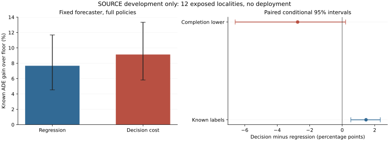

# Seven-Action Decision-Cost Training: Complete SOURCE Result

## Material Passport

fresh_run:18 real Torch cost critics,36,000 primary updates,2,000 exact first-head refit,complete72-group allocation/readout.
cached_verified:18 regression heads,seven forecasts,floor,462 past-only fields and all old full-policy controls.
not_run:new trajectory/JEPA/Transformer training,independent calibration/confirmation and deployment.
All views are exposed SOURCE fitting resubstitution,not whole-pipeline OOF or independent evidence.

## Registered Factor

Add the registered soft expected decision-cost loss and full-record risk duals to the original regression loss.
Same30,857 parameters,initialization,queries,draw hashes and2,000 updates. Original reference moments and2%hard decoder stay fixed.
Unknown rows use causal worst-case envelopes in the decision objective,not fabricated supervised labels.
Training optimizes a soft surrogate;actual evaluation uses the unchanged deterministic eligibility/MILP.
The primary is decision-joint minus regression-joint FULL completion-lower ADE utility.

|Contrast|Known pp [conditional95%CI]|Completion-lower pp [conditional95%CI]|Completion-upper pp [conditional95%CI]|
|---|---:|---:|---:|
|joint|+1.466317 [+0.529223,+2.342938]|-2.744940 [-6.587075,+0.210798]|+5.677574 [+3.509034,+8.660910]|
|matched|+0.588442 [+0.139005,+1.014072]|-0.934597 [-2.334035,+0.192423]|+2.111481 [+1.102069,+3.367560]|

|Policy|Known ADE gain over floor (%)|Own completion-lower pp|Original record risk supported|Known easy-risk violations|Undefined selected easy|Selected/unknown views|
|---|---:|---:|---:|---:|---:|---:|
|regression_independent|+6.211251 [+3.631494,+9.672941]|+1.995311 [-3.348346,+6.902306]|8/444|330|16|378174/6659|
|regression_joint|+7.672120 [+4.530374,+11.687024]|+3.196884 [-2.568636,+8.650162]|6/444|362|16|378174/7256|
|regression_matched|+7.247804 [+4.170469,+11.214369]|+5.455012 [+2.376944,+9.543639]|14/444|352|24|320875/6009|
|decision_independent|+7.599930 [+4.733407,+11.310408]|+7.223930 [+4.366618,+10.934701]|12/444|323|12|382087/5273|
|decision_joint|+9.138437 [+5.820241,+13.339230]|+8.653152 [+5.387204,+12.817439]|9/444|375|12|382087/5722|
|decision_matched|+7.836246 [+4.596434,+12.091156]|+7.385844 [+4.213175,+11.553505]|14/444|360|20|320875/5015|
|floor|+0.000000 [+0.000000,+0.000000]|+0.000000 [+0.000000,+0.000000]|0/444|0|444|0/0|

## Descriptive Accounting

Known benefit change:+1.493403pp;known harm change:+0.027086pp.
Benefit minus harm reproduces the paired known utility in every source. This is descriptive,not causal attribution.
Known-minus-lower paired unknown disagreement penalty:4.211257pp.
Fewer selected unknown rows need not mean less disagreement with the old policy on unobserved outcomes.

|Moment normalized MSE, supplementary equal-group mean|Regression|Decision cost|
|---|---:|---:|
|Benefit|0.349550|0.379746|
|Harm|0.106970|0.575948|
|Easy harm|0.151156|0.144618|

## Easy Record Tails

|Policy|Known easy defined|Worst known degradation (%)|Known views above2%|Completion-upper defined|Worst upper bound (%)|
|---|---:|---:|---:|---:|---:|
|regression_joint|444/444|+26.477426|28|444|+6590.694518|
|decision_joint|444/444|+28.329410|53|444|+430.773156|

Upper values are conservative missing-outcome bounds,not observed error. Empty risk is not_estimable,not safe0.
Pooled hard/easy gains are supplementary and never replace each original recording requirement.

## Hard And Easy Known-Label Slices

|Subset|Regression joint gain (%)|Decision joint gain (%)|
|---|---:|---:|
|hard|+9.372667|+9.386142|
|easy|+4.648667|+3.549522|

## Real Training And Reproduction

Training PID76819: 431.611798s,peakRSS10746478592B.
Readout PID79489: 1008.419213s,peakRSS9646882816B.
These phase timers start at runtime_ready;initial admission is not included.
Exact first2,000-update refit:True. All72 frozen-action/inference/score checks exact:True.
The final verifier does not reoptimize the wall-clock-limited MILPs. Do not call it a fresh allocation replay.
Final soft expected constraints positive:1332/1332.
Mean final soft intervention fraction:0.816041;maximum dual:6.736239.
Losses include changing training duals. Their total magnitudes are not directly comparable across updates or proof of final risk.
Native arm64 CPU4/interop1/workers0,checkpoint100/heartbeat50. Full fixed budget,no speed-based downgrade.

## Fitting Gates

- complete18newfits72groups: pass
- all72_original_full_policy_controls_exact: pass
- same_features_architecture_draws_updates: pass
- same_count_utility_controls: pass
- decision_minus_regression_lower_CI_positive: fail
- decision_floor_lower_CI_positive: pass
- complete_original_recording_risk: fail

Fitting advancement:False. No deployment or independent-role promotion from this run.

## Population And Limits

All149,510 unique targets,74 recordings,72 source/context/critic-seed groups and12 exposed localities retained.
3,000 paired locality bootstrap draws after averaging repeated context/critic views. Conditional,nominal and adaptively developed,not independent confirmation.
Critic seeds17/29/43 share forecast producer43. Repeated/overlapping windows are not independent examples.
Full-roster FDE remains not_estimable where requested endpoints are absent;no earlier endpoint substitution.
Wholly unknown completion bounds do not resolve missing interior labels.
EuropeanSquares oblique detector-silver/local-image,obs8/pred12/rawstride12. Not SDDt50,meters,seconds,human gold,true3D or foundation.
Stage5C and SMC remain disabled. Not yet a CCF-A submission candidate.
