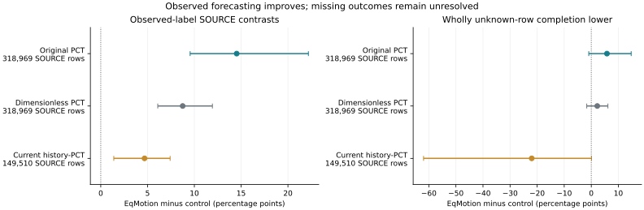

# Complete Stronger-Control SOURCE Readout

Fresh_run: nine actual full EqMotion fits, first full refit and full primary
forecast/metric replay; current history-PCT was inferred and replayed from
its frozen weights, reproducing the existing array hashes. Cached_verified:
dimensionless-PCT forecast arrays, after exact IDs/schema/source checks.
This report itself aggregates public scalar receipts, not new inference.

## Fixed Contrasts

|Comparator|Indexed SOURCE population|Known gain difference pp [95% CI]|Completion-lower pp [95% CI]|
|---|---:|---:|---:|
|Original PCT|318,969|+14.5236 [+9.5506, +22.1861]|+5.7879 [-0.9320, +14.7335]|
|Dimensionless PCT|318,969|+8.7522 [+6.0912, +11.9292]|+2.2097 [-1.6792, +6.1388]|
|Current history-PCT|149,510|+4.6779 [+1.3917, +7.4120]|-21.9971 [-61.9541, +0.0951]|

The original-PCT comparison is the registered primary. Stronger controls
were added before any new EqMotion outcome scoring and remain secondary.
The two fixed populations are not pooled or substituted. Units are percentage
points of gain using the common known CV denominator within each locality,
not percent error reduction relative to each PCT. Intervals use 3,000 SOURCE
locality resamples after averaging excluded folds and actual seeds 17/29/43.
These are exposed SOURCE crossfit results, not independent final tests.

Full population gains versus CV: EqMotion +17.2138%, original PCT +2.6902%.
Whitelist gains versus CV: EqMotion +10.8141%, current PCT +6.1362%.

## What Remains Negative

All completion-lower intervals cross zero. Wholly unknown-row bounds do not
fill steps within partial futures or identify full-12-step ADE. Current-control
known improvement is negative at locality 082; unknown-row candidate/control
disagreement makes its lower comparison especially wide. That uncertainty
is not an observed catastrophic future error. No locality is excluded.

|Locality|Known difference vs current PCT pp|Completion-lower pp|
|---|---:|---:|
|eu-locality-007|+7.0360|-0.5291|
|eu-locality-008|+10.7683|+2.5959|
|eu-locality-020|+11.5947|+6.9562|
|eu-locality-048|+5.4837|-12.6738|
|eu-locality-067|+2.2218|-4.5126|
|eu-locality-074|+2.0150|-2.3472|
|eu-locality-082|-9.6668|-232.4268|
|eu-locality-110|+8.6521|+7.5938|
|eu-locality-112|+2.3700|-12.1746|
|eu-locality-119|+3.1899|-0.2131|
|eu-locality-124|+5.7941|-12.7507|
|eu-locality-126|+6.6759|-3.4827|

The source backbone comparison is positive on observed labels. It does not
prove a new M3W method, isolated equivariance or safe deployment. Current PCT
has different grouped/partial neighbor processing and additional detector-history
fields; EqMotion uses complete aligned neighbors. Observation/request lengths,
SOURCE target identities, labels, seeds and fitting budgets match as registered.
The published core is adapted to fixed deterministic K=1, not best-of-20 results.

## Next Decisive Experiment

A stronger proposal is now available for a separate SOURCE-only admission
experiment. Preserve the physical floor and original 2% full-record contract;
test whether new proposal costs/latent features improve safe routing rather
than increase critic width again. Diagnose the 082 slice and unknown-row
disagreement without dropping it or treating unavailable futures as zero error.
Register that experiment before fitting; do not use calibration outcomes for
threshold tuning. It has not been run by this forecast comparison.

No new policy risk pass, independent confirmation, cross-dataset world-model
success or submission readiness. Historical calibration remains completed and
failed; its private arrays, final confirmation and DroneCrowd are not accessed.
Image-local pixels, raw stride 12 and released detector/tracker silver only.
No metric, seconds, human-gold, physical-safety, true-3D or foundation claim.
Stage5C and SMC remain off.
