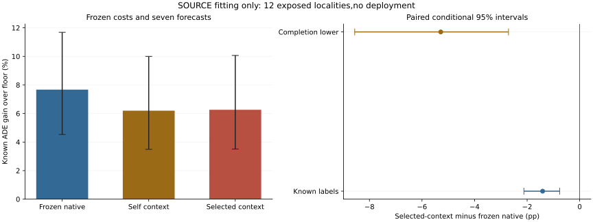

# Free Allocation Actors: Complete SOURCE Readout

## Material Passport

fresh_run:36 real Torch actors,72,000 primary updates,4,000 exact-refit updates and complete72-group hard allocation/readout.
cached_verified:18 frozen continuous regression critics,seven forecasts,floor,old full-joint actions and legacy decision-cost actions.
not_run:new forecasting/JEPA/Transformer training,independent calibration/confirmation,deployment and whole-pipeline OOF.
All outcomes are exposed SOURCE fitting/resubstitution,not independent efficacy evidence.

## Registered Primary And Controls

Selected-context joint minus zero-actor joint FULL completion-lower ADE utility is the primary.
Self-context is a prespecified matched architecture control,not a replacement primary after seeing outcomes.
Actor offsets are routing scores,not calibrated cost moments or trajectory corrections.
The original frozen2%cost constraints and all seven eligible actions remain.

|Contrast|Policy|Known pp [conditional95%CI]|Completion-lower pp [conditional95%CI]|Completion-upper pp [conditional95%CI]|
|---|---|---:|---:|---:|
|selected_minus_zero|joint|-1.411186 [-2.122265,-0.760321]|-5.286748 [-8.559925,-2.709728]|+2.464377 [-0.031812,+6.157054]|
|selected_minus_zero|matched|-0.934523 [-1.518443,-0.398990]|-1.958530 [-3.224829,-0.855834]|+0.089485 [-0.628028,+0.897485]|
|self_minus_zero|joint|-1.475234 [-2.318811,-0.700824]|-5.281367 [-8.604396,-2.625355]|+2.330900 [-0.290822,+6.048967]|
|self_minus_zero|matched|-1.069732 [-1.772816,-0.457781]|-2.144224 [-3.464829,-0.977348]|+0.004760 [-0.851955,+0.911390]|
|selected_minus_self|joint|+0.064048 [-0.111642,+0.243026]|-0.383416 [-0.711887,-0.098423]|+0.511512 [+0.315038,+0.701431]|
|selected_minus_self|matched|+0.135209 [+0.035560,+0.270257]|-0.056640 [-0.186401,+0.083809]|+0.327059 [+0.177051,+0.492205]|
|selected_minus_legacy_decision_v1|joint|-2.877502 [-3.890921,-1.870555]|-3.554374 [-4.655130,-2.438889]|-2.200631 [-3.165188,-1.258526]|

Count-matched controls test utility only. Empty comparisons remain not_estimable,not safe0.

|Policy|Known ADE gain over floor (%)|Known FDE gain (%)|Own completion-lower pp|Original record risk supported|Known easy-risk violations|Undefined selected easy|Selected/unknown views|
|---|---:|---:|---:|---:|---:|---:|---:|
|zero_independent|+6.211251 [+3.631494,+9.672941]|not_estimable|+1.995311 [-3.348346,+6.902306]|8/444|330|16|378174/6659|
|zero_joint|+7.672120 [+4.530374,+11.687024]|not_estimable|+3.196884 [-2.568636,+8.650162]|6/444|362|16|378174/7256|
|zero_matched|+6.960180 [+3.993930,+10.838799]|not_estimable|+5.415369 [+2.541186,+9.375334]|16/444|346|31|310304/5822|
|self_independent|+5.493559 [+3.117857,+8.925371]|not_estimable|+4.797838 [+2.444492,+8.278704]|19/444|239|23|325250/4856|
|self_joint|+6.196886 [+3.488291,+9.998688]|not_estimable|+5.459538 [+2.818007,+9.304574]|19/444|288|23|325250/4993|
|self_matched|+5.890448 [+3.258520,+9.624193]|not_estimable|+5.353537 [+2.809342,+9.070468]|31/444|273|31|310304/4672|
|selected_independent|+5.535686 [+3.098106,+8.973954]|not_estimable|+4.951827 [+2.570428,+8.411641]|29/444|236|26|328946/4914|
|selected_joint|+6.260934 [+3.510226,+10.067557]|not_estimable|+5.596602 [+2.945272,+9.388861]|24/444|293|26|328946/5021|
|selected_matched|+6.025657 [+3.349042,+9.764732]|not_estimable|+5.436981 [+2.869933,+9.173104]|25/444|288|31|310304/4704|
|decision_v1_joint|+9.138437 [+5.820241,+13.339230]|not_estimable|+8.653152 [+5.387204,+12.817439]|9/444|375|12|382087/5722|
|floor|+0.000000 [+0.000000,+0.000000]|not_estimable|+0.000000 [+0.000000,+0.000000]|0/444|0|444|0/0|

## Joint Versus Independent

|Actor|Known pp|Completion-lower pp|Completion-upper pp|
|---|---:|---:|---:|
|zero|+1.460868 [+0.787540,+2.194143]|+0.856963 [+0.200501,+1.577509]|+2.064774 [+1.083534,+3.096664]|
|self|+0.703327 [+0.321010,+1.154983]|+0.513559 [+0.180407,+0.921418]|+0.893095 [+0.438997,+1.396179]|
|selected|+0.725248 [+0.339748,+1.165403]|+0.542908 [+0.196552,+0.951486]|+0.907589 [+0.477057,+1.391720]|

## Easy Recording Tails

|Policy|Known easy defined|Worst known degradation (%)|Known views above2%|Worst completion-upper bound (%)|
|---|---:|---:|---:|---:|
|zero_independent|444/444|+26.477426|11|+6590.694518|
|zero_joint|444/444|+26.477426|28|+6590.694518|
|zero_matched|444/444|+26.477426|23|+581.907681|
|self_independent|444/444|+7.576261|5|+403.836989|
|self_joint|444/444|+7.576261|7|+403.836989|
|self_matched|444/444|+7.512765|5|+403.836989|
|selected_independent|444/444|+7.731198|5|+403.836989|
|selected_joint|444/444|+7.731198|7|+403.836989|
|selected_matched|444/444|+7.512765|6|+403.836989|
|decision_v1_joint|444/444|+28.329410|53|+430.773156|
|floor|444/444|+0.000000|0|+0.000000|

Completion-upper values are conservative missing-outcome bounds,not observed errors.
Pooled hard/easy gains do not replace the original recording-level all/easy requirements.

|Known-label subset|Zero joint gain (%)|Self joint gain (%)|Selected joint gain (%)|
|---|---:|---:|---:|
|hard|+9.372667|+6.202451|+6.507889|
|easy|+4.648667|+9.469560|+9.746591|

## Descriptive Accounting

Benefit delta:-1.771448pp;harm delta:-0.360262pp.
Paired unknown disagreement penalty:3.875563pp.
Benefit minus harm reconstructs every locality known contrast. This is descriptive,not causal attribution.

## Real Training And Reproduction

Training PID89945:215.136728s,peakRSS12370460672B.
Readout PID92815:1315.919043s,peakRSS10599104512B.
Phase timers start at runtime_ready and exclude initial admission. Both full2,000-update refits are exact.
All72 frozen-action inference/score checks and zero/legacy full controls agree exactly.
That verification does not rerun the wall-clock-limited optimizer. Actual18-query interruption/recovery was separately tested.
Training losses contain changing duals and are not calibrated risk certificates or cross-update comparable objectives.
Native arm64 CPU4/interop1/workers0,checkpoint100/heartbeat50;no speed-based budget reduction.

## Supplementary Interaction And Error Tails

Pair contraction is a causal diagnostic over query targets only,not a collision or physical-safety certificate.
The weighted mean repeats the original views;the maximum record p95 is not a pooled95th percentile.

|Policy|Mean pair contraction/frozen scale|Maximum recording p95 ADE (local image units)|
|---|---:|---:|
|zero_joint|+0.188571|+160.027003|
|self_joint|+0.100895|+161.654264|
|selected_joint|+0.110016|+161.654264|
|decision_v1_joint|+0.188389|+156.657577|
|floor|+0.000000|+178.960477|

## Fitting Gates

- complete36actors72groups: pass
- all72_zero_and_legacy_full_scores_exact: pass
- matched_context_arms: pass
- cost_moments_frozen: pass
- same_count_controls_every_query: pass
- primary_selected_minus_zero_lower_CI_positive: fail
- own_floor_lower_CI_positive: pass
- complete_original_recording_risk: fail

Fitting advancement:False.
No deployment or independent-role promotion. Component checks are descriptive SOURCE controls,not independent confirmation.

## Population And Limits

All149,510 unique targets,74 recordings,72 source/context/critic-seed views and12 exposed localities remain.
3,000 paired locality bootstrap draws average repeated context/seeds before resampling. Conditional and nominal,not independent confirmation.
Critic/actor seeds17/29/43 share forecast producer43;overlapping rows are not independent observations.
Full-roster FDE is not_estimable where requested endpoints are absent;no earlier endpoint substitution.
Wholly unknown bounds do not resolve missing interior labels.
EuropeanSquares oblique detector-silver/local-image,obs8/pred12/rawstride12. Not SDDt50,meters,seconds,human gold,true3D or foundation.
Stage5C and SMC remain disabled. Not yet a CCF-A submission candidate.
