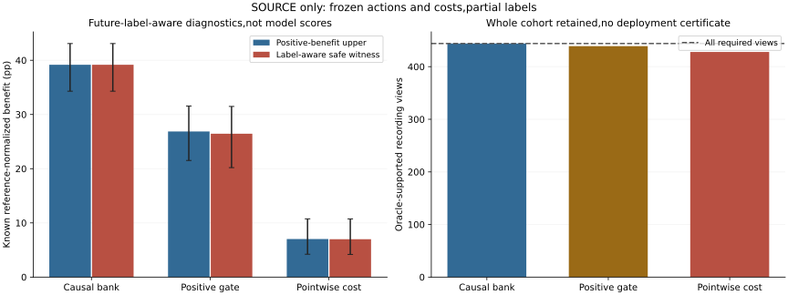

# Frozen Cost Gates: Where Safe Benefit Is Lost

## Material Passport

fresh_run:complete72-group label-aware support calculation and separate exact numerical replay.
cached_verified:forecasts,cost heads,frozen actor actions,all original rows and complete control scores.
not_run:new training,independent roles or deployment. Parent outcomes were already read before this diagnostic was registered.
These are future-label-aware diagnostic oracles,not model performance and never inference features.

## Nested Candidate Support

|Candidate restriction|Known positive-benefit upper pp [conditional95%CI]|Safe free-count witness gain pp [conditional95%CI]|Supported record views|Positive record views|
|---|---:|---:|---:|---:|
|causal_available|39.171287 [34.293328,43.092326]|39.171287 [34.293328,43.092326]|444/444|444|
|predicted_positive|26.863043 [21.511342,31.557965]|26.449226 [20.193806,31.483837]|439/444|439|
|pointwise_cost_guard|7.014350 [4.214891,10.739765]|6.985999 [4.178801,10.728877]|428/444|428|

The upper column ignores safety and is not an attainable model score. The witness column uses true labels to choose actions and easy anchors.
Pointwise-safe witnesses satisfy every original predicted query budget,but use free counts rather than the trained actor counts.
The pointwise restriction is not the full joint feasible set. Its failure would not prove joint infeasibility.

|Restriction|Lost known positive-benefit upper pp [conditional95%CI]|
|---|---:|
|causal_available_minus_predicted_positive|12.308244 [10.185824,14.381542]|
|predicted_positive_minus_pointwise_cost_guard|19.848693 [16.790898,22.016201]|

## Frozen Actions Versus Label-Aware Keep/Drop

|Policy|Actual supported record views|Deletion-oracle supported views|Deletion-oracle positive views|Known selected row views|Predicted pointwise-safe|Predicted safe with observed harm-budget excess|
|---|---:|---:|---:|---:|---:|---:|
|zero_joint|6|427|427|370918|235557|29755|
|selected_joint|24|416|416|323925|195677|23582|

A deletion oracle uses future labels and need not retain predicted query feasibility after removing balancing actions.
The last column counts H-.02R>0 or H_easy-.02R_easy>0. A zero reference does not define a risk ratio;the excess inequality still has its original meaning.
Row-level predicted/observed mismatch is a calibration diagnostic,not a replacement for whole-record safety.

## Unsupported Records

- causal_available: {}
- predicted_positive: {'no_real_allowed_known_easy_reference': 5}
- pointwise_cost_guard: {'no_real_allowed_known_easy_reference': 16}

All recordings remain,including those without estimable easy-reference support. Empty risk is not safe0.
Full details are in `unsupported_record_views.json`.

## What This Can And Cannot Resolve

A positive pointwise-safe witness demonstrates that this conservative subset contains useful label-known actions under frozen predicted budgets.
A gap from the actual policy locates missed decision opportunities;it does not prove causal features can identify those opportunities.
Predicted-positive headroom loss quantifies useful actions rejected by that frozen support gate.
Actual versus keep/drop support measures whether oracle rejection of current mistakes could fix recording risk;the trained model has no access to that oracle.
This is not an independent-generalization test,not proof of optimal query-count allocation,and not a reason to relax2%or discard difficult records.

## Execution

Complete diagnostic PID216,timed phase92.763621s,peakRSS10966614016B.
Native arm64 CPU4/interop1/workers0. All72original numerical results and control scores replay exactly.
No optimizer updates,threshold search,new forecast training or independent-role opening.

## Scope

149,510unique targets,74recordings,12exposed localities;72views repeat contexts/critic seeds. Shared forecast producer43.
3,000conditional paired locality bootstrap draws average repeated views before resampling;not independent confirmation or familywise significance.
EuropeanSquares oblique detector-silver/local-image,obs8/pred12/rawstride12. Not SDDt50,meters,seconds,human gold,true3D or foundation.
Wholly-unknown envelopes do not resolve missing interior labels. Stage5C/SMC off. No deployment or submission-ready claim.
