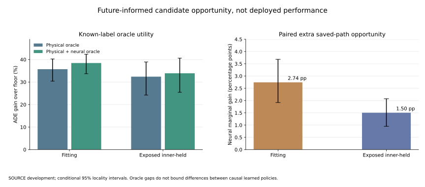

# Neural Saved-Path Opportunity Is Not Learned Policy Value

## Material Passport And Execution

Fresh post-hoc exposed-SOURCE diagnostic,not a preregistered primary model
result. Source data,causal physical candidates and frozen neural forecast banks
are cached_verified;known-label error/oracle arithmetic is fresh_run. No cost
head or trajectory predictor is trained. No oracle choices are exported as
inference inputs. Independent roles stay closed;deployment is unchanged.

PID4261exit0 computes all48groups/sixcontexts in20.354766s,peakRSS
7,463,256,064B. PID4752exit0 replays exactly in20.248758s. There is no controller
seed duplication:seed43denotes the fixed forecasting producer. Fitting has
148record/context views over74unique recordings;inner-held has62views over
31unique recordings. The source locality interval helper retains its generic
context/head-seed label,but there are no repeated controller seeds in this
diagnostic;the actual bootstrap units are12localities after context averaging.

## Known-ADE Candidate Opportunity

For each known query,compare the minimum ADE over the causal floor plus six
legal physical candidates with the minimum after adding the legal frozen
neural path. Future labels select these oracle minima only for diagnosis.

| Role | Physical oracle gain over floor | Mixed oracle gain over floor | Paired marginal neural opportunity |
|---|---:|---:|---:|
| Fitting | 35.709429% | 38.453167% | 2.743738pp [1.919879,3.680984] |
| Exposed inner-held | 32.396033% | 33.899940% | 1.503906pp [0.951225,2.074855] |

Intervals are conditional3,000-locality bootstrap intervals,not independent
confirmation. The marginal quantity is nonnegative by construction;its positive
interval is not a test of a learned neural contribution. This is opportunity
for a saved-path candidate class on known ADE support,not a score produced by
a causal model. Unknown outcomes are not imputed or turned into safe cases.

The full held hard aggregate is not_estimable:locality020has no hard known
queries under the original fitting-defined cutoff in two required context
views. These views are retained rather than dropped for a favorable average.
Fitting hard marginal opportunity is2.924472pp[1.967344,3.997222]. Per-group
and per-record hard results remain available in the aggregate files. A missing
aggregate is not a measured0%hard gain or proof of no hard opportunity.



This figure is generated from exactly verified aggregates. Its source is
`scripts/plot_m3w_neural_marginal_ceiling.py`;the raster preview stays private.

## What This Does Not Bound

The1.503906pp difference is relative to a future-informed physical oracle.
It is not an upper bound on the difference between two learned causal policies,
and it does not prove the neural forecast is nearly useless under uncertainty.

A finite Euclidean-loss counterexample demonstrates the distinction. Suppose
three futures share the same observed past and lie at vertices of a unit-radius
equilateral triangle. Physical actions predict vertices;the neural action
predicts the center. The future-informed physical oracle already has zero
loss,so adding the center does not change the oracle. Yet every fixed physical
action has expected loss2*sqrt(3)/3,larger than the center's loss1. This is a
mathematical interpretation test,not a result on the real candidate bank.
The standalone regression test keeps this limitation explicit.

Conversely,large oracle opportunity would not prove causal learnability.
Future-informed opportunities and actual expected-cost routing must therefore
be tested separately,not substituted for each other.

## Next Discriminating Comparison

The existing physical candidates retain substantial future-informed room,and
the frozen neural path adds a smaller,nonzero saved-path opportunity. The
current causal mixed controller's+0.011277pp neural increment remains uncertain
and the full safety criterion still fails. Do not train another same-family
loss coefficient merely because an oracle interval is positive.

Next compare strong causal expected-cost estimators on the current seven-action
feature/target contract,with physical-only and mixed banks,fitting-only training
and fixed evaluation. First check compatibility of existing forest assets;
the old binary-forecast five-moment forest failure must remain visible,not be
renamed as a fresh seven-action control. If a new matched control is necessary,
profile it locally,freeze its roster and report estimator/compute differences.
This can distinguish a routing/representation weakness from a need to retrain
the forecasting producer. No new causal-control training is claimed here.

## Scope

Obs8/pred12/rawstride12 webcam detector-track pixels,not metric/seconds,human
gold,true3D or foundation evidence. These SOURCE inner-held recordings were
already exposed;this is not whole-pipeline OOF or independent confirmation.
The oracle is not deployed and no future endpoint,central velocity,test-built
goal or test normalization enters inference. Empty risk remains not_estimable;
count matching is utility-only. No Stage5C execution orSMC.

```bash
.venv-pytorch/bin/python scripts/diagnose_m3w_neural_marginal_ceiling.py verify
.venv-pytorch/bin/python scripts/plot_m3w_neural_marginal_ceiling.py
```

Private source assets are needed for real inference arithmetic. Public
aggregates and their plot are narrower evidence,not raw-data reproduction.
