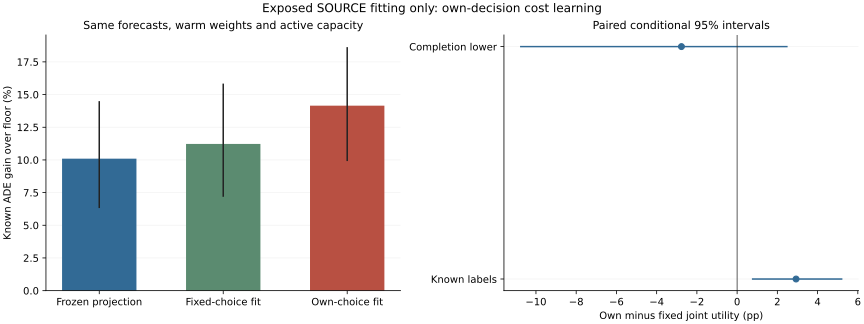

# Fixed Versus Own-Decision Coherent Cost Learning

## Material Passport

fresh_run:36real Torch cost fits,complete72-group allocation and separate inference/frozen-action verification.
cached_verified:seven forecasts,462causal fields,normalizers,labels,warm weights and original projected policy.
not_run:forecaster/JEPA/Transformer/residual training,independent selection/calibration/confirmation and deployment.
All results are exposed SOURCE fitting/resubstitution,not independent scientific confirmation.

## One Controlled Factor

Both arms have31,119active/total parameters,the same warm state,differentiable reference-sharing/benefit-cap decoder,draws and full budgets.
Only the query-risk residual target changes:fixed causal initial choices versus detached current native joint choices.
All known legal pointwise supervision remains. Empty/unknown-selected query targets are not supervised zero.
The network context input stays fixed in both arms. No gradient through the integer solver or published consistency theorem is claimed.

|Arm|Fits|Updates|Gradient query solver calls|Gradient solver seconds|Complete/unknown/empty selected query views|
|---|---:|---:|---:|---:|---:|
|fixed_choice|18|104160|0|+0.000000|810129/35145/821286|
|own_choice|18|104160|1666560|+2947.300997|952481/74417/639662|

The two first-context full refits add14,336updates and match all scientific state exactly,excluding only measured wall times.
Training solver counts are native solve_frame invocations,including zero-count and feasible-unconstrained shortcuts,not all calls to the MILP backend.
Every query receives at least four gradient sampling visits;none is undrawn. Unknown rows still enter causal context and choices.

## Registered Primary And Secondary Contrasts

Primary:own joint minus fixed joint FULL completion-lower utility. Frozen-parent and own-floor lowerCI and all recording risks must also pass.
Same2%contract,full cohort and source roles;no seed/checkpoint/subset replaces the primary.

|Contrast|Scope|Known pp [conditional95%CI]|Completion-lower pp [conditional95%CI]|Completion-upper pp [conditional95%CI]|
|---|---|---:|---:|---:|
|own_minus_fixed|full|+2.929688 [+0.735230,+5.232952]|-2.767659 [-10.790112,+2.510282]|+8.627034 [+3.617933,+16.339474]|
|own_minus_fixed|matched|not_estimable|not_estimable|not_estimable|
|own_minus_frozen|full|+4.052796 [+1.872610,+6.271665]|-2.730253 [-12.654568,+3.383176]|+10.835846 [+4.994269,+20.100156]|
|own_minus_frozen|matched|not_estimable|not_estimable|not_estimable|
|own_joint_minus_independent|full|+1.542264 [+0.841134,+2.361770]|+0.828666 [+0.207920,+1.581455]|+2.255863 [+1.167487,+3.485678]|
|own_joint_minus_independent|matched|not_estimable|not_estimable|not_estimable|

Post-hoc trimmed controls are utility-only;required empty views remain not_estimable,not safe0.
Paired completion bounds use policy trajectory disagreement on unknown rows;subtracting two individual floor-lower points is not the paired lower effect.
The native joint allocator preserves its own independent intervention count;common-count cross-arm controls are separate.

|Policy|Known ADE gain over floor (%)|Full-roster FDE|Own completion-lower pp|Risk-supported recording views|Known all/easy risk violations|Undefined selected easy|Selected/unknown views|
|---|---:|---:|---:|---:|---:|---:|---:|
|fixed_independent|+9.490090 [+6.076472,+13.426499]|not_estimable|+1.006066 [-12.135289,+9.657610]|9/444|242/348|11|424954/7914|
|fixed_joint|+11.220770 [+7.178735,+15.840874]|not_estimable|+2.528374 [-11.102384,+11.592197]|9/444|307/369|11|424954/8234|
|fixed_matched|+10.176101 [+6.303903,+14.668736]|not_estimable|+1.838199 [-11.651942,+10.748396]|14/444|251/343|18|206508/5102|
|own_independent|+12.608193 [+8.789895,+16.474213]|not_estimable|+2.787257 [-11.817329,+11.981527]|10/444|123/272|12|220857/5124|
|own_joint|+14.150457 [+9.910351,+18.627045]|not_estimable|+4.159293 [-10.836125,+13.772787]|10/444|226/343|12|220857/5264|
|own_matched|+12.046273 [+7.798839,+16.851989]|not_estimable|+4.457208 [-6.432546,+12.310812]|15/444|210/330|16|206508/4918|
|frozen_projected_joint|+10.097661 [+6.317607,+14.495635]|not_estimable|+4.375998 [-3.433555,+10.669076]|9/444|309/360|10|399380/7696|
|floor|+0.000000 [+0.000000,+0.000000]|not_estimable|+0.000000 [+0.000000,+0.000000]|0/444|0/0|444|0/0|

## Action Usage And Regret

|Policy|Repeated row views|Switch rate|Neural row rate|Mean group cost-scale regret|
|---|---:|---:|---:|---:|
|fixed_independent|897060|+0.473719|+0.175377|+0.305759|
|fixed_joint|897060|+0.473719|+0.149730|+0.287878|
|fixed_matched|897060|+0.230205|+0.073206|+0.298793|
|own_independent|897060|+0.246201|+0.073816|+0.274403|
|own_joint|897060|+0.246201|+0.072003|+0.258419|
|own_matched|897060|+0.230205|+0.069041|+0.279825|
|frozen_projected_joint|897060|+0.445210|+0.157399|+0.299505|
|floor|897060|+0.000000|+0.000000|+0.404191|

Rates include repeated context/cost-seed views. Regret is the unweighted mean of complete group means,not a pooled-row or independent score.
Full action counts are in supplementary_statistics.json. Neural usage is not a causal neural-increment ablation or a dynamics claim.

## Cost Error And Chosen-Action Bias

Normalized SOURCE fitting MSE,not independent calibration. Moments:B,H,R,R_easy,H_easy.

|Moment|Fixed choices|Own choices|
|---|---:|---:|
|0|+0.238811 [+0.119814,+0.394463]|+0.256699 [+0.132114,+0.418169]|
|1|+0.089538 [+0.066033,+0.117256]|+0.132180 [+0.102402,+0.166342]|
|2|+0.159714 [+0.088127,+0.251420]|+0.191928 [+0.116210,+0.285518]|
|3|+0.268949 [+0.128462,+0.450270]|+0.273227 [+0.131774,+0.453926]|
|4|+0.106867 [+0.038078,+0.211309]|+0.110898 [+0.041381,+0.215030]|

|Policy|Known selected views|B bias|H bias|R bias|R_easy bias|H_easy bias|
|---|---:|---:|---:|---:|---:|---:|
|fixed_joint|416720|+0.095486|-0.012612|-0.047248|-0.082883|-0.008472|
|own_joint|215593|+0.081808|-0.008937|-0.077614|-0.049137|-0.005786|

Bias pools repeated SOURCE views after original causal normalization. Negative H bias means underprediction,not independent calibration.
All projected coherence checks are public. Algebraic coherence is structural,not evidence of trajectory accuracy or risk control.

## Easy Tails And Hard Cases

|Policy|Known easy defined|Worst known net easy degradation (%)|Recording views above2%|
|---|---:|---:|---:|
|fixed_independent|444/444|+9.102392|14|
|fixed_joint|444/444|+12.119622|22|
|fixed_matched|444/444|+10.084102|16|
|own_independent|444/444|+4.584243|4|
|own_joint|444/444|+12.154390|11|
|own_matched|444/444|+6.332064|9|
|frozen_projected_joint|444/444|+14.745066|20|
|floor|444/444|+0.000000|0|

Known harm,missing-outcome uncertainty,and net easy degradation are different quantities. Both original all/easy risk requirements remain.
The ten worst known easy record views per policy are retained with original context/source/seed identities in supplementary_statistics.json;they repeat recordings and do not become a new selection set.
Pooled known-label subsets below repeat source/context/cost-seed views;they are not independent samples.

|Subset|Frozen projected policy|Fixed joint|Own joint|
|---|---:|---:|---:|
|hard|+11.501076|+12.758547|+11.763355|
|easy|+9.057563|+10.033452|+4.215657|

## Compute And Verification

Real400-update pilot:PID36519,41.121026s,peakRSS9816473600B.
Formal training including full refits:PID37642,4728.797628s,peakRSS10807148544B.
Complete policy readout:PID44966,1510.604866s,peakRSS10470309888B.
Separate inference/frozen-action verification:PID47913,167.473205s,peakRSS11469537280B.

Readout:112596repeated query views,285730solver calls.
Actual training interruption/resume and18-query allocation recovery passed. Full refits exclude wall time,not loss/choice/model state.
Final verification re-infers every new cost and scores frozen choices,not timed MILP reoptimization.
Original full and recording scores remain exact. Failed/invalid solves keep the declared feasible independent parent.
Native arm64CPU4/interop1/workers0;checkpoint50updates,readout250queries,live heartbeat,explicit resume,no speed-based reduction.

## Fitting Gates

- complete36fits72groups: pass
- matched_active_capacity_warm_draws_and_budget: pass
- all_queries_covered_at_least4times: pass
- frozen_projected_control_exact: pass
- coherent_cost_moments: pass
- primary_own_minus_fixed_full_lower_CI_positive: fail
- own_minus_frozen_full_lower_CI_positive: fail
- own_floor_lower_CI_positive: fail
- all_original_recording_risk: fail

Fitting advancement:False. Independent confirmation:false. Deployment changed:false. Stage5C:false. SMC:false.

## Evidence Limits

All149,510targets,74recordings,72groups and12exposed localities remain.3,000paired locality bootstrap draws average repeated context/cost-seed views first.
The three cost seeds share forecaster43. SOURCE fitting intervals are not three independently retrained forecast pipelines or independent evaluation.
Unknown endpoints keep full-roster FDE not_estimable;no earlier endpoint substitution or fabricated future interior labels.
EuropeanSquares oblique detector-silver/local-image,obs8/pred12/rawstride12. Not SDDt50,meters,seconds,human gold,true3D or foundation.
No new world dynamics is established by cost-head training. Public scalar evidence does not replace independent role-compliant experiments.
