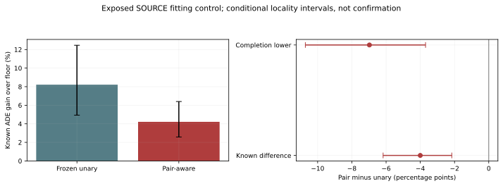

# Predicted-Path Interaction: Full Real-Data Control

## Evidence Source

fresh_run: complete seven-action pair-aware allocation,full original outcome readout and a separate complete replay.
cached_verified: 18 neural cost heads,all candidate/floor forecasts,past-only features,original unary predictions and full-policy choices.
not_run: new neural or trajectory training,independent calibration/confirmation,and SDD deployment retesting.
This is exposed SOURCE fitting resubstitution,not whole-pipeline OOF or independent generalization. No deployment changes.

This document regenerates from frozen evidence. Fresh_run above describes the original experiment,not each report-export invocation.

## Fixed Factor

The original query allocator shares unary gain and all/easy risk budgets but does not optimize pairwise trajectories.
This control adds one fixed predicted-path contraction cost over a past-position four-nearest-neighbor graph.
Every query retains exactly the original intervention count,action availability and original two-percent predicted-risk constraints.
The objective is negative total predicted net gain divided by total past query scale,plus the mean graph cost(weight1.0).
Candidate/floor paths are restored to common local image coordinates. No future observations enter this decoder.
The geometric proxy is not a body-aware collision metric,physical safety guarantee or method novelty claim.

## Registered Results

| Pair minus unary | Percentage points [conditional95% CI] |
|---|---:|
| known_pp | -4.002468 [-6.173491, -2.160963] |
| lower_pp | -6.973934 [-10.717766, -3.694180] |
| upper_pp | -1.031002 [-3.770033, +1.691117] |

| Policy | Known ADE gain over floor (%) | Original recording risk supported | Known easy-risk violations | Undefined easy |
|---|---:|---:|---:|---:|
| unary_joint | +8.215347 [+4.933142, +12.463510] | 1/444 | 383 | 13 |
| pair_joint | +4.212878 [+2.582405, +6.399285] | 2/444 | 360 | 13 |

Full-locality graph contraction change: not_estimable. Negative is less predicted contraction,not lower realized error.
Supplementary pooled graph points: 0.24214137246392545 before,0.037656961736617034 after.
Zero-edge groups: 6;their missing graph statistic is not imputed as zero or removed from the utility/risk cohort.
Changed query views: 50905/112596; solver calls: 61346; nonoptimal solver returns: 6.
Every timeout or failed numerical postcheck retains the original parent and remains in the full scoring roster. No cohort-wide optimality claim.
Unavailable requested FDE endpoints remain missing; known partial endpoint evidence cannot certify full-roster FDE.

## Interpretation

The registered primary completion-lower difference is -6.973934 [-10.717766, -3.694180].
The original full-risk requirement is supported in 2/444 recording/context/seed views.
Fitting advancement: false. This alone cannot authorize deployment or independent confirmation.
Lower geometric contraction must not be substituted for ADE improvement or original positive-harm safety.
6 old zero-pair groups are already risk-unsupported and retain their exact unary choices.
This pair-only control therefore cannot certify complete original risk,even if crowded-query utility improves. It does not repair those unary failures.
Known-label utility,completion-lower utility and individual-policy lower bounds have different estimands;their differences are not interchangeable.

## Descriptive Accounting

Known benefit change: -4.172003pp;known harm change: -0.169535pp.
Benefit change minus harm change exactly reproduces the paired known utility difference in every source.
Positive known source effects: 0/12;unchanged sources: 1/12.
Neural action6 views: 195149 -> 123314. Counts repeat contexts/critic seeds,not distinct people.
These describe changed assignments,not a causal identification of missing intent,detector noise or feature insufficiency.

## Hard And Easy Preservation

|Known pooled subset|Unary ADE gain over floor (%)|Pair-aware ADE gain over floor (%)|
|---|---:|---:|
|hard|10.128366|2.641659|
|easy|3.767161|5.575447|

These supplementary gains pool repeated known-row views and do not replace the original locality/record-risk contract.
Easy pooled error improves,but that is not preservation in every recording or positive-harm risk control.
|Policy|Defined known easy record views|Worst known easy degradation (%)|Known views above2%|Worst completion-upper degradation (%)|
|---|---:|---:|---:|---:|
|unary_joint|444/444|26.477426|54|22555.292054|
|pair_joint|444/444|26.477426|30|22555.292054|

Completion-upper ratios are conservative missing-outcome bounds,not observed losses. Very small reference masses can make them large;they are not clipped or excluded.
The unchanged original full-risk gate remains failed.

## Annotated Pair Geometry

Secondary frozen-action diagnostic: 115,704,792 requested pair-step views,
87,548,430 observed and28,156,362 unknown.
Observed normalized pair-distance error: 0.983701227 unary -> 1.067189361 pair-aware.
This pooled repeated-view point worsens;it is not an independent-sample CI. The missing-outcome completion interval crosses zero.
Future labels enter only after actions are frozen. No primary score,selection threshold or risk gate changes.
[Full secondary diagnostic](pair_distance_diagnostic/readout.md).

## Population And Statistics

All149,510 unique targets,74 recordings,72 original source/context/critic-seed groups and12 exposed source localities remain.
Bootstrap3,000 paired locality resamples after averaging repeated contexts and critic seeds. Overlapping windows are not independent samples.
Critic seeds17/29/43 share forecast-producer seed43;this is not a three-seed forecaster experiment.
Per-source effects appear in locality_effects.csv. The graph includes query targets only,not all visible agents.

## Runtime And Recovery

Pilot PID58733: exact interrupted recovery;18 queries/402 rows,peakRSS9630269440B.
Full readout PID59783: 2563.680355s from runtime_ready,peakRSS10848567296B.
Separate complete redecoding/replay PID64032: 2547.453577s,peakRSS9647685632B.
Initial admission/loading is outside these phase timers. Native arm64 CPU4,interop1,workers0;no CREATE job submitted.
Config,registration,heartbeat,progress checkpoints and exact frozen controls are retained. Weights/private rows are not in Git.

## Scope

EuropeanSquares oblique detector-silver local image coordinates;obs8/pred12,stride12 raw frames.
Not SDDt50,metric,seconds-level,human gold,true3D or a foundation world model.
Independent roles and reserved DroneCrowd labels remain closed. Stage5C and SMC remain disabled.
