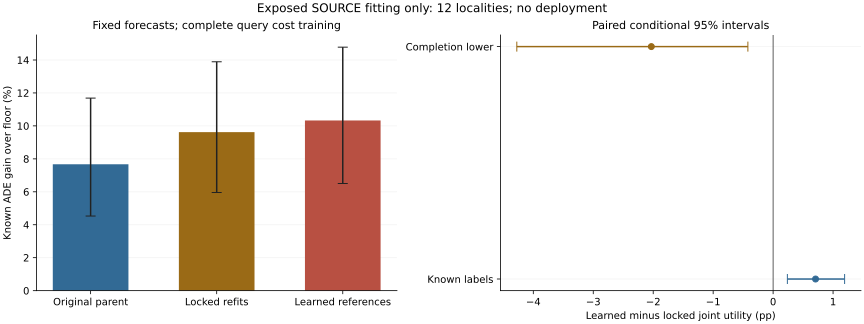

# Coverage-Complete Reference Cost Refits

## Evidence Role

fresh_run:36 actual Torch warm-started cost fits,two full-budget exact refits,complete72-group policy evaluation and separate inference/score verification.
cached_verified:18 old cost weights,seven forecast candidates,floor,462causal fields,fitting normalizers and original parent full-joint control.
not_run:new forecaster/JEPA/Transformer/residual training,independent selection/calibration/confirmation,whole-pipeline OOF or deployment.
All present outcomes are exposed SOURCE fitting/resubstitution. They are not independent test results.

## Prespecified Primary

Learned-reference minus locked-reference FULL joint completion-lower ADE utility is the primary.
Both use the same warm start,query draws,budget and31,119total parameters. The learned arm has262additional active parameters;
this is not a fully active-capacity-matched ablation. The locked continuation combines changed coverage and longer budgets relative to the old random2,000-update model.

|Policy contrast|Known pp [conditional95%CI]|Completion-lower pp [conditional95%CI]|Completion-upper pp [conditional95%CI]|
|---|---:|---:|---:|
|learned minus locked:joint|+0.707816 [+0.238023,+1.192602]|-2.031363 [-4.275018,-0.420831]|+3.446995 [+1.849931,+5.497652]|
|learned minus locked:matched|+0.665327 [+0.322708,+1.050231]|-0.817503 [-1.611754,-0.136574]|+2.148157 [+1.178424,+3.394103]|
|learned joint minus original parent|+2.657443 [+1.650619,+3.727757]|-1.099016 [-5.104666,+1.381450]|+6.413902 [+3.941150,+9.631632]|

Paired known-minus-completion-lower penalty:+2.739179pp. This is missing-outcome uncertainty,not observed harm.
Count-matched controls evaluate utility only. Empty selected easy support stays not_estimable,not safe0.

|Policy|Known ADE gain over floor (%)|Known FDE gain (%)|Own completion-lower pp|Supported original record-risk views|Known easy-risk violations|Undefined selected easy views|Selected / unknown views|
|---|---:|---:|---:|---:|---:|---:|---:|
|locked_independent|+7.710755 [+4.760613,+11.340832]|not_estimable|+1.642170 [-6.875677,+7.972773]|4/444|362|12|440715 / 7935|
|locked_joint|+9.621747 [+5.958598,+13.892016]|not_estimable|+3.356410 [-5.688878,+10.053233]|5/444|384|12|440715 / 8401|
|locked_matched|+9.126447 [+5.541389,+13.335804]|not_estimable|+3.621057 [-4.210526,+9.712277]|10/444|368|17|373312 / 7373|
|learned_independent|+8.628119 [+5.429942,+12.340106]|not_estimable|+3.006316 [-4.412475,+8.828199]|12/444|330|9|401460 / 7367|
|learned_joint|+10.329562 [+6.503952,+14.779442]|not_estimable|+4.535264 [-3.298350,+10.917652]|9/444|369|9|401460 / 7708|
|learned_matched|+9.791774 [+6.034891,+14.144672]|not_estimable|+4.574157 [-2.835018,+10.570298]|10/444|360|15|373312 / 7271|
|parent_joint|+7.672120 [+4.530374,+11.687024]|not_estimable|+3.196884 [-2.568636,+8.650162]|6/444|362|16|378174 / 7256|
|floor|+0.000000 [+0.000000,+0.000000]|not_estimable|+0.000000 [+0.000000,+0.000000]|0/444|0|444|0 / 0|

## Cost Prediction Error

Normalized SOURCE fitting MSE,not independent calibration. Indices0..4 are benefit,harm,reference,easy reference,easy harm.

|Moment|Locked [conditional95%CI]|Learned [conditional95%CI]|
|---|---:|---:|
|0|+0.264401 [+0.138958,+0.424284]|+0.267517 [+0.142116,+0.431118]|
|1|+0.090470 [+0.068126,+0.117099]|+0.095654 [+0.073170,+0.122462]|
|2|+0.351355 [+0.262367,+0.436969]|+0.191049 [+0.116591,+0.283589]|
|3|+0.484916 [+0.292808,+0.700229]|+0.335499 [+0.169982,+0.545153]|
|4|+0.124488 [+0.053272,+0.230523]|+0.112226 [+0.042600,+0.216960]|

Mean reference MSE change:-0.154861 [-0.230003,-0.097589].

## Prediction Coherence Diagnostic

Added after registration,not a new primary or gate. No labels are read by this diagnostic and not one prediction byte or action changes.
Counts repeat source/context/cost-seed views;they are not independent samples. Excess tolerance is1e-12in frozen causal scale units.

|Arm|Legal action views|Benefit above reference|Negative implied candidate ADE|Easy reference above reference|Easy harm above harm|
|---|---:|---:|---:|---:|---:|
|locked_references|5369850|136156|93505|0|0|
|learned_references|5369850|251929|169709|0|0|

Per-model exact/tolerance violations,zero references and candidate-reference spread remain in coherence_verification.json.
A coherent prediction is not proof of calibrated risk or useful decisions;incoherent moments locate a concrete remaining model limitation.

## Source-Level Diagnostic

These repeat contexts and cost seeds,not independent recording samples. Cost-MSE changes are descriptive,not causal attribution.

|Exposed locality|Learned-minus-locked lower pp|Reference MSE change|Locked record-risk support|Learned record-risk support|Locked pointwise witnesses|Learned pointwise witnesses|
|---|---:|---:|---:|---:|---:|---:|
|eu-locality-007|-0.828280|-0.107634|0/18|0/18|17|17|
|eu-locality-008|-1.996579|-0.063527|0/168|0/168|168|168|
|eu-locality-020|-0.295519|-0.241975|0/6|0/6|6|6|
|eu-locality-048|-3.967527|-0.171373|0/6|0/6|6|6|
|eu-locality-067|-2.703258|-0.091280|0/18|0/18|18|18|
|eu-locality-074|-0.603472|-0.045109|5/192|9/192|189|190|
|eu-locality-082|-11.839578|-0.111838|0/6|0/6|4|2|
|eu-locality-110|+0.136734|-0.135552|0/6|0/6|6|6|
|eu-locality-112|-4.806569|-0.245829|0/6|0/6|6|6|
|eu-locality-119|+0.705688|-0.122106|0/6|0/6|6|6|
|eu-locality-124|+1.398127|-0.042764|0/6|0/6|6|6|
|eu-locality-126|+0.423871|-0.479350|0/6|0/6|6|6|

## Complete Training And Coverage

36fits;208320primary optimizer updates;14336full-refit updates.
Registered per-fit budgets:[2000, 7168, 8192]. Every query enters at least4optimizer-step sampling batches;zero queries remain undrawn.
Unknown outcomes never become supervised zeros. Unknown rows may enter causal query context but receive no cost-label gradient.

|Arm|Updates|Active parameters|First fixed-monitor loss|Final fixed-monitor loss|First reference MSE|Final reference MSE|
|---|---:|---:|---:|---:|---:|---:|
|locked_references|104160|30857|0.612188|0.551586|0.365380|0.365380|
|learned_references|104160|31119|0.612188|0.461488|0.365380|0.286730|

## Original Easy Tails

|Policy|Known easy views|Worst known degradation (%)|Known views above2%|Worst completion-upper bound (%)|
|---|---:|---:|---:|---:|
|locked_independent|444/444|+14.700772|18|+14190.466093|
|locked_joint|444/444|+18.657640|22|+14190.466093|
|locked_matched|444/444|+19.101464|18|+10721.405196|
|learned_independent|444/444|+8.880528|16|+10088.333244|
|learned_joint|444/444|+17.170690|22|+10088.333244|
|learned_matched|444/444|+16.173415|18|+10088.333244|
|parent_joint|444/444|+26.477426|28|+6590.694518|
|floor|444/444|+0.000000|0|+0.000000|

Bounds on missing outcomes are not observed errors. Pooled hard/easy results cannot replace every original recording requirement.

|Known-label subset|Original parent|Locked joint|Learned joint|
|---|---:|---:|---:|
|hard|+9.372667|+11.360049|+11.912005|
|easy|+4.648667|+11.128298|+8.677657|

## Resource And Recovery Evidence

Pilot PID14077:20.832748s,peakRSS9646735360B;400actual updates,zero initialization and interruption recovery exact.
Training PID15145:1128.131876s,peakRSS9747415040B.
Policy readout PID20020:1905.292910s,peakRSS10907205632B.
Separate verification PID23599:147.818049s,peakRSS11511250944B.
Complete readout:112596repeated query views,273684solver calls. Phase timers exclude admission.
Both first-context full-budget refits are exact. Separate72-group verification re-infers costs and scores frozen actions.
It does not rerun wall-clock-limited MILP optimization. Actual allocation checkpoint recovery has separate focused tests.
The original evaluation entry failed before runtime_ready with a local runtime-name collision. A committed execution erratum renames only that receipt binding and its two uses;all original scientific files and models remain unchanged.
Solver reason/nonoptimal counts are retained in supplementary_statistics.json;nonoptimal calls keep their feasible independent parent.
Native arm64CPU4/interop1/workers0,checkpoint100/heartbeat50,no resource probing. No reduced roster or speed-based downgrade.

## Diagnostic Support And Interaction Proxy

Pointwise label-aware support counts are saved in supplementary_statistics.json. They use labels for diagnosis,not inference or real utility.
Pair contraction is a query-target diagnostic,not collision safety. Recording-p95 maximum is not a pooled percentile.

|Policy|Pair contraction / frozen scale|Maximum recording p95 ADE|
|---|---:|---:|
|parent_joint|+0.188571|+160.027003|
|locked_joint|+0.207756|+156.353008|
|learned_joint|+0.201348|+149.109072|
|floor|+0.000000|+178.960477|

## Fitting Gates

- complete36fits72groups: pass
- matched_warm_start_draws_and_budget: pass
- all_queries_covered_at_least4times: pass
- original_parent_control_exact: pass
- primary_learned_minus_locked_lower_CI_positive: fail
- reference_MSE_decreased_CI_supported: pass
- own_floor_lower_CI_positive: fail
- complete_original_recording_risk: fail

Fitting advancement:False. No deployment or independent confirmation.

## Limits

All149,510unique targets,74recordings,72source/context/critic-seed views and12exposed localities remain.
3,000paired locality bootstrap draws average repeated contexts and cost seeds before resampling. Intervals are nominal,conditional fitting evidence.
Cost seeds17/29/43share forecaster43,not three whole forecast pipelines. Overlapping windows are not independent samples.
Full-roster FDE remains not_estimable without requested endpoints;no earlier endpoint substitution. Missing interior labels remain unresolved.
Reference updates share a row scale but preserve old per-action differences. Exact-zero references cannot become positive multiplicatively.
Inherited predicted benefit<=reference is not structurally guaranteed. Lower reference MSE does not establish decision-ratio calibration.
EuropeanSquares oblique-camera detector-silver/local-image,obs8/pred12/rawstride12. Not SDDt50,meters,seconds,human gold,true3D or foundation.
Stage5C and SMC remain disabled. Not yet a CCF-A submission candidate.
