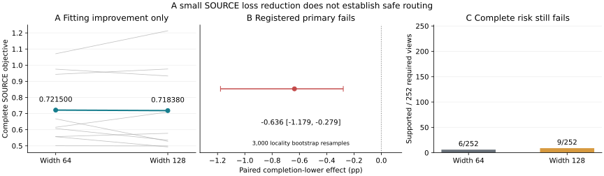

# Matched Neural Cost Width: Complete

## Material Passport

Fresh_run: nine width-128 Torch cost fits, the first full refit, nine frozen
policies, 54 metric groups and separate complete SOURCE/development replay.
Cached_verified: the original width-64 mean critic, forecasters, features,
roles and query exposures.
No new trajectory/JEPA/Transformer training or threshold selection.

## The Single Change

The same CostHead grows from 64 to 128 hidden units: 29,253 to 58,501 parameters.
Loss, AdamW, learning rate, training budget, SOURCE rows, normalization, scales,
sampler/draw hashes, initial outputs and inference/risk thresholds match.
Encoder initial weights have different shapes;zero output heads preserve
the exact initial cost predictions. This is not a matched-compute study.
All producers fit their original eight forecaster-excluded SOURCE localities.
The last complete checkpoint is fixed; no epoch or width is picked on test.

## Complete SOURCE Fitting Objective

Original width 64: 0.721499644. New width 128: 0.718380440.
These are full decoded query-visit/RMS-weighted fitting objectives, not
minibatch trace values or validation loss. SOURCE improvement alone is not
safe selection or generalization.



Gray lines are the nine paired SOURCE producers; teal is their mean.
The primary uses the complete paired lower bound, not observed ADE loss.
Repeated risk views are not independent scenes; neither width passes.

## Full Development Policies

|Width|Known ADE gain % [95% CI]|Mean switch %|Supported views|All/easy violations|Undefined easy|Worst signed easy net %|
|---|---:|---:|---:|---:|---:|---:|
|width64|+1.503747 [+0.816987, +2.130741]|22.495891|6/252|199/211|14|8.495468|
|width128|+1.431216 [+0.514364, +2.414025]|16.169195|9/252|202/207|13|10.165838|

## Registered Contrast

|Width128 minus width64|Paired effect pp [95% CI]|
|---|---:|
|known_pp|-0.072531 [-0.666519, +0.390598]|
|completion_lower_pp|-0.636338 [-1.178580, -0.278679]|
|completion_upper_pp|+0.491277 [-0.166818, +1.069933]|

Primary pass:**False**. Complete original risk pass:**False**.
Development candidate criterion:**False**. Deployment is not changed.
All 38,102 targets, 28 recordings, six exposed development localities and 252
repeated recording/pipeline risk views remain. Intervals use 3,000 locality
resamples after averaging SOURCE folds and actual training seeds 17/29/43.
These are not 252 independent scenes or an independent final confirmation.
The original 2% all/easy positive-harm, easy-net and finite-support rules
remain. Empty selected-reference risk is not a measured safe zero.

## Secondary Easy And Hard Results

|Width/subset|Equal-locality gain % [95% CI]|
|---|---:|
|width64/easy|+0.409986 [-0.592027, +1.339483]|
|width64/hard|+1.234199 [+0.491434, +2.012122]|
|width128/easy|+0.815554 [+0.064616, +1.426883]|
|width128/hard|+1.596601 [+0.677688, +2.647502]|

Required-view absence remains N/A, not a favorable-zero subset.

## Real Compute And Reproduction

|Phase|PID|Seconds|Peak RSS bytes|
|---|---:|---:|---:|
|pilot|62811|12.360554|8614395904|
|training_freeze|63129|503.017461|14489632768|
|policy_freeze|63969|23.363241|2508898304|
|complete|64114|19.653166|2673786880|
|verification|64257|119.249712|14846705664|

Primary optimizer updates: 70656; first full refit: 7168; pilot: 200.
The real 50->100/direct-100 pilot and full first-producer model/optimizer/
sampler/trace/RNG refit are exact. All nine SOURCE predictions and objectives,
nine development predictions and 54 metric groups replay. Native arm64 CPU4,
inter-op1, workers0, atomic checkpoints and the 10 GiB/12 h guards are unchanged.

Stage entry points are immutable after completion; do not delete receipts
to pretend fresh execution. The private SOURCE/forecaster assets are still
needed;this is not complete anonymous cold-start reproduction.

```sh
.venv-pytorch/bin/python scripts/run_m3w_selection_capacity.py pilot
.venv-pytorch/bin/python scripts/run_m3w_selection_capacity.py train --resume
.venv-pytorch/bin/python scripts/run_m3w_selection_capacity.py infer --resume
.venv-pytorch/bin/python scripts/run_m3w_selection_capacity.py eval --resume
.venv-pytorch/bin/python scripts/run_m3w_selection_capacity.py verify
.venv-pytorch/bin/python scripts/report_m3w_selection_capacity.py
```

Available-label ADE is not full-12-step ADE; unknown-row bounds do not fill steps
inside partially observed futures. Pixels, raw stride 12 and silver labels: not metric,
seconds, human gold, physical safety, true 3D, foundation or world-dynamics lift.
No private calibration,confirmation or DroneCrowd arrays. Matched public
forecasting and independent confirmation remain research gaps. Not yet
submission-ready. Stage5C and SMC off.
