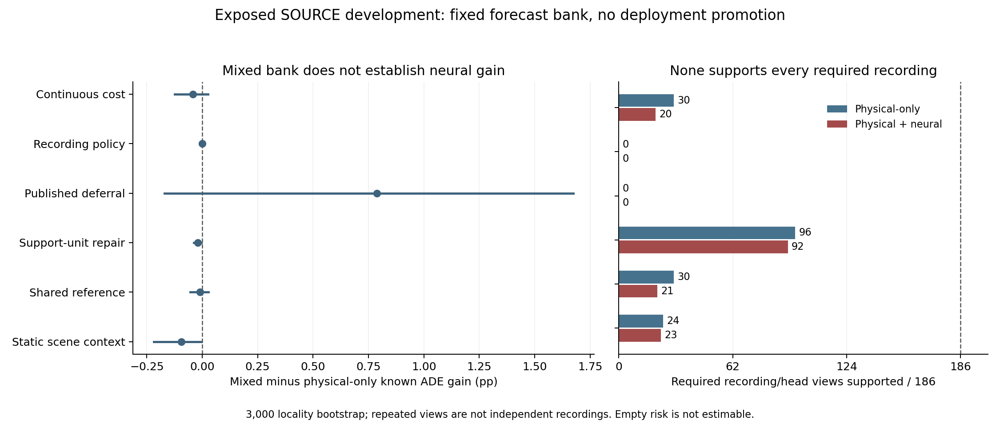

# Learning When to Replace a Motion Baseline under Partial Future Labels

Anonymous research draft. This is a complete prose working revision, not a
formatted eight-page submission, an independently confirmed method, or a claim
that the M3W world-model objective has been achieved.

## Abstract

Mean trajectory accuracy does not determine when a learned forecast should
replace a competent motion baseline. A controller may improve aggregate error
while harming easy agents or concentrating risk in a particular recording.
Missing future labels further separate observed utility from a defensible
deployment claim. We investigate forecast substitution with a frozen causal
floor, six analytic motion candidates and one learned forecast. We formulate
baseline-relative benefit, positive harm and easy-reference moments; derive
elementary disagreement completion bounds; and compare continuous cost
learning, a published regression-deferral surrogate and exact-record
primal-dual decision training. A single-factor conditioning experiment changes
the numerical unit of a positive-support constraint without changing its
feasible set. Each comparison retains three controller seeds, six producer
contexts and a complete preregistered readout. The results expose a gap between
an available action bank, learned mean utility and complete selected-risk
support. No reported full policy supports the complete required exposed internal recording roster. The study therefore does not establish a deployable safe learned upgrade. All reported intervals remain conditional SOURCE
development evidence. Independent calibration, confirmation and a successful
scene-joint mechanism remain necessary before a main deployment claim.

We also test parameter-matched reference sharing and a causal static-image-region feature ablation. Scene context improves known-label routing, but neither new ablation establishes a safe neural increment. 

## 1. Introduction

Trajectory forecasting often evaluates a predictor through aggregate position
error. In deployment, however, an existing causal predictor may already be
accurate for many agents. Replacing all of its outputs can discard that
competence. The decision problem is not simply whether a neural predictor has
lower mean error, but where a forecast substitution is useful and what evidence
supports its risk on the selected population.

Three distinctions motivate this investigation. First, positive and negative
error changes need not cancel for the purpose of protecting easy examples.
Second, an average over scenes can hide a failing recording. Third, future
labels may be partial or absent, even though a causal policy must still make
its decision without consulting their availability. These issues are present
even when the trajectory predictor itself is held fixed.

We study a controlled multi-action setting. The available forecasts are fixed
before controller training, exact aliases of the floor cannot manufacture
interventions, and every controller receives only causal information. This
isolates cost estimation and decision training from a simultaneous search for
a more favorable trajectory producer. A label-aware oracle asks whether the
bank contains feasible useful choices; it is never an inference-time model.

The research question is whether a learned decision can capture useful neural
substitutions while satisfying a fixed baseline-relative positive-harm budget
on every required recording. The contribution under investigation is not a
combination of JEPA and Transformer modules. This revision instead provides
an explicit decision formulation, controlled real Torch comparisons, a
measured optimizer-conditioning diagnosis and reproducible negative evidence.
The broader agent-scene world-model goal remains unfinished.

## 2. Related Work

Graph-structured and attention-based trajectory models already incorporate
agent interactions and temporal context. Trajectron++ [1] includes heterogeneous
agents, dynamics and environmental information. AgentFormer [2] uses agent-aware
attention to model social and temporal dependencies jointly. These precedents
mean that adding neighbors or a Transformer is not sufficient methodological
novelty. This round does not reproduce either forecasting implementation, and
their published scores are not numerically comparable to our native protocol.

Regression with multiple experts is also established. Mao et al. [3] provide
single-stage and two-stage regression-deferral formulations and surrogate
analyses. We adapt their two-stage logistic loss as a matched published-loss
control, not a proposed loss or reproduction of their original experiments.
Cortes et al. [4] study expert imbalance through cost-sensitive deferral. MILD
is not implemented here; an imbalance-only claim would need that comparison.

Risk control requires care about the loss and its assumptions. Conformal Risk
Control [5] is not an automatic certificate for arbitrary selected positive-harm
ratios. Removing a low-harm row can shrink the reference denominator enough to
increase the ratio. Thus a monotone threshold argument cannot simply be assumed.
We report empirical full-policy recording checks without a population guarantee.

## 3. Problem and Causal Information Boundary

Let x contain the current and past agent history, legal neighbor context and
diagnostics of forecasts computed from that history. A frozen floor b(x) and
K candidate forecasts p_k(x) are available. The controller chooses a(x) in
{0,...,K}, with a=0 retaining b. Intervention here means changing a forecast
shown to a downstream user, not controlling the real agent.

The observation protocol requests eight past and twelve future steps on the
current SOURCE grid, with twelve raw frames between steps. Historical raw-frame
t+50 is a different supplementary task. Coordinates remain image-space or
dataset-local unless separately verified; this paper makes no meter, effective
second, true-3D or foundation-model claim.

For a nonempty observed future mask M, let c(p,y;M) be native partial-mask ADE.
An absent future outcome is not a zero-error label. Ground-truth future
endpoints, future goals, eventual label masks and central-difference velocities
are not controller inputs. Train-only fitted normalizers and legal causal
rollout endpoints are allowed. This estimand is not fully observed twelve-step
trajectory error, physical collision probability or real-world control safety.

For candidate k define B_k=max(c(b)-c(p_k),0), H_k=max(c(p_k)-c(b),0),
R=c(b), ER=E*R and EH_k=E*H_k. The easy event E uses a positive CV error
below a threshold fixed from producer-fitting data. Future labels define this
supervised event for loss/evaluation only; they never identify easy examples
to the deployed decision.

For a selected set, the positive-harm ratios are sum(H)/sum(R) and
sum(EH)/sum(ER). Net easy ADE change is different: gains on one easy row must
not erase positive harm on another for this ratio. The approved tolerance is
2% on every required recording. A zero denominator is not_estimable, not a
safe zero. Count-matched controls compare utility only, not safety.

## 4. Completion Bounds and Support

For any future point, the reverse triangle inequality bounds the absolute
change in position error by ||p_t-b_t||. Therefore any nonempty masked ADE
change is bounded by D_k=max_t ||p_kt-b_t||. The implementation additionally
retains the preceding CV disagreement envelope when larger.

For an unknown selected outcome, -D_k is a lower utility contribution and D_k
an upper positive-harm contribution. Combining known positive reference mass
with unknown upper harm gives a conservative ratio bound whenever the known
denominator is positive. This is a deterministic completion statement for
fixed decisions, not missing-at-random identification, a population certificate
or a claim that missing outcomes actually attain the bound.

A necessary support fact is equally important. If every genuine eligible known
easy action in a recording has harm/reference ratio above 2%, any nonempty
mixture remains above 2%; its ratio is a reference-weighted average. If no such
reference action exists, the selected easy ratio is undefined. These elementary
facts explain why an attractive average oracle and a feasible every-record
oracle are different diagnostics. They are not claimed as new consistency or
generalization theorems.

## 5. Controllers and Controlled Conditioning

### 5.1 Continuous Conditional Costs

A shared MLP predicts five nonnegative moments B,H,R,ER,EH from each action's
380-dimensional causal geometry/rollout feature vector and action identity.
Causal disagreement bounds its predicted error-change magnitude. Moment MSE
uses a fixed higher weight for underestimated harm and a within-row continuous
cost contrast. It does not classify a one-hot best-baseline label. Physical-only,
physical+neural and neural-only arms retain matched dimensions, initialization,
source-balanced row draws and 2,000 updates. All preprocessing is fitted using
physical fitting actions only.

### 5.2 Published Regression-Deferral Control

With the floor treated as expert zero, the logistic surrogate of [3], Section 4,
Eq. (3), has coefficient sum_l c_l-c_j for expert j. We minimize the weighted
negative base-two log-softmax using known continuous ADE costs. Only the active
bank enters its loss. Unknown outcomes are not sampled as labels and remain
in evaluation. A separate preregistered fixed cost gate uses the earlier frozen
moment predictions; no held-result threshold search is performed. The native
loss application does not verify the original bounded-loss theorem assumptions.

### 5.3 Exact-Record Decision Training

The decision head freezes both producer and moment model. It receives twelve
causal descriptors per action: five predicted moments, six existing motion/
neighbor descriptors and a disagreement envelope, plus action identity. A
673-parameter MLP corrects a warm-start action logit. The floor logit is zero;
unavailable actions cannot be chosen. A straight-through categorical operation
uses hard actions forward and a temperature-annealed gradient surrogate.

For each fitting recording we accumulate complete finite-population lower
utility and all/easy harm-minus-budget totals, including unknown completion
terms. Separate recording duals enforce the two harm constraints. A third
constraint requires genuine positive selected easy-reference support, equal
to one minimum eligible easy-row equivalent. Full-gradient chunking changes
memory use, not the fitting population. It does not make the hard constrained
problem convex or its solution globally feasible.

### 5.4 A Single-Factor Numerical Repair

Write positive support as S_r>=m_r>0. The original normalized excess is
(m_r-S_r)/s_r, where s_r is the recording easy-reference scale. The repair uses
(m_r-S_r)/m_r. Both have the same feasible set. With a zero-initialized dual,
nonnegative support and step size eta, the old dual after T steps is at most
min(L,T*eta*m_r/s_r). The frozen fitting median empty excess is0.000292227;
372/444 repeated views per bank cannot reach a dual of 1 within 500 updates.
This diagnoses weak numerical pressure, not a sufficient cause of failure.

The repair changes only the third constraint's unit and corresponding effective
dual coefficient. Model, inputs, populations, all/easy2% budgets, optimizer,
dual cap and 500 updates remain fixed. An unchanged-unit 500-update control exactly
reproduces the original scientific checkpoint state. All three real recovery
pilots match interrupted and continuous training. No checkpoint is selected
after looking at a favorable readout.

### 5.5 Candidate-Invariant Reference Sharing

The floor reference and its easy-event mass belong to a query, not to the proposed
action. A frozen 36-state fitting diagnosis finds substantial variation between
candidate estimates of these invariant targets. We evaluate a shared-reference
head that reuses the existing network with a single causal floor token and zero
action code. Candidate tokens still supply benefit, harm and easy harm. The model
retains 25,157 parameters and the original initialization, normalizers, draws, loss
and update budget. Exact reference invariance is an architectural constraint,
not a theorem about cost accuracy or empirical risk.

### 5.6 Static Image-Region Context

Relative-motion features discard global image translation. Static region context
may therefore distinguish situations with similar local motion but different
image positions. The publisher releases image-coordinate place polygons [6].
We bind 14 actual cameras to 74 fitting recordings by raw camera ID, rather than by
conservative locality grouping. Some locality groups contain two cameras.
The audit verifies no gross expanded-bbox mismatch; it does not establish metric
calibration, walkability, obstacles, an exit label or exact viewport boundaries.
Missingness is not monotonic in polygon distance, so edge-driven censoring is
not established as the explanation for policy failure.

Eighteen fields encode normalized current/past-start position, current/mean
velocity, past signed region distance and changes, and distances/inside fractions
of a proposed causal rollout. Future positions and label availability never
enter this feature function. A zero-initialized 18x64 projection adds 1,152 weights
to the existing hidden layer, for 26,309 total parameters. Normalization uses only
physical fitting candidates. The comparison does not stack reference sharing
with the scene change. A full 2,000-update disabled branch exactly reproduces
old network weights, Adam moments, sampled rows and loss traces.

Both ablations retain six contexts, three controller seeds, three banks and all
54 planned fits. They add 216,000 actual primary updates to the four-study record,
for 324 controller heads and 486,000 updates total. The trajectory producer stays
fixed at seed 43. Every new endpoint is committed before first readout, and each
of the 144 group readouts is reproduced in a separate process.

## 6. Experimental Protocol

These are SOURCE-development experiments, not a fresh independent benchmark.
Twenty-four hash-verified TRAIN packets supply twelve localities. Six frozen
producer/controller contexts and three controller seeds yield 54 fits per study.
The trajectory producer is frozen at seed43; three head seeds are not three
newly trained forecasters. Fitting and inner-held record roles are explicit,
but the latter have been exposed in earlier development and cannot be renamed
as independent confirmation or whole-pipeline out-of-fold evidence.

All 54 endpoints are frozen before the first readout of each new study. Every
completed144-view readout is replayed exactly. The main utility table averages
context/head views within locality before a 3,000-resample locality bootstrap.
There are 74 unique fitting and 31 unique inner-held source/recordings. Repeated
contexts, head seeds and overlapping windows are not independent recordings.
Intervals are conditional development uncertainty, not a guarantee about unseen
domains, hidden labels or the forecaster population.

The banks hold candidate forecasts fixed; exact aliases of the floor are not
credited as interventions. We retain every preregistered seed and bank, fixed
sensitivity controls and missing-outcome completion contrasts. Physical-only
is the key comparator for whether adding the frozen neural expert helps.
Whole-policy and count-matched utility are reported separately.

## 7. Results

The following table is generated from the completed verified aggregates.
Gain is known-label ADE improvement over the floor, not a completion lower
bound. Supported views require both all/easy 2% risk support, including the
prescribed missing-outcome treatment. The 186 views repeat contexts/head seeds.

| Fixed controller | Physical-only gain % | Mixed gain % | Mixed supported views |
|---|---:|---:|---:|
| Continuous moment cost | 0.595285 | 0.553787 | 20/186 |
| Exact-record decision | 0.000000 | 0.000000 | 0/186 |
| Published deferral loss adapter | 7.229477 | 8.018405 | 0/186 |
| Positive-support unit repair | 0.053946 | 0.034796 | 92/186 |

Full per-bank intervals, fixed gated controls, completion bounds, intervention
counts, undefined risks and fitting monitors are in the accompanying evidence
table. No reported full policy supports the complete required exposed internal recording roster. The study therefore does not establish a deployable safe learned upgrade.

The experiments must not be reduced to a ranking by mean ADE. The earlier
record decision collapses toward empty intervention; the published unrestricted
loss instead selects extensively and violates required risk slices. The
conditioning control tests a measured numerical weakness without changing the
evaluation contract. Its result does not by itself establish that all future
failures have that mechanism. Different controller families also have different
capacities and objectives; only the support-unit pair is a single-factor trial within that original comparison.

### 7.1 Reference and Static-Context Ablations

| Additional controller | Physical-only gain % | Mixed gain % | Mixed risk-supported views |
|---|---:|---:|---:|
| Shared reference | 0.553001 | 0.542017 | 21/186 |
| Static image-region context | 1.076598 | 0.982769 | 23/186 |

Reference sharing does not establish an incremental gain over either its
unshared parent or the physical-only bank. Static context raises mixed known-
label utility relative to the no-scene parent by 0.428982 percentage points,
conditional 95% locality interval [0.053706,1.044617]. The matched-count
utility difference is 0.112189 points [0.028429,0.232094]. However, the full
completion-lower change is -0.405680 points [-1.185725,0.126229]. The known-
label component effect is not robust positive utility under missing futures.

For static context, mixed minus physical-only is -0.093829 points,
interval [-0.217875,-0.003382]. Neural availability does not
improve this decision study. The mixed policy selects 32,219 row views, including
518 unknown outcomes, and supports only 23/186 required recording/head views.
Its 20 undefined easy-risk views are not passed safety checks.

The normalized harm-moment MSE change is -0.106608,
conditional interval [-0.173896,-0.047766]. This is a squared-error
difference,not a percentage or pixel-error change. Lower overall harm-MSE
coexists with failed selected-risk support. Candidate selection may concentrate
underestimated risks,but that mechanism remains a hypothesis to test directly.
The five-moment comparisons are exploratory,not a multiplicity-controlled
familywise claim. All intervals remain conditional on exposed SOURCE data.

Figure 1. Paired neural increments and required risk support across the six
fixed studies. Repeated contexts/head seeds do not create independent recordings.

## 8. Failure Analysis and Limitations

Available forecasts are not the same as causally identifiable good choices.
A label-aware oracle uses outcomes unavailable at inference. Conditional
moment regression can underestimate harm on the population selected by its
own errors. Finite hard decisions and temperature saturation can make a
constrained gradient procedure favor the floor or oscillate between constraints.
Changing one numerical unit can repair pressure without repairing predictive
features, model capacity, missing-outcome uncertainty or record shift.

The studies do not yet implement scene-joint interaction optimization. Neighbor
features are not a joint multi-agent decision method. No new JEPA contribution,
Transformer dynamics lift, occupancy improvement, verified physical validity,
cross-dataset success or foundation-model capability is established here.
The native partial-mask estimand and conservative unknown completion can differ
substantially from a fully observed forecasting benchmark. Detector-derived
or visual-prior annotations are not human gold.

Independent model selection, risk calibration and final confirmation remain
unopened. A matched public forecasting implementation, explicit intervention
rate/conflict comparisons, independent-domain evidence and a successful causal
mechanism are still missing. This revision is useful research material but
does not satisfy the project's submission-readiness or world-model success gates.

The new scene result narrows rather than resolves the failure. Static layout
proxies can improve cost prediction, but the available neural forecast still
does not add reliable value over physical alternatives. Neither average moment
MSE nor candidate-invariant denominators certifies the population selected by
the policy. A prospective frozen-TRAIN audit of selected versus all-eligible
moment errors is the next distinguishing test, not another favorable threshold.
No independent outcomes are opened to choose that repair.

## 9. Reproducibility and Responsible Reporting

Each real run records native arm64Torch CPU threads, single-process loading,
configuration, PID, heartbeat, atomic recoverable checkpoints, optimizer state
and data/feature/weight hashes. Published aggregate bundles preserve numerical
JSON bytes; a bundle check is not fresh inference. Full training or inference
needs the licensed/private local source assets and frozen checkpoints. The
public aggregate package alone does not provide end-to-end reconstruction.

The protocol retains historical failed exits and the weight-preserving singleton
inference fix. It does not rerun unchanged validated experiments merely to
change a provenance label. Stage5C execution and SMC remain disabled. Formal
submission requires a separate user confirmation; no paper has been submitted.

## LLM Usage Statement

LLM assistance was used substantially for code development and debugging,
experiment orchestration, literature retrieval, analysis, documentation and
draft preparation. This was not limited to grammar correction. Claims must
remain traceable to the frozen artifacts and primary sources; the statement
does not certify that all analysis is correct or that scientific review is complete.

## References

1. Salzmann et al. Trajectron++: Dynamically-Feasible Trajectory Forecasting With
Heterogeneous Data. ECCV 2020. https://www.ecva.net/papers/eccv_2020/papers_ECCV/papers/123630664.pdf
2. Yuan et al. AgentFormer: Agent-Aware Transformers for Socio-Temporal Multi-Agent
Forecasting. ICCV 2021. https://openaccess.thecvf.com/content/ICCV2021/html/Yuan_AgentFormer_Agent-Aware_Transformers_for_Socio-Temporal_Multi-Agent_Forecasting_ICCV_2021_paper.html
3. Mao, Mohri and Zhong. Regression with Multi-Expert Deferral. ICML 2024.
https://proceedings.mlr.press/v235/mao24d.html
4. Cortes et al. Optimized Deferral for Imbalanced Settings. ICML 2026.
https://proceedings.mlr.press/v306/cortes26b.html
5. Conformal Risk Control. ICLR 2024.
https://proceedings.iclr.cc/paper_files/paper/2024/file/f3549ef9b5ff520a7e41ff3cc306ab2b-Paper-Conference.pdf

6. Wolff, N., and Perry, L. Pedestrian Trajectory Dataset of Public European Squares.
Version 1.1, 2026. https://zenodo.org/records/18267205
