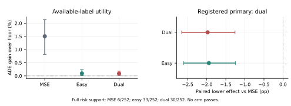

# Learning When to Replace a Motion Baseline under Partial Future Labels

**Working draft. Exposed development and completed unsuccessful calibration; not independent final confirmation or submission-ready.**

## Abstract

A learned trajectory forecast can improve average error while harming agents
that a motion baseline already predicts well. Missing future labels make this
gap harder to measure: observed benefit, positive harm and evidence supporting
a recording-level decision are different quantities. We study forecast
substitution with a frozen causal floor, six analytic candidates and one learned
forecast. Controllers learn baseline-relative benefit, positive harm and
easy-reference costs from past-only inputs. We compare individual and
same-count joint admission, matched cost objectives and conventional estimator
controls, retaining undefined risk rather than scoring abstention as a safe zero.
On six exposed development localities, a matched absolute-cost objective gains
1.50% available-label ADE over the floor but supports only 6/252 repeated
recording-risk views. Changing harm losses reduces some violations but loses
1.98 percentage points on the registered paired completion-lower comparison.
A separate 102-recording calibration experiment finds no common multiplier
that satisfies the original complete 2% recording requirements. These results
are reinforced by a complete matched forest control: its registered lower
contrast loses 2.01 percentage points and its complete risk contract also fails.
The comparisons
locate a gap between mean routing utility and reliable selected-cost prediction,
including error already present on fitting data. SOURCE decomposition finds
that reference sharing and output projection slightly help, while doubling
the neural critic width still fails the fixed primary and risk requirements.
A separately registered public-forecaster control improves observed-label
SOURCE accuracy, including against the current PCT, but its missing-outcome
lower comparisons remain unresolved. Neither result establishes a safe learned
admission upgrade. A new 36-fit, doubly excluded SOURCE cost comparison improves
bound-target fitting and some recording-risk views, but its registered paired
lower effect remains unsupported. No population-risk certificate or new
world-dynamics model is established.

## 1. Introduction

Trajectory forecasting is usually evaluated by mean position error. A practical
system may instead have a competent motion predictor already in place. The
relevant decision is then whether a learned forecast should replace that
baseline for a particular agent, not whether an unrestricted neural model has
a favorable global mean. Errors on easy agents, failing recordings and missing
outcomes can be hidden by an aggregate score.

This distinction matters even when the candidate trajectories are fixed. A
future-informed oracle can find useful alternatives without showing that past
information identifies them. Similarly, an accurate marginal cost predictor
can underestimate harm where its own decision rule selects interventions.
Joint allocation can redistribute a fixed intervention budget, but it cannot
repair incorrectly predicted costs merely by solving that allocation exactly.

We investigate these issues on real pedestrian detector/tracker trajectories.
The current protocol observes eight steps and predicts twelve at a stride of
twelve raw frames in image-local coordinates. It is not a metric, calibrated
time or physical-control task. Future labels supervise training and evaluation;
their eventual availability is never a decision input.

The contribution under investigation is a baseline-relative admission problem,
not a combination of JEPA and Transformer modules. We make benefit, positive
harm, easy-reference support and missing-label completion explicit, then use
matched experiments to test whether continuous cost learning and joint
admission solve that problem. The present evidence is negative: no full policy
supports the complete original recording-risk contract. We retain the failed
comparisons, distinguish fitting from development and confirmation, and report
which explanations the controls do and do not separate. A useful deployable
method and independent final confirmation remain unresolved.

## 2. Related Work and Positioning

Trajectory models already combine agent dynamics, social context and scene
information. Trajectron++ [1] and AgentFormer [2] are important precedents;
adding interaction tokens or attention is not sufficient novelty. Neither
published forecasting implementation has been rerun under the native protocol
reported here, and its published score cannot substitute for that comparison.
EqMotion [9] provides a geometric interaction control. We run a pinned,
fixed-head deterministic K=1 adaptation on SOURCE, not published best-of-20
evaluation. Stronger own-PCT controls and their context differences are explicit.

Regression with multiple experts is also established. Mao et al. [3] study
regression-deferral formulations; an earlier SOURCE experiment in this project
adapts their two-stage logistic surrogate. Cortes et al. [4] address expert
imbalance. Those studies preclude claiming that continuous expert costs or
imbalance awareness are new by themselves. The earlier adapted-loss experiment
uses a different predictor/controller bank and is not ranked numerically against
the current nine-pipeline results.

Conformal Risk Control [5] requires an appropriate loss and assumptions. Our
selected positive-harm/reference ratios are not automatically bounded or
monotone: removing a low-harm agent can reduce the reference denominator and
increase the ratio. We therefore report empirical checks of complete policies,
not a distribution-free certificate. The non-monotonic extension [10] uses
algorithmic stability and exchangeability; non-monotonicity alone is therefore
not a novelty argument or an impossibility result. We establish neither that
stability condition nor an expected-risk certificate. The generalized cost divergence used in
one control is classical [7]; its ideal conditional-mean property does not
guarantee finite-network accuracy after selection. ExtraTrees [8] supplies a
conventional nonlinear estimator control, not a proposed world model.

## 3. Forecast Substitution and the Risk Contract

At query time, each agent has past-only features and a fixed bank of candidate
forecasts. Retaining the causal floor is action zero. The controller may choose
one legal alternative per agent. Exact trajectory aliases of the floor cannot
manufacture an intervention. An intervention changes a displayed prediction;
it does not control the pedestrian.

For a nonempty future observation mask, cost is native available-label ADE.
An absent outcome is not a zero-error label. This is not fully observed
twelve-step ADE, endpoint FDE on missing endpoints, or collision probability.
For each candidate define benefit, harm and reference costs:

```math
B_k=[c(b)-c(p_k)]_+,\qquad H_k=[c(p_k)-c(b)]_+,
```

```math
R=c(b),\qquad ER=E R,\qquad EH_k=E H_k.
```

The easy event uses positive constant-velocity error below a cutoff fixed on
producer-fitting data. It is a supervised future event, never an inference-time
label. Gains on one easy agent cannot cancel positive harm on another in the
positive-harm numerator. For the selected set the two required ratios are

```math
\frac{\sum H}{\sum R},\qquad \frac{\sum EH}{\sum ER}.
```

The original empirical contract requires both ratios and signed easy-net
degradation to be at most 2% in every required recording, with finite reference
support. An empty selected reference is not estimable, not a measured safe zero.
Same-count controls compare utility only; they do not establish risk support.

For any future point, reverse triangle inequality bounds error change by the
candidate/floor disagreement. Therefore masked ADE change is bounded by

```math
D_k=\max_t\|p_{kt}-b_t\|.
```

For a wholly unknown selected row, negative disagreement is a lower utility
contribution and positive disagreement is an upper harm contribution. The
implementation retains a larger preceding CV-disagreement envelope when
applicable. A paired policy comparison uses disagreement between the two
policies on unknown rows, not subtraction of their individual lower bounds.
The denominator is fixed known floor-error mass, not an unknown full-population
error total. These bounds cover wholly unknown rows only: they do not fill
missing steps inside partially observed futures or identify full12 ADE.

## 4. Controllers and Matched Comparisons

### 4.1 Conditional Costs

The current controller receives 444 causal geometry, rollout and detector-history
fields and action identities. It has 29,253 parameters. The coherent decoder
keeps nonnegative costs, candidate-invariant references and benefit/harm within
a causal disagreement envelope. Row-only and context variants share parameters
and initialization. The context variant adds learned leave-self-out same-query
agent context, without future targets, future masks or scene IDs as shortcuts.

Training uses eight SOURCE localities excluded from the particular forecaster's
four fitting localities. Complete cyclic query sampling balances SOURCE groups;
all original queries receive at least four visits. The current absolute-cost
objective combines five normalized squared cost errors with half-weighted
absolute net-gain error. Unlike centered ranking alone, it supervises the gain
level needed to decide whether an intervention is useful.

Independent admission requires positive predicted gain and both original 2%
predicted harm/reference checks. The same-count joint control reallocates the
independent policy's exact intervention count within each contemporaneous query,
using the same predicted costs. It is budget pooling, not pairwise interaction
optimization. Solver nonoptimal cases retain a feasible parent decision.

### 4.2 Harm-Loss Repair

The matched loss comparison keeps data, initialization, query draws, optimizer,
coverage and decision thresholds fixed. The easy-only arm replaces the EH
squared term; the dual arm replaces H and EH. The other cost terms and absolute
gain anchoring remain unchanged. For nonnegative cost and positive prediction,
the existing scaled divergence is

```math
2\left(\frac{p-y}{s}+\frac{y}{s}\log\frac{y}{p}\right).
```

This is not a Poisson-count model or a new divergence. Stable log decoding
retains a gradient for underestimated nonzero costs. An ideal unconstrained
mean property does not resolve limited capacity, coupled outputs, partial
labels or selected-tail error. All eighteen new cost heads complete the
original budgets; loss values are not validation utility.

### 4.3 Nonlinear Estimator Control

A further registered control uses the same current nine producers, original
SOURCE preprocessing, complete query-draw multiplicities and absolute-gain
quadratic objective before projection. Row and same-query-context ExtraTrees
use 128 trees with depth 12, minimum leaf 64 and feature fraction one-third.
The fixed context is a leave-self-out raw-feature summary, not neural hidden
pooling. References are shared across actions and physical cost constraints
are applied after regression. Thus this is an estimator/representation control,
not a perfectly isolated architecture or FLOP comparison. All eighteen forests
complete their original budgets, with full inference and metric replay.
The older forest studies use different banks and retain their negative status.

### 4.4 Explicit Unknown-Row Cost Targets

A matched SOURCE comparison asks whether the critic should learn the same
unknown-row contributions that its evaluator bounds. Let nu indicate at least
one observed requested future label. The supervised moment vector is

```math
\begin{aligned}
Z={}&(\nu B,\;\nu H+(1-\nu)D,\;\nu R,\\
    &\nu ER,\;\nu EH+(1-\nu)D).
\end{aligned}
```

Zero R or ER for an unknown row denotes absent observed denominator mass, not
a zero-error future. The known-only control omits unknown target rows but keeps
their causal context. Both arms have the same initial weights, preprocessing,
objective, query draws and complete budgets; target-defined query averaging
changes with supervision support and is part of this comparison.

For each fixed EqMotion producer, the critic fits one other four-site SOURCE
group and evaluates on the remaining four sites. Rotating both choices and
three actual seeds gives 18 jobs per arm. Held sites are in neither fit.
Only the neural candidate intervenes, with amplitude between zero and one
limited by both original predicted 2% inequalities. This convex interpolation
bounds predicted costs, not actual selected risk. All 36 prediction arrays
freeze before scoring. The primary is the direct paired completion-lower
bound-aware-minus-control gain; binary admission is secondary. This is neither
a new conditional-mean theorem nor scene-joint conflict optimization.

## 5. Data, Roles and Statistical Evidence

We use the Public European Squares release [6]. Its trajectories are extracted
from webcam footage using detection and tracking. This pipeline evaluates
image-local detector-track midpoints, not the release's georeferenced outputs.
The source dataset description does not verify metric calibration for our
derived arrays. Detector/tracker silver is not manually annotated human gold.

|Cohort|Target windows|Recordings|Localities|Role in this study|
|---|---:|---:|---:|---|
|Forecaster SOURCE|318,969|163|12|Producer fitting and excluded-SOURCE forecasting|
|SOURCE whitelist|149,510|74|12|Controller costs and fixed query subset|
|Selection|38,102|28|6|Already exposed model development|
|Calibration|481,537|102|12|Completed unsuccessful calibration, now exposed|
|Final confirmation|Not opened|Not scored|Not scored|Reserved, no claimed result|

The whitelist is a subset of the original forecaster population, not extra
independent observations. The latter retains 193,705 complete, 118,217 partial
and 7,047 wholly unknown futures. Public-family comparisons use the full
population; the current history-PCT comparison uses the unchanged whitelist.
All twelve SOURCE localities have already informed research choices.

Three SOURCE folds and actual forecaster seeds 17, 29 and 43 yield nine frozen
pipelines. Repeated pipeline/recording views do not create independent scenes.
The selection cohort has 252 such risk views. Its intervals use 3,000 locality
resamples after averaging folds and actual training seeds within each locality.
They describe six exposed development groups, not independent final tests.

Calibration preserves all 102 recordings and at most 256 queries per recording.
There are 918 recording/pipeline views and 4,333,833 model-target predictions; those
are repeated views, not independent pedestrians. One locality contributes
86.35% of target windows. All nine models, four policies and thirteen common
multipliers are frozen before future-label construction for that experiment.
After readout these outcomes are disclosed as exposed, not reused as untouched
confirmation. The new loss and forest controls do not fit to its private arrays.

No future endpoint, eventual track length, future mask, central-difference
velocity, test endpoint goal or test normalization enters inference. Training
labels and evaluation labels are separate from the causal packet. Final
confirmation and DroneCrowd remain closed. Old test-selected or lineage-
contaminated results are exploratory history, not independent replications.

## 6. Results

### 6.1 Mean Routing Gain Does Not Establish Joint Benefit

The parameter-matched query-context study completes eighteen SOURCE fits.
Same-count context joint minus independent known utility is +0.0138 pp
[95% CI: -0.0081, +0.0344]; its direct paired completion-lower effect is +0.0016 pp
[-0.0152, +0.0168]. Neither supports a reliable joint gain. Worst known easy-net
degradation is 7.02%, and only 21/252 recording views support the full contract.
Neighbor information and exact count matching do not establish a useful joint
decision method on their own.

The matched absolute-cost objective subsequently improves the preceding
independent critic's registered lower comparison by about 0.80 pp [0.18, 1.33].
Known ADE gain over the floor rises to 1.50%, while intervention rises to 22.50%
and worst known easy-net degradation reaches 8.50%. Only 6/252 risk views pass.
This is a limited observed routing improvement, not a deployment promotion.

### 6.2 Cost Failure Is Already Present on SOURCE

The matched SOURCE diagnosis recomputes native costs directly for all nine
producers and both frozen cost families, with separate exact replay. The
current critic's selected-record median predicted/observed EH ratio is 0.000503
on its fitting data. Its selected pooled known all/easy risks are 5.109%/11.449%,
despite predicted 0.803%/0.330%. Thus new-scene shift is not the sole explanation.
This is fitting resubstitution, not held-out validation.

A separate SOURCE bank diagnosis finds at least one genuine known easy action
satisfying the original support requirements in every one of 444 repeated
recording views. This outcome-informed existence result is not a causal policy.
The exact candidate-to-floor radius also gives a tighter cost-support bound
than the old decoder sometimes uses. Classical weighted projection onto that
bound reduces the complete SOURCE objective only from 0.721500 to 0.718860,
about 0.37%, without training or evaluating a new policy. A valid constraint
and a small fitting improvement do not establish the main failure cause.

The corresponding independent calibration-policy EH median is 0.0000296. These
SOURCE and calibration cohorts differ; their ratio is not a paired causal
transfer effect. Different selected pools must also not be confused with a
fixed-set cost accuracy comparison.

### 6.3 Stronger Harm Sensitivity Loses Policy Utility

|Cost head|Known ADE gain over floor|Supported risk views|Known all/easy violations|Undefined easy|
|---|---:|---:|---:|---:|
|Original mean-squared control|1.5037%|6/252|199/211|14|
|Easy-only divergence|0.0918%|33/252|139/127|67|
|Dual H/EH divergence|0.0869%|30/252|134/133|64|

The registered dual-minus-control FULL paired completion-lower effect is
-1.9774 pp [-2.6565, -1.2590]. Easy-only also loses: -1.9449 pp [-2.6086, -1.2496].
The dual policy's worst signed easy-net degradation falls to 1.6223%, but the
positive-harm and finite-support failures in the table remain. A single net
check below 2% cannot rescue the complete failed contract.



The fixed all-legal SOURCE bank contains 5,267,952 repeated known action views
with matching observed cost masses across arms. Dual H normalized MSE decreases
from 0.00347079 to 0.00315142, while EH MSE increases from 0.000415010 to 0.000486812.
Its better selected EH prediction ratio therefore does not establish blanket
fixed-bank regression improvement.

A post-readout label-free audit reads frozen cost predictions and choices only.
Across 342,918 repeated pipeline-target views, the original policy codes 82,848
interventions; dual codes 7,500. For 62,198 old choices, new gain remains positive
but the new guard rejects. Another 16,398 fail both tests; 673 fail gain only.
Guard rejection dominates within the original choice region, so retaining old
utility alone cannot restore most of those actions under unchanged new guards.
This is not a bound over every alternative action or evidence that each rejected
choice was beneficial. Code changes can also occur between identical paths.

### 6.4 Complete Calibration Does Not Find a Supported Multiplier

At the unadjusted common multiplier, the matched joint policy gains 1.9255%
available-label ADE [1.4393, 2.4855], but worst signed easy-net degradation is
103.57% and 0/918 recording/pipeline views pass the full original contract. The
independent policy gains 1.4121% [1.0922, 1.7757], with worst easy-net 41.08% and
6/918 supported views. The direct paired completion-lower joint-minus-independent
effect is 0.0697 pp [-0.0946, 0.2628], not a supported joint improvement.

At the strictest registered multiplier 4096, joint mean gain is 0.00210% and
141/918 views pass. Tightening loses useful interventions and finite selected
support without satisfying the complete roster. No common multiplier passes;
favorable points on the fixed grid are not chosen afterward. All 47,736 metric
groups replay exactly, including feasibility and per-query matched counts.
The calibration is complete but unsuccessful, not an unrun future experiment
or independent confirmation of a learned upgrade.

### 6.5 The Conventional Nonlinear Control Also Fails

|Estimator|Known ADE gain %|Supported risk views|Undefined easy|Worst easy-net %|
|---|---:|---:|---:|---:|
|Neural mean control|1.5037|6/252|14|8.4955|
|Row forest|0.0579|67/252|143|0.1021|
|Context forest|0.0489|56/252|158|0.6179|

The fixed context-minus-control paired completion-lower effect is -2.0106 pp
[-2.7030, -1.2924]. Intervention falls from 22.50% to 0.53%. Context retains
34 known-all and 37 known-easy violations; its lower net easy degradation
does not repair missing support or pass complete safety. Row is secondary and
does not replace the negative primary. All eighteen SOURCE and development
cost inferences and all 54 metric groups replay exactly.

Uniformly pooled H and R fitting errors improve, but the complete decoded
query-visit/RMS objective worsens: 0.721500 for the neural control versus
0.918171 row and 0.920199 context. Context EH MSE rises from 0.402858 to
0.761374 and net-gain MSE from 0.382875 to 0.549883. Those query-weighted values
are not the uniform action errors above or the forest's unprojected subset
monitor. This control has not solved SOURCE fitting.

A separate SOURCE-only decomposition now evaluates the same eighteen frozen
forests before reference sharing, after sharing and after the original output
projection. Raw objectives are 0.920821 row and 0.922766 context; sharing lowers
them to 0.918441 and 0.920482, and projection to 0.918171 and 0.920199. Both
transformations slightly help in every case. The raw fitting gap therefore
precedes the decoder; decoder damage is not the observed cause of this control's
failure. All eighteen SOURCE predictions and 54 stage scores replay, with
original target, weight and query-exposure hashes unchanged. This fitting-side
result does not prove irreducible feature insufficiency.

### 6.6 Doubling Neural Cost Width Does Not Resolve Routing

We next change only the existing mean-cost critic's width from 64 to 128,
increasing parameters from 29,253 to 58,501. Original SOURCE rows, preprocessing,
loss, sampling, complete fitting budgets and risk thresholds remain fixed.
Zero output-head initialization gives exactly matching initial cost predictions;
encoder weights have different shapes. All nine real training pipelines finish
their original budgets. This is not a matched-compute comparison.

The complete SOURCE objective improves only from 0.721500 to 0.718380.
Known-label development gain is 1.4312%, versus 1.5037% for width 64. The paired
known effect is -0.0725 pp [-0.6665, +0.3906], so its direction is inconclusive.
The registered full paired completion-lower effect is -0.6363 pp
[-1.1786, -0.2787]; it fails and must not be reported as observed-ADE loss.
Width 128 supports only 9/252 required views, with 202 known-all violations,
207 known-easy violations, 13 undefined easy views and 10.1658% worst easy-net
degradation. Favorable secondary hard/easy means do not replace that failure.
All nine SOURCE objectives, nine development inferences and 54 metric groups
replay exactly. Increasing this width alone is not an effective safe-routing
repair; it is not evidence that all larger models or all causal inputs fail.

### 6.7 Public-Family SOURCE Forecasting Improves Observed Error

Nine new EqMotion K=1 producers retain the original SOURCE fitting sites,
sampling, label masks, loss factors and 4,000-update budgets. A head fixed
before fitting emits one trajectory. Original PCT shares complete-neighbor
observations and conditioning but has a bounded output wrapper; EqMotion
emits coordinates. Stronger PCT variants use grouped/partial context and,
for the current history arm, additional detector-history fields. This is a
family control, not isolated equivariance, equal active capacity or a new
EqMotion method. Secondary controls were fixed before new outcome scoring.

|Forecast Control|SOURCE windows|Known difference pp [95% CI]|Completion-lower pp [95% CI]|
|---|---:|---:|---:|
|Original PCT, primary|318,969|+14.5236 [9.5506, 22.1861]|+5.7879 [-0.9320, 14.7335]|
|Dimensionless PCT|318,969|+8.7522 [6.0912, 11.9292]|+2.2097 [-1.6792, 6.1388]|
|Current history-PCT|149,510|+4.6779 [1.3917, 7.4120]|-21.9971 [-61.9541, 0.0951]|

These differences use a common known CV denominator within locality, not
percent error reduction relative to each control. Full-population gains versus
CV are 17.2138% for EqMotion and 2.6902% for original PCT; fixed damped velocity
0.97 gives 3.9755%. On the whitelist, EqMotion and current PCT give 10.8141%
and 6.1362%. The populations are not pooled. The fitting-selected physical
baseline averages -0.8388% on excluded SOURCE groups; observed fixed-baseline
rankings do not retroactively select a different floor.

All 72 primary and 144 secondary groups reproduce, with complete new/original
forecast replay and current-history control hashes matching their earlier
readout. Dimensionless-PCT arrays are cached verified, not fresh inference.
All lower intervals cross zero. Locality 082 has a known negative current-control
effect (-9.6668 pp) and large unknown-row disagreement. That disagreement is
uncertainty, not observed catastrophic error. Better SOURCE forecasting supplies
a stronger proposal; it does not validate a new admission policy or independent
world-model contribution.

### 6.8 Bound Supervision Helps Fitting, Not Complete Admission

All 36 full cost fits complete 116,160 primary updates, 4,000 full-refit updates
and a 1,200-update recovery pilot. On the same full-bound fitting target, the
objective decreases from 4.883677 to 1.489479; on the known-only target it rises
from 0.901362 to 1.011491. These different target scores must not be treated as
interchangeable validation losses.

|Bound target|Known gain %|Individual lower %|Supported views|Worst easy-net %|
|---|---:|---:|---:|---:|
|Known-only control|3.0531|1.0579|28/444|71.0389|
|Explicit bound-aware|3.4304|2.7669|108/444|43.6929|

The registered direct paired completion-lower effect is -1.7031 pp
[-5.7081, +1.1166]. It is not the difference of the two individual lower bounds
in the table. The paired known-label effect, +0.3774 pp [-1.4814, +1.9475], is
also inconclusive. These negative-primary results do not establish significant
observed-ADE regression. Known-all violations increase from 79 to 143, while
known-easy violations decrease from 330 to 235: better support is a mixed
trade-off, not full safety.

For locality 008, recording 77, one bound-aware view predicts selected easy
risk of 0.0598% but realizes 57.7637% on known labels and a 96.6815% completion
upper. Both numerator and denominator are estimated; this comparison alone
cannot identify which one causes the error. Locality 082 retains a -7.0221 pp
paired known effect. All sites remain in the analysis. The 444 views repeat
74 recordings, twelve exposed SOURCE sites and three seeds. All 36 cost and
amplitude arrays and 72 metric groups replay exactly, without independent
confirmation or a deployable upgrade.

## 7. Failure Analysis and Remaining Gaps

The controls separate several errors. A candidate bank can contain future-
informed opportunity without causally learnable safe choices. Fitting-side
selected-cost error rules out an exclusively new-scene explanation. More
conservative harm estimates can reduce violations while discarding most useful
interventions. Global cost fit, event probabilities, selected-pool ratios,
known utility and every-record risk support are not interchangeable objectives.

The observed losses do not prove causal inputs are useless or all regressors
fail. The complete nonlinear control does not repair the full fitting objective
or policy utility. SOURCE decomposition rejects the tested decoder-damage
explanation on these data, while the one-factor width control offers only a
small fitting improvement without safe routing. Finite model comparisons
cannot prove irreducible risk or justify blind capacity escalation.
Explicit bound supervision further reduces its intended fitting error but
leaves severe selected-record miscalibration. Missing-row target mismatch is
therefore not the sole unresolved cause. The next diagnostic must separate
H/EH prediction from R/ER support error on identical selected sets, including
critic-fitting versus doubly excluded sites; another global loss score cannot
answer that question.
The calibration result also does not certify a population-level 2% risk bound.
Arbitrary selected ratios, small scene samples, dependence and partially
observed futures prevent that inference without additional justified assumptions.

The present method does not establish scene-joint interaction optimization,
new JEPA downstream lift, stronger Transformer dynamics, occupancy, calibrated
physical validity or cross-dataset world modeling. The public-family SOURCE
control is complete; matching public forecasters in an independent full-policy
evaluation remains incomplete. New independent
confirmation and an anonymous cold-start reproduction package are also missing.
These are substantive research gaps, not formatting details. The project is
not yet a CCF-A submission candidate.

## 8. Reproducibility and Reporting

Real runs use native arm64 Python/Torch, four CPU compute threads, one inter-op
thread and single-process loading. The x86 Conda/Intel OpenMP environment is not
used. Configuration, software versions, input/weight hashes, PIDs, heartbeat,
complete optimizer/sampler/RNG state and atomic checkpoints are retained.
The current harm-loss study completes 141,312 primary updates plus 21,504 full
control/refit updates. An actual disk-reserve interruption preserves its
2000-step checkpoint; unchanged resume to 8192 matches an independent direct
full fit, including optimizer and sampling state. No slow-run budget reduction
or data deletion was used. Engineering recovery does not demonstrate efficacy.
The estimator control completes 2,304 primary trees and 128 first-producer
refit trees. Its actual 96-to-128-tree interrupted producer also matches a
separate direct 128-tree refit, including the saved prefix and trace. These
128 additional reproduction trees are counted separately; unknown unsaved
interrupted work and the earlier process are not hidden in the completion
process's runtime. No guard or model budget was changed.
The width control adds 70,656 primary optimizer updates, a 7,168-update complete
first-producer refit and a 200-update real recovery pilot. Complete state and
sampler comparisons reproduce both recovery and the first full fit. Primary
training takes 503.02 s with 14.49 GB peak RSS; complete separate replay takes
119.25 s. These costs concern cost-critic training, not trajectory training.
The public forecasting control adds 36,000 primary updates, a 4,000-update full
refit and 200 pilot updates. Training/refit takes 3.58 h with 2.25 GB peak RSS;
complete primary forecast replay takes 2.10 h. These are actual CPU Torch fits,
not fallback arithmetic. Source exclusion and exact replay do not turn these
exposed development data into independent final tests.
The bound-target comparison adds 36 complete cost fits, taking 378.71 s at
9.24 GB peak RSS. A separate verification takes 124.66 s, including 76.35 s
for complete cost/amplitude inference. Both first-job full refits and all six
critic-group/arm recovery checks are exact. No new trajectory fit is counted
as part of these cost-head updates.

Public scalar evidence supports exact numerical reconstruction of reported
aggregates. It is not fresh raw-data inference. Full execution still needs
licensed/private source arrays and model checkpoints; neither is included in
the public lightweight artifact set. The frozen v8 paper and its exact-PDF
receipt are retained separately; this revision has its own build/review status.
Stage5C and SMC remain disabled. No metric, seconds, human-gold, true3D or
foundation claim is made. Actual paper submission remains an author decision.

## LLM Usage Statement

LLM assistance was used substantially for implementation and debugging,
experiment orchestration, primary-source retrieval, analysis, documentation
and draft preparation, not only grammar correction. Claims remain tied to
frozen artifacts and sources. This disclosure is not a certificate of scientific
correctness or completed author review.

## References

1. Salzmann et al. Trajectron++: Dynamically-Feasible Trajectory Forecasting With Heterogeneous Data. ECCV 2020. https://www.ecva.net/papers/eccv_2020/papers_ECCV/papers/123630664.pdf
2. Yuan et al. AgentFormer: Agent-Aware Transformers for Socio-Temporal Multi-Agent Forecasting. ICCV 2021. https://openaccess.thecvf.com/content/ICCV2021/html/Yuan_AgentFormer_Agent-Aware_Transformers_for_Socio-Temporal_Multi-Agent_Forecasting_ICCV_2021_paper.html
3. Mao, Mohri and Zhong. Regression with Multi-Expert Deferral. ICML 2024. https://proceedings.mlr.press/v235/mao24d.html
4. Cortes et al. Optimized Deferral for Imbalanced Settings. ICML 2026. https://proceedings.mlr.press/v306/cortes26b.html
5. Angelopoulos et al. Conformal Risk Control. ICLR 2024. https://proceedings.iclr.cc/paper_files/paper/2024/file/f3549ef9b5ff520a7e41ff3cc306ab2b-Paper-Conference.pdf
6. Wolff and Perry. Pedestrian Trajectory Dataset of Public European Squares. Version 1.1, 2026. https://zenodo.org/records/18267205
7. Banerjee, Guo and Wang. On the Optimality of Conditional Expectation as a Bregman Predictor. IEEE Transactions on Information Theory 51(7):2664-2669, 2005. https://doi.org/10.1109/TIT.2005.850145
8. Geurts, Ernst and Wehenkel. Extremely randomized trees. Machine Learning 63:3-42, 2006. https://doi.org/10.1007/s10994-006-6226-1
9. Xu et al. EqMotion: Equivariant Multi-agent Motion Prediction with Invariant Interaction Reasoning. CVPR 2023, pp. 1410-1420. https://arxiv.org/abs/2303.10876
10. Angelopoulos. Conformal Risk Control for Non-Monotonic Losses. arXiv:2602.20151, 2026. https://arxiv.org/abs/2602.20151
