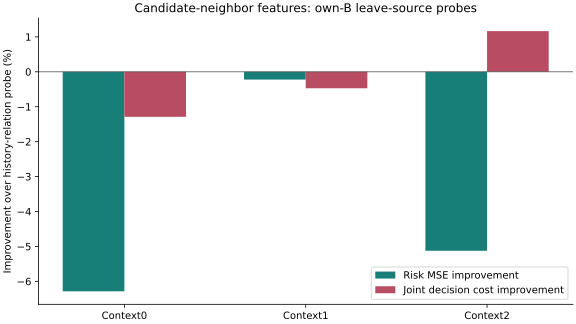

# Candidate-Neighbor Relations

I tested whether explicit forecast-to-neighbor geometry explains the remaining intervention errors.
The fixed leave-source probe does **not** support expanding this feature branch.

| Context | Own-B rows | Known proposed rows | MSE improvement | Joint cost improvement |
|---|---:|---:|---:|---:|
| critic0 | 6197 | 5767 | -6.285% | -1.290% |
| critic1 | 5521 | 3715 | -0.223% | -0.472% |
| critic2 | 50748 | 38579 | -5.124% | +1.164% |

Positive values mean lower error/cost. The internal follow-up screen passes in **0/3** contexts.
There are eight source folds and sixteen fitted linear probes, not sixteen new neural networks.
The 62,466 rows include overlapping windows and are not independent observations.
48,061 known proposals enter the probe; 1,274 unknown proposed outcomes are recorded but not imputed.

## What Changed

The control uses kinematic64 and rollout/history32. The treatment adds 24 features describing
the candidate and floor paths relative to neighbors continued with their last observed velocity.
Only neighbors aligned to the last two ego observation times are used. Normalization and
target RMS are refitted on each leave-source fitting subset; no held labels enter fitting.
Both probes use the fixed ridge penalty 0.01. The treatment has more coefficients, so this
is a feature-utility diagnostic, not an equal-capacity neural ablation.

## What It Means

Adding this particular proximity representation does not provide stable linear risk information.
Two contexts worsen both prediction and decision cost. The third reduces decision cost 1.164%
while worsening MSE 5.124%. This does not prove that all interaction features or nonlinear
models are useless, nor does it establish domain shift as the sole root cause.
The source-held relationship remains unstable; the next model intervention should target
cross-source risk learning instead of a threshold sweep or more versions of the same feature.

## Evidence Status

- `fresh_run`: feature extraction, 16 ridge fits, frozen-neural error slices, exact replay.
- `cached_verified`: original forecasts, neural checkpoints, source roles and causal schema.
- `not_run`: a new neighbor neural branch, reserved/H confirmation and deployment.
- Original 2% all/easy risk, easy-net, reference/support rules unchanged; empty support remains NA.
- No identity certification. Prior 17-view neural risk/support failure remains 0/17.
- Native obs8/pred12 image coordinates, not metric/seconds/true3D/foundation evidence.
- Stage5C/SMC off. The paper is not yet submission-ready.

[Protocol](protocol.md) | [All metrics](analysis.json) | [Source folds](source_folds.md)
| [Failure analysis](failure_analysis.md) | [Reproducibility](validation_receipt.md)
