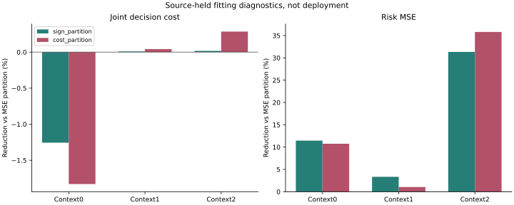

# Cost-Directed Partitions

I changed how the model divides fitting examples, keeping the same causal
features, risk targets and zero decision boundary. The final readout remains
the original weighted two-channel mean, not a classifier probability.

| Context | Partition | MSE reduction % | Joint-cost reduction % | False-safe-cost reduction % |
|---|---|---:|---:|---:|
| critic0 | mse_partition | +0.0000 | +0.0000 | NA |
| critic0 | sign_partition | +11.4521 | -1.2560 | NA |
| critic0 | cost_partition | +10.7439 | -1.8295 | NA |
| critic1 | mse_partition | +0.0000 | +0.0000 | +0.0000 |
| critic1 | sign_partition | +3.3376 | +0.0090 | +100.0000 |
| critic1 | cost_partition | +1.0417 | +0.0410 | -555.8370 |
| critic2 | mse_partition | +0.0000 | +0.0000 | NA |
| critic2 | sign_partition | +31.3327 | +0.0165 | NA |
| critic2 | cost_partition | +35.8044 | +0.2843 | NA |

Positive reductions are better. NA means a zero reference cost, not a pass.
The primary cost-partition follow-up screen passes **0/3** contexts.
It requires two; the sign-only arm cannot replace the registered primary.

## Decisions

| Context | Arm | Known proposals | Joint-safe labels | Accepted | False safe | False reject |
|---|---|---:|---:|---:|---:|---:|
| critic0 | mse_partition | 5767 | 5303 | 1 | 0 | 5302 |
| critic0 | sign_partition | 5767 | 5303 | 16 | 2 | 5289 |
| critic0 | cost_partition | 5767 | 5303 | 58 | 6 | 5251 |
| critic1 | mse_partition | 3715 | 2248 | 10 | 1 | 2239 |
| critic1 | sign_partition | 3715 | 2248 | 1 | 0 | 2247 |
| critic1 | cost_partition | 3715 | 2248 | 43 | 9 | 2214 |
| critic2 | mse_partition | 38579 | 24216 | 0 | 0 | 24216 |
| critic2 | sign_partition | 38579 | 24216 | 1 | 0 | 24215 |
| critic2 | cost_partition | 38579 | 24216 | 40 | 3 | 24179 |

These signs concern known source-held fitting labels, not a complete-policy
safety certificate. Unknown outcomes remain unknown; zero intervention is
not an identity exemption. Absolute costs are retained in result_summary.json.

## Same-Partition Identity

For each channel, P(positive) times positive severity minus P(negative)
times negative severity reconstructs the original weighted mean when the
partition and measure are unchanged. This arithmetic does not establish
that separately trained hurdle models must behave identically.

Maximum factorization difference: 1.11e-16; sign changes: 0.
Maximum original-mean reconstruction difference: 3.886e-16; sign changes: 0.

## Evidence Scope

Own-B rows: 62466; known proposals: 48061; unknown proposals: 1274.
- fresh_run: 16 new partition models, full refits and target/decision diagnostics.
- cached_verified: eight MSE controls and frozen source inputs; controls also refit exactly.
- not_run: new neural model, nested-C/H, independent confirmation or deployment.
- One producer seed; three exposed contexts and dependent windows are not three independent seeds.
- Original 2% harm, easy-net and support rules unchanged; no identity certification.
- Empty support stays NA; prior failures and original24-group primary NA remain.
- Moving20, DUT, DroneCrowd and H remain closed; Stage5C/SMC off.
- Native obs8/pred12 silver image coordinates, not metric/seconds/true3D/foundation.
- Not submission-ready. No scientific gate is established by exact replay.

[Protocol](protocol.md) | [Failure analysis](failure_analysis.md) | [Reproduction](operation_zh.md)
