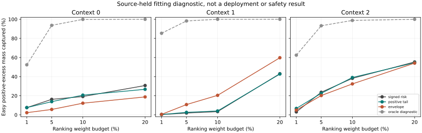

# Can Past-Only Information Identify The Harmful Forecast Tail?

Eight positive-target forest probes are freshly trained on source-separated
own-B data. Eight signed-risk controls are cached_verified by model/data hashes
and exact predictions. All16 models also reproduce by a fresh full refit.
The frozen trajectory bank is reused, not retrained. This is exposed-development
information evidence, not an independent test or a deployable model.

## Fixed Primary Ranking Diagnostic

At10% query-balanced weight, capture of positive easy-channel budget-excess
mass is shown below. Scores are computed from past history and frozen causal
forecasts; future observations supply labels only. Source-macro means are used.

| Context | Signed-risk head | Positive-tail head | Envelope | Label oracle (diagnostic) | Internal screen |
|---|---:|---:|---:|---:|---|
| 0 | 19.196% | 20.675% | 12.214% | 99.880% | fail |
| 1 | 3.419% | 4.078% | 20.427% | 99.990% | fail |
| 2 | 38.228% | 39.099% | 32.400% | 98.798% | fail |

Internal screen passes **0/3**. The screen requires50% mass
capture and >=5 percentage points over both controls, in at least2contexts.
This does not replace the original safety gates. A label oracle is a diagnostic
upper ranking, not a learned predictor. Tie allocation is fractional and
label-independent; it does not describe actual intervention counts.

There are 48,061 known proposals and 1,274 unknown proposals, across
eight source folds and three dependent contexts from one producer seed17.
Unknown futures are not assigned safe labels. The underlying packing is
64admitted SOURCE recordings /195286rows, not195286independent observations.

## What Was And Was Not Tested

New target: positive parts of the original two signed risk excesses; same120
causal inputs,64trees/depth8/minleaf32, fitting-only preprocessing/RMS and
original source/query weights. No source/action IDs or future fields are added.
The nonlearned envelope score is maximum predicted candidate-floor displacement
in the existing causal-normalized coordinates. No new hypothesis about
metres, seconds, true3D, foundation learning, JEPA or physical safety follows.

The main quantity is a cost-mass ranking diagnostic, **not ADE improvement,
easy degradation, tail-event probability, calibration or original risk ratio**.
Costs use available future labels and retain the old incomplete-label caveat.
The result cannot prove that all possible inputs/models are insufficient.

Policy evaluation: not_run, because this probe defines no deployment policy.
No newC/H or reserved readout, no threshold search, no identity certification,
no deployment change; original24group primary remains NA, not passed.
Stage5C and SMC stay off. Submission readiness remains false.

## Execution

| Phase | PID | Seconds | Peak RSS bytes |
|---|---:|---:|---:|
| pilot | 42310 | 57.639 | 6939099136 |
| run | 42441 | 67.455 | 7367901184 |
| verify | 42584 | 70.429 | 7262404608 |

Native arm64 `.venv-pytorch`, CPU4/inter-op1/workers0. The inherited runtime
banner says forest_threads=1; the actual registered forest uses n_jobs=4.
Local resources suffice, so no new CREATE job or data transfer was needed.
Exact repeats establish engineering reproducibility, not independent evidence.

See [source folds](source_folds.md), [causal slices](causal_slices.md),
[failure analysis](failure_analysis.md), [protocol](protocol.md),
[Chinese reproduction instructions](operation_zh.md), and the complete
[machine-readable analysis](analysis.json).

