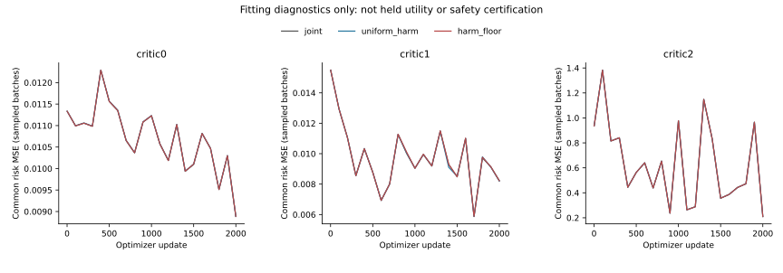
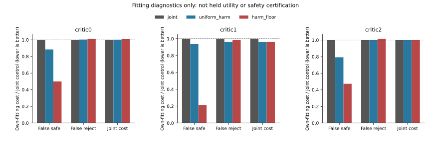

# Harm-Weight Allocation Under Unchanged Safety Rules

I tested whether strengthening lower-magnitude harmful labels improves
the joint intervention decision. A uniform-weight arm has the same total
positive coefficient mass, separating allocation from a uniform increase.
All nine full fits, exact controls, recovery checks and the first full
treatment refit are complete. These are risk heads, not new forecasts.

## Fitting Results

| Context | Arm | MSE reduction from warm % | All sign-cost reduction % | Easy sign-cost reduction % | False-safe proposals | False rejections |
|---|---|---:|---:|---:|---:|---:|
| eqmotion_fold1_seed17_critic0 | joint | 19.8732 | 19.0536 | 36.0392 | 18 | 2655 |
| eqmotion_fold1_seed17_critic0 | uniform_harm | 19.8309 | 19.1686 | 36.1701 | 17 | 2660 |
| eqmotion_fold1_seed17_critic0 | harm_floor | 19.8190 | 19.3987 | 36.3804 | 7 | 2693 |
| eqmotion_fold0_seed17_critic1 | joint | 27.8200 | 36.6171 | 76.9128 | 35 | 1924 |
| eqmotion_fold0_seed17_critic1 | uniform_harm | 28.0981 | 37.3430 | 77.3294 | 32 | 1942 |
| eqmotion_fold0_seed17_critic1 | harm_floor | 27.8628 | 37.5763 | 79.4731 | 11 | 2001 |
| eqmotion_fold0_seed17_critic2 | joint | 9.8970 | 26.4488 | 84.4775 | 162 | 22704 |
| eqmotion_fold0_seed17_critic2 | uniform_harm | 9.8986 | 26.7163 | 84.5200 | 143 | 22752 |
| eqmotion_fold0_seed17_critic2 | harm_floor | 9.8994 | 26.5294 | 85.0037 | 81 | 22971 |

| Context | Contrast | Joint-cost reduction % | False-safe-cost reduction % | False-reject-cost reduction % |
|---|---|---:|---:|---:|
| eqmotion_fold0_seed17_critic1 | uniform_harm_minus_joint | 3.8016 | 6.3174 | 3.7266 |
| eqmotion_fold0_seed17_critic1 | harm_floor_minus_joint | 3.5706 | 78.6784 | 1.3317 |
| eqmotion_fold0_seed17_critic1 | harm_floor_minus_uniform_harm | -0.2402 | 77.2406 | -2.4876 |
| eqmotion_fold0_seed17_critic2 | uniform_harm_minus_joint | 0.1846 | 20.7543 | -0.3943 |
| eqmotion_fold0_seed17_critic2 | harm_floor_minus_joint | -0.1659 | 52.6766 | -1.6531 |
| eqmotion_fold0_seed17_critic2 | harm_floor_minus_uniform_harm | -0.3512 | 40.2827 | -1.2538 |
| eqmotion_fold1_seed17_critic0 | uniform_harm_minus_joint | -0.1697 | 11.5504 | -0.2987 |
| eqmotion_fold1_seed17_critic0 | harm_floor_minus_joint | -0.7968 | 50.0518 | -1.3565 |
| eqmotion_fold1_seed17_critic0 | harm_floor_minus_uniform_harm | -0.6261 | 43.5292 | -1.0546 |

Negative reductions mean worse. Counts and normalized costs are fitting
diagnostics, not held trajectory gains or deployment guarantees.

Different auxiliary weights make total training objectives incomparable
across arms. The plotted risk MSE is unchanged; sampled-batch values are
not full-population fitting loss. Curves may overlap.

| Context | Positive weighted median | Uniform multiplier | Original positive mass | New positive mass |
|---|---:|---:|---:|---:|
| eqmotion_fold1_seed17_critic0 | 0.0557 | 1.1365 | 0.0118 | 0.0134 |
| eqmotion_fold0_seed17_critic1 | 0.0246 | 1.1093 | 0.0170 | 0.0188 |
| eqmotion_fold0_seed17_critic2 | 0.1163 | 1.1277 | 0.0997 | 0.1125 |

Loss-weight magnitudes use the mean positive target across channels.
Attributed decision costs above sum channel magnitudes. Their absolute
values are not interchangeable; matched comparisons retain one convention.

Original internal fitting screen: **3/3**, overall **True**.
It compares harm_floor with warm initialization, not a scientific risk
gate or a posthoc choice among fitted arms.

## Exposed Development

Seven previously exposed SOURCE units / 17 recording views, one producer seed.

| Policy | Known ADE gain % | Hard gain % | Switch % | Worst defined easy-net % | Full risk/support |
|---|---:|---:|---:|---:|---:|
| constant_veto | 3.6006 | 4.6257 | 15.0144 | 38.9046 | 0/17 |
| joint_veto | 0.8948 | 1.1698 | 5.9882 | 8.6334 | 0/17 |
| uniform_harm_veto | 0.8809 | 1.1590 | 5.9048 | 8.6334 | 0/17 |
| harm_floor_veto | 0.7926 | 1.0460 | 5.3957 | 8.0481 | 1/17 |
| harm_floor_risk_only_veto | 3.3037 | 4.2802 | 14.5041 | 40.3776 | 0/17 |

Primary harm_floor minus uniform_harm: -0.0883 pp, completion bounds [-0.1004, -0.0762] pp.
Original full risk/support pass: **False**. Known all/easy violations: 12/13; undefined selected-easy views: 3.
Completion bounds are not sampling CIs. Partial-outcome known ADE is
not complete-roster 12-step ADE; exposed development is not independent confirmation.

## Runtime

| Phase | PID | Seconds | Peak RSS bytes |
|---|---:|---:|---:|
| pilot | 9647 | 96.82 | 6530007040 |
| train | 10991 | 1252.74 | 7588331520 |
| evaluate | 13840 | 74.19 | 5614600192 |
| verify | 14065 | 78.59 | 6417383424 |

Native arm64 PyTorch CPU 4/inter-op 1/workers 0. Checkpoints/heartbeat
every 100 completed updates; 18,000 primary, 2,000 refit and 600 pilot updates.
Own-B medians, mass controls and all sampler counts recompute exactly.

The training phase above is the resumed process. The first attempt exited1
at JSON receipt export after completing the first control. Its checkpoint
is byte-identical after recovery; its 182.75 fit seconds are
not included in resumed process time. No completed optimizer steps were
repeated. The original registration and failed attempt remain recorded.

Parent assets cached_verified; training/diagnostics fresh_run. Reserved/H
confirmation not_run. Original 2% rules unchanged, no identity exemption.
Empty controls/support stay NA; original 24-group primary remains NA, not pass.
No deployment or submission-ready claim. Native obs8/pred12 image coordinates;
not metric, seconds, true 3D, foundation or human gold. Stage5C and SMC disabled.

[Protocol](protocol.md) | [Failure analysis](failure_analysis.md) |
[Run/recovery guide](operation_zh.md) | [Numbers](result_summary.json)
