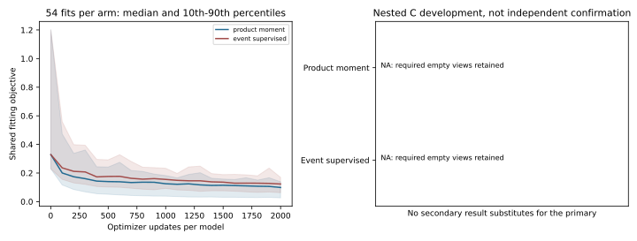

# Neural Joint-Harm Learning Under The Original Rules

I tested whether explicit benefit, harm and easy-harm event supervision makes
a neural intervention policy more reliable. The experiment is complete, but
does not support deployment. All original risk and support rules remain in
place, including the unavailable primary views.

## What Actually Ran

- **fresh_run:** 108 Torch cost heads, 216,000 primary updates, three producer
  seeds, all 54 matched fitting pairs, complete nested-C evaluation and exact
  replay. A separate repeatable read-only inference command was also run.
- **cached_verified:** forecast checkpoints, source admission, original data
  roles, causal feature construction and own-source preprocessing.
- **not_run:** new H readout, independent final confirmation, deployment,
  a real-data public deferral benchmark, Stage5C and SMC.

Both arms have 28,489 parameters and identical initialization, fitting data,
sampler draws and optimization budgets. The event arm adds categorical event
and conditional severity losses; it is not a new trajectory forecaster. This
combined auxiliary treatment, not factorization itself, is the tested change.

## Main Finding

The event-veto primary is unavailable in 24/276 required source views. Its
full-strategy known secondary loses **1.031 pp** to its same-count,
same-amplitude-histogram control (95% CI: **-1.886 to -0.369**). Only **47/696**
repeated recording views meet the original risk/support contract. The complete
primary is not replaced by a favorable subset, secondary score or loss curve.

Harm-estimation MSE improves over the matched product-moment head, but the
event probabilities lose to fitting-source frequency priors. On all frozen
proposer choices, pooled harm is overestimated; on the subset admitted by
the veto, harm is underestimated. Average error prediction and reliable
selection are still different problems. The negative result is preserved.

[Complete results and runtime](readout.md) | [Failure analysis](failure_analysis.md)
| [Every source](per_source.md) | [Original gates](gates.md)
| [Model/data card](model_data_card.md) | [Protocol](protocol.md)



## Reproduction

Use the native arm64 `.venv-pytorch` environment from the repository root.
The actual run used 4 CPU threads, 1 interop thread and 0 workers, with
checkpoints and heartbeat every 100 updates. The terminal resumed attempt took
7,954.35 seconds and peaked at 9.77 GB RSS. The initial receipt-serialization
failure and unchanged resume are documented in [runtime_fix.md](runtime_fix.md).

With the existing private data and weights, this command recomputes every
saved nested-C prediction and decision while leaving public receipts unchanged:

```sh
.venv-pytorch/bin/python scripts/replay_m3w_joint_harm.py
```

This exact command completed with exit code 0 in 293.93 seconds. It is repeatable,
not an independent raw-data cold start, new training or a new test evaluation.
The checkpoint/source audit and deterministic aggregate report are:

```sh
.venv-pytorch/bin/python scripts/audit_m3w_joint_harm_fits.py
.venv-pytorch/bin/python scripts/report_m3w_joint_harm.py
```

The registered original phase entrypoint is
`scripts/run_m3w_moving_joint_harm_runtime.py PHASE`. Completed phase receipts
are immutable. Use `--resume` only for an interrupted unchanged phase, never
delete successful artifacts to force a fresh run. Weights, row data and caches
are not in GitHub. The public repository alone is not a full raw-data bundle.

There are 23 passing focused tests. The entire historical test suite was not
rerun; these checks do not establish scientific success. See the model/data
card for scientific limits and [the public-loss note](public_control_note.md)
for the implemented but not yet benchmarked published deferral control.

## Evidence Limits

MovingDroneCrowd++ exposed SOURCE, native observation 8/prediction 12 annotation
order, image pixels. These are not verified video seconds or metric world
coordinates. The 23 supported source units are not verified IID physical
scenes; the original 24-group primary remains not estimable. Partial future
labels retain their available-label meaning. No human-gold, true 3D,
foundation, independent-confirmation or submission-readiness claim is made.
