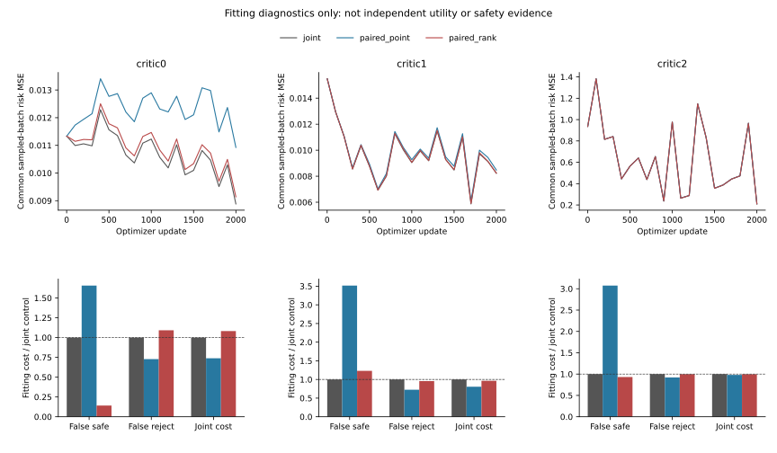

# Paired Useful/Harmful Decision Learning

I tested within-query paired ranking against a matched pointwise loss and
the preceding joint control. All nine complete fits, three exact controls,
one full treatment refit and fitting-metric replay are complete.
Held evaluation and its replay status are reported separately below.
These are neural intervention-risk heads, not new trajectory forecasts.

## Own-Fitting Results

| Context | Arm | MSE reduction from warm % | Joint cost | False-safe | False-reject | AUROC | Cost-weighted AUROC |
|---|---|---:|---:|---:|---:|---:|---:|
| eqmotion_fold1_seed17_critic0 | joint | 19.8732 | 0.00645961 | 18 | 2655 | 0.9446 | 0.9931 |
| eqmotion_fold1_seed17_critic0 | paired_point | 1.9809 | 0.00477017 | 19 | 1945 | 0.9628 | 0.9946 |
| eqmotion_fold1_seed17_critic0 | paired_rank | 18.0686 | 0.00699085 | 4 | 2873 | 0.9586 | 0.9935 |
| eqmotion_fold0_seed17_critic1 | joint | 27.8200 | 0.00335666 | 35 | 1924 | 0.8641 | 0.9766 |
| eqmotion_fold0_seed17_critic1 | paired_point | 25.4845 | 0.00270265 | 118 | 1499 | 0.8755 | 0.9809 |
| eqmotion_fold0_seed17_critic1 | paired_rank | 27.7226 | 0.00323437 | 43 | 1881 | 0.8765 | 0.9793 |
| eqmotion_fold0_seed17_critic2 | joint | 9.8970 | 0.01963634 | 162 | 22704 | 0.7200 | 0.9042 |
| eqmotion_fold0_seed17_critic2 | paired_point | 9.6903 | 0.01923719 | 551 | 21048 | 0.7196 | 0.8822 |
| eqmotion_fold0_seed17_critic2 | paired_rank | 9.8931 | 0.01956957 | 171 | 22573 | 0.7281 | 0.9110 |

| Context | Contrast | Joint-cost reduction % | False-safe-cost reduction % | False-reject-cost reduction % |
|---|---|---:|---:|---:|
| eqmotion_fold0_seed17_critic1 | paired_point_minus_joint | 19.4840 | -251.5149 | 27.5621 |
| eqmotion_fold0_seed17_critic1 | paired_rank_minus_joint | 3.6430 | -22.9912 | 4.4370 |
| eqmotion_fold0_seed17_critic1 | paired_rank_minus_paired_point | -19.6743 | 65.0111 | -31.9241 |
| eqmotion_fold0_seed17_critic2 | paired_point_minus_joint | 2.0327 | -207.3172 | 7.9245 |
| eqmotion_fold0_seed17_critic2 | paired_rank_minus_joint | 0.3400 | 6.8609 | 0.1565 |
| eqmotion_fold0_seed17_critic2 | paired_rank_minus_paired_point | -1.7278 | 69.6928 | -8.4366 |
| eqmotion_fold1_seed17_critic0 | paired_point_minus_joint | 26.1539 | -65.6614 | 27.1644 |
| eqmotion_fold1_seed17_critic0 | paired_rank_minus_joint | -8.2240 | 85.8238 | -9.2591 |
| eqmotion_fold1_seed17_critic0 | paired_rank_minus_paired_point | -46.5534 | 91.4427 | -50.0079 |

Negative reductions mean worse. Ranking excludes zero-target and unknown
rows; attribution counts use the preceding target-safe convention.
Higher fitting AUROC is not better held decisions or a safety certificate.

The common MSE term is comparable; differently constructed total objectives
are not interchangeable. Sampled-batch curves may overlap.

## Exposed Development

Original internal fitting screen: **3/3**. It is not the scientific safety gate.

Seven already exposed SOURCE units / 17 views, one producer seed.

| Policy | Known ADE gain % | Hard gain % | Switch % | Worst defined easy-net % | Full risk/support |
|---|---:|---:|---:|---:|---:|
| constant_veto | 3.6006 | 4.6257 | 15.0144 | 38.9046 | 0/17 |
| joint_veto | 0.8948 | 1.1698 | 5.9882 | 8.6334 | 0/17 |
| paired_point_veto | 1.4674 | 1.8402 | 8.1189 | 8.4650 | 0/17 |
| paired_rank_veto | 0.8363 | 1.1294 | 5.3685 | 8.3373 | 0/17 |
| paired_rank_risk_only_veto | 3.3212 | 4.3155 | 14.5540 | 41.7732 | 0/17 |

Primary rank-minus-point known contrast: -0.6311 pp; completion bounds [-0.8664, -0.3957] pp.
Original full risk/support pass: **False**; known all/easy violations 11/13; undefined selected-easy views 4.

Completion bounds are not sampling CIs. Known partial-outcome ADE is not
complete-roster ADE. Repeated development is not independent confirmation.

## Execution

| Phase | PID | Seconds | Peak RSS bytes |
|---|---:|---:|---:|
| pilot | 16418 | 110.79 | 6521880576 |
| train | 18194 | 1717.60 | 7354515456 |
| evaluate | 20797 | 67.64 | 5564301312 |
| verify | 20940 | 75.36 | 6290030592 |

18,000 primary, 2,000 full-refit and 600 pilot updates; actual arm64 PyTorch
CPU4/inter-op1/workers0. Parent assets cached_verified, fits/diagnostics
fresh_run, reserved/H confirmation not_run. No CREATE job started.
The train-phase duration is for the resumed process only, excluding
initial-process time and downtime. The [interruption and recovery record](interruption_recovery.md)
retains the unavailable first exit code; no crash cause is inferred.

Original 2% risk/easy/support rules unchanged; no identity certification.
Original 24-group primary remains NA; empty support is not passed.
No deployment or submission-ready claim. Native obs8/pred12 image
coordinates, not metric/seconds/true3D/foundation/human gold. Stage5C/SMC disabled.

[Protocol](protocol.md) | [Failure analysis](failure_analysis.md) |
[Loss geometry](loss_geometry.md) | [Validation receipt](validation_receipt.md) |
[Run/recovery guide](operation_zh.md) | [Metrics](result_summary.json)
