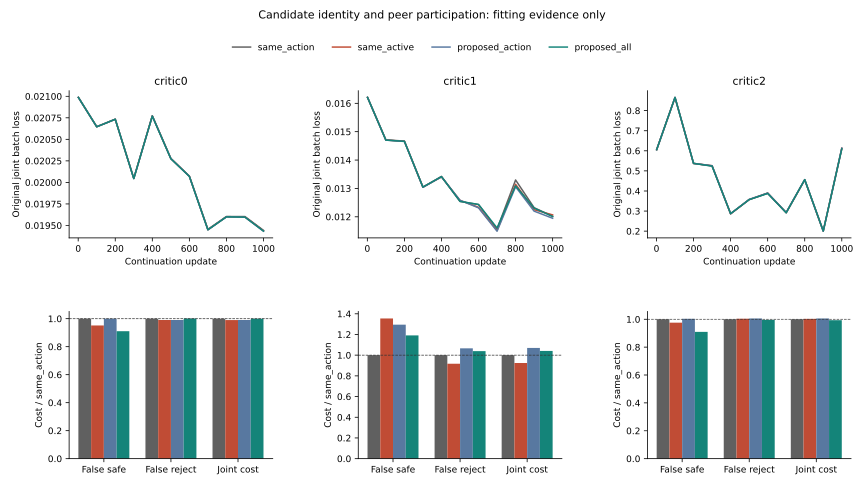

# Candidate Identity And Peer Participation

I separated two choices in neural risk estimation: which forecast represents
each peer, and whether peers that fall back to the baseline remain visible.
Six new neural fits complete the two-by-two comparison; six prior fits are
hash-verified controls, not new training. All have the same initial function,
76,548 parameters, 1,000 updates, query draws, scalers and original loss.

## Primary Contrast

Proposed forecast versus same-index forecast, with all peers retained.
Positive reductions are better; these are fitting costs, not held-out ADE.

| Context | MSE reduction % | Joint-cost reduction % | False-safe-cost reduction % | False-reject-cost reduction % |
|---|---:|---:|---:|---:|
| critic0 | 0.0427 | -0.0433 | 8.9220 | -0.1543 |
| critic1 | -0.2794 | -4.1076 | -19.0946 | -3.8698 |
| critic2 | -0.4021 | 0.6746 | 9.0270 | 0.4278 |

The fixed internal screen passes **0/3** contexts. This is not a safety gate.

## All Factor Contrasts

| Context | Contrast (treatment vs control) | MSE reduction % | Joint-cost reduction % | False-safe-cost reduction % |
|---|---|---:|---:|---:|
| critic0 | proposed_all vs same_action | 0.0427 | -0.0433 | 8.9220 |
| critic0 | proposed_action vs same_active | -0.0300 | -0.0649 | -5.0727 |
| critic0 | same_action vs same_active | -0.0970 | -0.9935 | -5.0727 |
| critic0 | proposed_all vs proposed_action | -0.0243 | -0.9717 | 8.9220 |
| critic1 | proposed_all vs same_action | -0.2794 | -4.1076 | -19.0946 |
| critic1 | proposed_action vs same_active | 0.4310 | -15.7514 | 4.3978 |
| critic1 | same_action vs same_active | -0.6536 | -8.2037 | 26.1739 |
| critic1 | proposed_all vs proposed_action | -1.3718 | 2.6809 | 8.0325 |
| critic2 | proposed_all vs same_action | -0.4021 | 0.6746 | 9.0270 |
| critic2 | proposed_action vs same_active | -0.1617 | -0.2484 | -2.8244 |
| critic2 | same_action vs same_active | 0.2002 | 0.3086 | -2.4848 |
| critic2 | proposed_all vs proposed_action | -0.0392 | 1.2265 | 9.3275 |

## Evidence Boundary

The non-proposer representation is action0, verified row-by-row to equal
the causal physical-floor path. It is not a future label or a permissible
intervention. Pooling excludes ego and other queries. The proposal is frozen
before the final veto, not the final admitted set.

**not_run:** Fixed proposed-all versus same-all fitting screen failed; no additional nested-C or H readout.
No extra nested-C or reserved-H result is inferred. The previous17-view
risk/support failure and original24-group NA remain unchanged.

## Execution

| Phase | PID | Seconds | Peak RSS bytes |
|---|---:|---:|---:|
| pilot | 36108 | 132.12 | 7696744448 |
| train | 36291 | 778.81 | 7301939200 |
| evaluate | 37469 | 16.72 | 975814656 |
| verify | 37523 | 43.27 | 6413336576 |

6,000 fresh primary +1,000 full-refit +500 pilot updates. The pilot also
reproduces the saved legacy100-update model exactly. All12cells replay exactly.
Native arm64 CPU4/inter-op1/workers0, checkpoint/resume/heartbeat. One producer
seed and three dependent fitting contexts are not three independent seeds.

- fresh_run: six new heads, causal-floor audit, recomputed diagnostics.
- cached_verified: six existing controls, parents, source splits and scalers.
- not_run: independent confirmation, new trajectory/JEPA training, deployment.
- Original2% all/easy harm, signed easy-net and support rules unchanged.
- Empty support remains NA; no identity certification or threshold search.
- Moving20, DUT, DroneCrowd and H remain closed; original24-group primary NA.
- Native obs8/pred12 silver image coordinates, not metric/seconds/true3D/foundation.
- Stage5C/SMC disabled. Not yet submission-ready.

[Protocol](protocol.md) | [Metrics](result_summary.json) | [Failure analysis](failure_analysis.md)
| [Reproduction](operation_zh.md)
