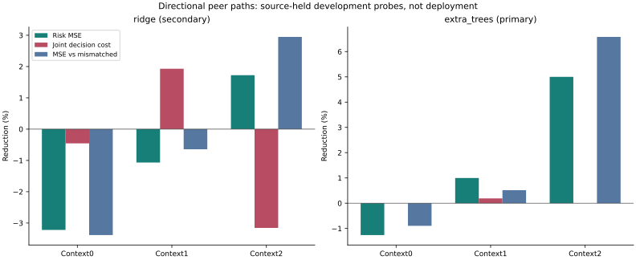

# Directional Peer Paths

I tested whether directional path information lost by proximity summaries
helps predict intervention risk on an excluded fitting source. The primary
nonlinear probe uses fixed ExtraTrees; ridge is a secondary diagnostic.
A within-query mismatched association control checks whether correctly
assigning the new geometry matters. It is not an independent test set.

| Family | Context | MSE reduction % | Joint-cost reduction % | False-safe-cost reduction % | MSE reduction vs mismatched % |
|---|---|---:|---:|---:|---:|
| ridge | critic0 | -3.221 | -0.455 | -18.101 | -3.386 |
| extra_trees | critic0 | -1.262 | -0.000 | NA | -0.896 |
| ridge | critic1 | -1.067 | +1.929 | +9.595 | -0.645 |
| extra_trees | critic1 | +0.997 | +0.189 | -757.427 | +0.514 |
| ridge | critic2 | +1.723 | -3.156 | -10.160 | +2.946 |
| extra_trees | critic2 | +5.000 | +0.000 | NA | +6.581 |

Positive reductions are better. Source-macro costs retain their original
sum-over-channels semantics; these are not held trajectory ADE improvements.
The primary internal follow-up screen passes **1/3** contexts.
A passing information screen could justify a later neural experiment, not
deployment. A favorable secondary ridge result cannot replace the primary.

## Decisions Behind The Error

| Context | Known candidates | True joint-safe labels | Summary accepted / harmful | Aligned accepted / harmful | Mismatched accepted / harmful |
|---|---:|---:|---:|---:|---:|
| critic0 | 5767 | 5303 | 1 / 0 | 1 / 0 | 1 / 0 |
| critic1 | 3715 | 2248 | 10 / 1 | 61 / 10 | 30 / 8 |
| critic2 | 38579 | 24216 | 0 / 0 | 0 / 0 | 0 / 0 |

These are descriptive per-row signs on known fitting outcomes, not a
full-policy safety certificate. A joint-safe label is not a deployment pass.
All rejected candidates can lower regression error without improving any
decision. Zero harmful cost has an undefined relative reduction (NA),
not a new safety certification. The context1 relative harmful-cost increase
has a small nonzero denominator; absolute costs are retained in
[decision_counts.json](decision_counts.json).

## What Was Run

48 fixed probe fits over eight source folds:24ExtraTrees and24ridge. Eight
ridge cells reproduce previously completed summary120 controls exactly.
A separate full64-tree pilot repeats exactly. All48model structures,
coefficients, predictions and metrics are reproduced by fresh refits.

Own-B rows:62466; known proposals:48061; unknown proposals:1274.
Unknown outcomes are counted, not imputed. Row features and the fixed
misassociation are constructed before the outcome-availability filter.
Overlapping windows and these three contexts are not independent seeds.

| Context | Queries | Aligned-neighbor rows % | Singleton queries unchanged by mismatch |
|---|---:|---:|---:|
| critic0 | 52 | 100.00 | 0 |
| critic1 | 137 | 100.00 | 0 |
| critic2 | 898 | 100.00 | 0 |

## Scope And Reproduction

- fresh_run: causal path extraction,48probe fitting executions and deterministic refits.
- cached_verified: source data, frozen forecasts, splits and earlier linear controls.
- not_run: new neural branch, nested-C/H, reserved data and independent confirmation.
- Original2% all/easy harm, easy-net and support rules unchanged; empty support remains NA.
- No identity certification, threshold selection or deployment promotion.
- Original24-group primary NA; Moving20,DUT,DroneCrowd,H remain closed.
- Native obs8/pred12 silver image coordinates, not metric/seconds/true3D/foundation.
- Stage5C/SMC off. Not yet submission-ready.

Saved ExtraTrees models use n_jobs=4. The inherited runtime banner has
a legacy forest_threads=1 label; the registered and saved estimator settings,
not that generic label, describe this probe. No DataLoader multiprocessing.

[Protocol](protocol.md) | [All metrics](analysis.json) | [Failure analysis](failure_analysis.md)
| [Reproduction](operation_zh.md)
