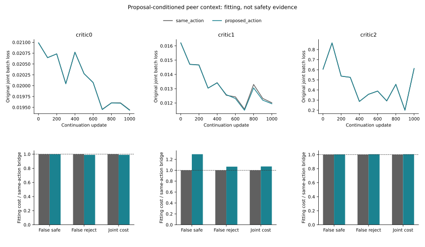

# Proposal-Conditioned Peer Context

I tested whether a neural risk head benefits from knowing which candidate
each peer actually proposes. The matched control receives peers' same-index
hypothetical candidate. Both learn an equally sized, zero-initialized context
bridge from the same completed parent, with the original loss and safety rules.

## Matched Fitting Results

| Context | Risk MSE reduction % | Joint-cost reduction % | False-safe-cost reduction % | False-reject-cost reduction % |
|---|---:|---:|---:|---:|
| critic0 | 0.0670 | 0.9195 | 0.0000 | 0.9309 |
| critic1 | 1.0776 | -6.9754 | -29.4963 | -6.6181 |
| critic2 | -0.3627 | -0.5588 | -0.3314 | -0.5655 |

Positive reductions are better. These are own-fitting diagnostics, not
held trajectory gains, independent confirmation or calibrated safety.
The fixed internal follow-up screen passes **0/3** contexts.

All six models complete1,000 updates with76,548 parameters. Initial predictions
match the parent exactly. Both risk/decision encoders and both bridges update.
Unknown-bound supervision, normalizers, draws and optimizer settings match.

## Input Audit

| Context | Rows | Complete queries | Mixed-proposal queries | Empty-proposal queries |
|---|---:|---:|---:|---:|
| critic0 | 6197 | 52 | 46 | 0 |
| critic1 | 5521 | 137 | 99 | 27 |
| critic2 | 50748 | 898 | 735 | 32 |

All own-B proposals replay exactly from the original full legal-action mask
and source-disjoint frozen proposer. A legal mask is never interpreted as an
action set. Proposals precede the risk veto; this is not final admitted-set
context or a physical interaction model. Overlapping queries are dependent.

## Exposed Development

**not_run:** Fixed proposal-context fitting screen failed; no additional nested-C or H readout.
No additional development/test gain is inferred. The previous17-view
risk/support failure is unchanged. Lower fitting error is not safety.

## Execution And Scope

| Phase | PID | Seconds | Peak RSS bytes |
|---|---:|---:|---:|
| pilot | 33505 | 116.77 | 7068205056 |
| train | 33697 | 680.13 | 7415808000 |
| evaluate | 34628 | 16.56 | 977436672 |
| verify | 34694 | 37.28 | 6425591808 |

6,000 primary +1,000 exact-refit +400 pilot updates. Native arm64 CPU4,
inter-op1/workers0; checkpoints and heartbeat. Three contexts share one
producer seed and do not constitute a three-seed independent confirmation.

- fresh_run: six neural fits, causal-context audit and exact metric replay.
- cached_verified: parent weights, data/schema, source roles and normalizers.
- not_run: reserved/H confirmation, new trajectory training, JEPA or deployment.
- Original2% all/easy positive-harm, easy-net and reference/support rules retained.
- Empty support stays NA. No identity certificate or threshold search.
- Original24-group primary stays NA. Moving20, DUT, DroneCrowd and H stay closed.
- Native obs8/pred12 image coordinates, not metric/seconds/true3D/foundation/gold.
- Stage5C/SMC disabled. The paper is not yet submission-ready.

[Protocol](protocol.md) | [Metrics](result_summary.json) | [Failure analysis](failure_analysis.md)
| [Reproduction](operation_zh.md)
