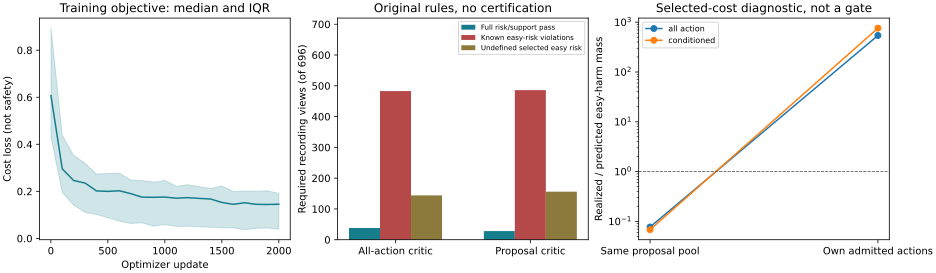

# Proposal-Conditioned Risk: Completed Development Experiment

Primary nonempty matched utility: not estimable, not passed. Original risk/support contract fails.

## Material Passport

fresh_run:108 new real Torch cost critics,216000 primary updates, evaluation and replay.
cached_verified: frozen forecasts, public routers and all-action point critics. No retraining claim for controls.
not_run: new H or independent final test, new trajectory dynamics, deployment upgrade, Stage5C and SMC.
MovingDroneCrowd++ exposed SOURCE, native8/12 annotation order, image pixels. Not SDDt50,
verified seconds, metric geometry, true3D or a foundation result.

## Main Contrasts

|Contrast|Known effect pp [95% CI]|Direct completion lower pp [95% CI]|
|---|---:|---:|
|Conditioned veto minus all-action veto|-0.2880 [-0.8643,+0.2825]|-1.0764 [-2.0174,-0.2208]|
|Conditioned full strategy minus own matched control (secondary)|-0.8753 [-1.7854,-0.3053]|-2.5434 [-3.9292,-1.4343]|

Original required nonempty matched comparison: 8/276 source views are unavailable. No unavailable view is replaced by zero or dropped.
Original24group primary remains not_estimable_not_passed. All23 source units are retained.
Intervals use3000source-cluster resamples after seed/context/orientation averaging;
these repeated development views are not verified independent test sites.

## Policies

|Policy|Known ADE gain vs floor %|Hard gain %|Switch %|Risk/support pass|Easy-risk violations|Undefined selected easy|
|---|---:|---:|---:|---:|---:|---:|
|physical_floor|+0.0000 [+0.0000,+0.0000]|+0.0000 [+0.0000,+0.0000]|+0.0000 [+0.0000,+0.0000]|0/696|0|696|
|public_router|+12.2948 [+6.9366,+17.8779]|+14.8000 [+9.2505,+21.0889]|+65.8277 [+60.5869,+71.5573]|14/696|582|50|
|all_action_veto|+4.1466 [+1.7752,+7.0181]|+4.5704 [+2.1859,+7.3699]|+29.3465 [+21.2958,+37.3791]|38/696|483|144|
|all_action_matched|+4.9535 [+2.3490,+8.0205]|+5.9912 [+3.2128,+9.1152]|+29.3465 [+21.2958,+37.3791]|24/696|479|159|
|conditioned_veto|+3.8586 [+1.7495,+6.3768]|+4.2120 [+2.1260,+6.6301]|+29.9757 [+21.6792,+38.4245]|28/696|486|156|
|conditioned_matched|+4.7339 [+2.3516,+7.4736]|+5.8484 [+3.1663,+8.8063]|+29.9757 [+21.6792,+38.4245]|7/696|485|169|

Source-macro gains are means of within-source ratios, not ratios of separately averaged pixel errors.
Available-label ADE is not full12 ADE; available endpoint FDE is diagnostic. See policy_metrics.json.
Worst defined signed recording easy-net degradation is 421.9831931239742%, not a dataset mean; undefined easy-net views remain undefined.

## Selected-Cost Reliability

|Critic|Selection|Actual/predicted harm mass|Actual/predicted easy-harm mass|
|---|---|---:|---:|
|all_action|same_proposals|0.2765056798634459|0.07713322584539242|
|all_action|admitted|105.88371144124731|540.5530666041254|
|conditioned|same_proposals|0.24744997952550588|0.06821908656112999|
|conditioned|admitted|89.65337052670183|758.3353299894784|

Ratios pool repeated view masses for diagnosis only, not an independent calibration guarantee.
Same-proposal comparisons hold actions fixed. Admitted comparisons change the selected population.

## Engineering Evidence

All108 checkpoints match control initialization, own-source preprocessing and query draw hashes.
The real600-update pilot resumes exactly in all3cells; first full refit is exact.
All108 policy/prediction blocks replay and1104cached source-policy readouts match.
These checks establish implementation reproducibility, not independent scientific confirmation.

|Phase|PID|Measured seconds|Peak RSS bytes|
|---|---:|---:|---:|
|pilot|54827|44.850|5957582848|
|train|54910|7682.120|8074117120|
|evaluate|65899|289.442|5579915264|
|verify|66414|286.949|5614714880|

Native arm64 CPU4/interop1/workers0. Full checkpoints stay local, not in Git.
The change is the supervised-action support, including its effective label exposure.
Architecture, future-free features, forecast bank, thresholds and original risk/support rules are unchanged.
No new publication-ready method, safe deployment, Stage5C or SMC is declared.

