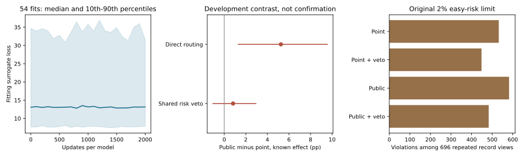

# Public Cost-Sensitive Routing On MovingDroneCrowd++

I trained a task-adapted multi-expert deferral router to test whether direct
cost-sensitive decisions improve on the existing point-cost selector. The
candidate trajectories, causal features, source roles and risk rules stayed
fixed. All54new models completed2000updates, with three producer seeds and
source-excluded validation. All inference blocks replay exactly.

The result separates predictive utility from safe admission. Unguarded routing
improves known-label utility over the point selector by5.25percentage points
(95%source-bootstrap CI1.31to9.55), but the direct missing-outcome lower
comparison is unresolved. The original risk veto leaves no clear paired gain
and still fails the full2%risk/support contract. I have not upgraded deployment.

- [Complete results, physical-floor comparisons and runtime](readout.md)
- [What improved and what failed](failure_analysis.md)
- [Model and data card](model_data_card.md)
- [Original gates](gates.md)
- [All source units](per_source.md)
- [Frozen protocol](protocol.md)
- [Public-method equation and limitations](method_note.md)
- [Full fitting audit](fit_audit.json)
- [Original point-control reproduction](parent_control_replay.json)
- [Independent inference replay](verification.json)

These are exposed SOURCE development results in image pixels with native
observation8/prediction12, not independent confirmation, metric or seconds-level
prediction. The router is an adaptation of an existing public method, not a new
M3W contribution by itself. Stage5C and SMC remain off.
