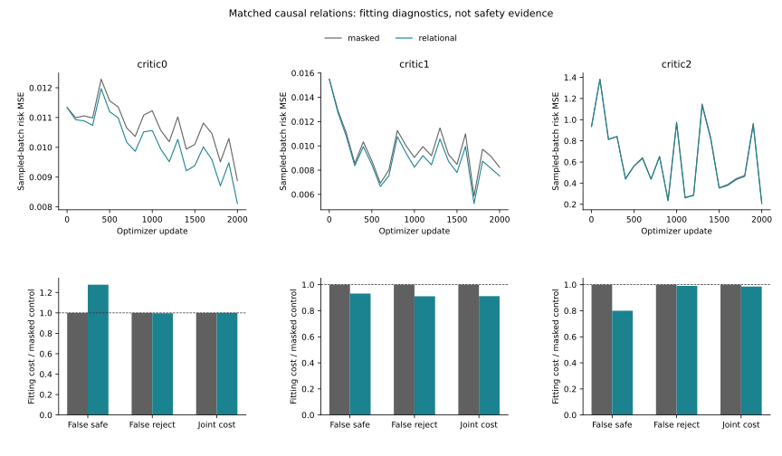

# Causal Rollout-History Feature Experiment

I tested whether explicitly relating a candidate forecast to observed motion
helps a neural intervention-risk model make safer decisions. Six models use
identical initialization, query draws, original joint loss and fixed budget.
Both arms have 68,356 parameters; masking the new inputs reduces effective
capacity, so this is not a pure capacity-matched information experiment.

## Own-Fitting Results

| Context | Arm | Full risk MSE | Joint cost | False-safe | False-reject |
|---|---|---:|---:|---:|---:|
| eqmotion_fold1_seed17_critic0 | masked | 0.00956420 | 0.00645961 | 18 | 2655 |
| eqmotion_fold1_seed17_critic0 | relational | 0.00872861 | 0.00646050 | 17 | 2623 |
| eqmotion_fold0_seed17_critic1 | masked | 0.00839910 | 0.00335666 | 35 | 1924 |
| eqmotion_fold0_seed17_critic1 | relational | 0.00751850 | 0.00306017 | 36 | 1876 |
| eqmotion_fold0_seed17_critic2 | masked | 0.61272211 | 0.01963634 | 162 | 22704 |
| eqmotion_fold0_seed17_critic2 | relational | 0.60058792 | 0.01934724 | 150 | 22700 |

| Context | MSE reduction % | Joint-cost reduction % | False-safe-cost reduction % | False-reject-cost reduction % |
|---|---:|---:|---:|---:|
| eqmotion_fold1_seed17_critic0 | 8.7366 | -0.0137 | -27.6636 | 0.2907 |
| eqmotion_fold0_seed17_critic1 | 10.4844 | 8.8327 | 6.8066 | 8.8931 |
| eqmotion_fold0_seed17_critic2 | 1.9804 | 1.4723 | 19.9970 | 0.9509 |

Negative reductions mean worse. These are fitting results, not held
trajectory accuracy or a calibrated safety guarantee.

Curves use the same sampled batches; full-data metrics above are separate.

## Exposed Development

Original internal fitting screen: **3/3**. Not a deployment gate.

| Policy | Known ADE gain % | Hard gain % | Switch % | Worst defined easy-net % | Original risk/support |
|---|---:|---:|---:|---:|---:|
| physical_floor | 0.0000 | 0.0000 | 0.0000 | 0.0000 | 0/17 |
| constant_veto | 3.6006 | 4.6257 | 15.0144 | 38.9046 | 0/17 |
| history_masked_veto | 0.8948 | 1.1698 | 5.9882 | 8.6334 | 0/17 |
| history_relational_veto | 0.9813 | 1.3032 | 6.4544 | 8.6603 | 0/17 |
| history_relational_risk_only_veto | 3.2682 | 4.1622 | 14.0159 | 25.7262 | 0/17 |

Primary relational-minus-masked contrast: 0.0865 pp; missing-label completion bounds [0.0451, 0.1279] pp.

| Source | Known contrast pp | Completion lower pp | Completion upper pp |
|---|---:|---:|---:|
| moving_source_component_051 | -0.1856 | -0.1983 | -0.1728 |
| moving_source_component_062 | -0.0387 | -0.1248 | 0.0473 |
| moving_source_component_066 | -0.0392 | -0.0392 | -0.0392 |
| moving_source_component_070 | 0.0000 | 0.0000 | 0.0000 |
| moving_source_component_075 | 0.0078 | 0.0078 | 0.0078 |
| moving_source_component_077 | -0.0616 | -0.0616 | -0.0616 |
| moving_source_component_078 | 0.9229 | 0.7318 | 1.1141 |

Source consistency: 2 improve, 4 worsen, 1 unchanged. The posthoc leave-one-source-out means range from -0.0529 to 0.1319 pp.
Leave-one-source-out means are influence diagnostics, not alternative
primary results, confidence intervals or permission to remove a source.
All frozen legacy and same-count controls remain in the complete JSON.
The risk-only arm is an ablation, not an authorized deployment policy.

Completion bounds are not sampling CIs. Partial-outcome development ADE
is not complete-roster ADE or independent confirmation. One producer seed
and repeatedly exposed nested C cannot support a final paper claim.

## Execution

| Phase | PID | Seconds | Peak RSS bytes |
|---|---:|---:|---:|
| pilot | 25011 | 83.98 | 6461767680 |
| train | 25357 | 1084.43 | 7617871872 |
| evaluate | 27000 | 68.90 | 6386548736 |
| verify | 27153 | 69.38 | 6350356480 |

12,000 primary + 2,000 full-refit + 500 pilot updates. Native arm64 Torch,
CPU4/inter-op1/workers0. Controls, full refit, fitting metrics and error
attributions replay exactly. No new trajectory predictor, JEPA or CREATE job.

The original 2% all/easy positive-harm, easy-net, reference/support contract
is unchanged. Empty support remains NA. No identity exemption. The original
24-group primary stays NA; reserved Moving20, DUT, DroneCrowd and H stay closed.
Native obs8/pred12 image coordinates; no metric/seconds/true3D/foundation
or human-gold claim. Stage5C/SMC are disabled; deployment is unchanged.

[Protocol](protocol.md) | [Metrics](result_summary.json) |
[Interpretation](failure_analysis.md) | [Reproduction](operation_zh.md)
