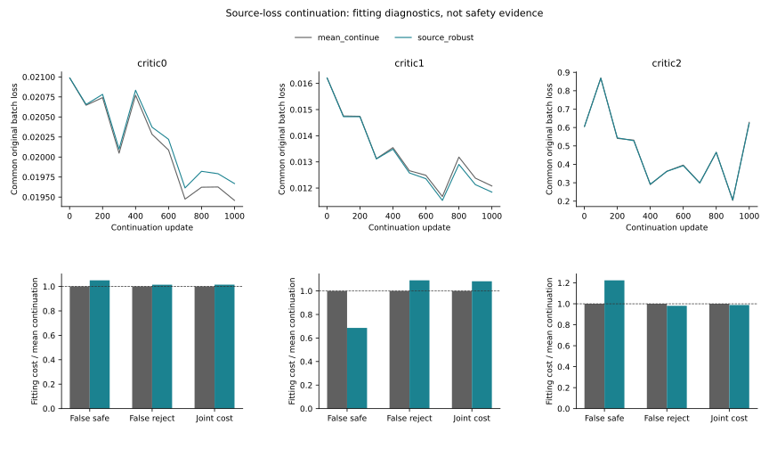

# Source-Robust Neural Continuation

I tested whether giving the worst fitting source a fixed extra loss weight
improves intervention-risk learning. Six actual neural fits continue the
same parent models, with identical inputs, initialization, draws and budget.
This changes training, not the original evaluation contract.

## Matched Fitting Contrast

| Context | Worst-source objective reduction % | Risk MSE reduction % | Joint-cost reduction % | False-safe-cost reduction % | False-reject-cost reduction % |
|---|---:|---:|---:|---:|---:|
| critic0 | 2.1492 | -0.8688 | -1.4646 | -5.0465 | -1.4323 |
| critic1 | 6.9365 | 5.4689 | -8.2327 | 31.4085 | -9.0615 |
| critic2 | 1.9804 | -0.1660 | 1.1602 | -22.4348 | 1.8982 |

Positive reductions are better. These are own-fitting results, not
held trajectory improvements, independent confirmation or calibrated safety.
The fixed internal follow-up screen passes **0/3** contexts.

The treatment is 0.75 original loss + 0.25 worst-source loss. The control
continues the original mean loss. Each model has 68,356 parameters, 524
input fields and 1,000 additional updates after its 2,000-update parent.
Unknown targets retain their original bounds. Source names group training
loss only, not inference inputs. Both encoders and all parameters update.

The plot compares the same original loss on matched sampled batches, not
two differently weighted objective values. Full-data costs are separate.

## Exposed Development

**not_run:** Fixed source-robust fitting screen failed; no additional nested-C or H readout.
No additional development or test improvement is inferred. The previous
17-view risk/support failure remains unchanged, not converted into a pass.

## Execution

| Phase | PID | Seconds | Peak RSS bytes |
|---|---:|---:|---:|
| pilot | 30383 | 73.51 | 6518161408 |
| train | 30621 | 590.20 | 7739359232 |
| evaluate | 31462 | 16.78 | 971145216 |
| verify | 31505 | 39.83 | 6388252672 |

6,000 primary + 1,000 exact full-refit + 400 real pilot updates. Native arm64
PyTorch, CPU4/inter-op1/workers0; checkpoints and heartbeat. Three contexts
share one producer seed and are not three independent training seeds.

- `fresh_run`: six continuations, source losses, error attribution and exact replay.
- `cached_verified`: parent weights, causal data, schema, own-B source partitions.
- `not_run`: reserved/H confirmation, a new trajectory predictor, JEPA and deployment.
- Original 2% all/easy positive-harm, easy-net and reference/support rules retained.
- Empty support remains NA; no identity certification or threshold search.
- Original 24-group primary stays NA. Moving20, DUT, DroneCrowd and H stay closed.
- Native obs8/pred12 image coordinates; no metric/seconds/true3D/foundation claim.
- Stage5C/SMC remain off; the paper is not yet submission-ready.

[Protocol](protocol.md) | [Source losses](source_losses.md) | [Metrics](result_summary.json)
| [Failure analysis](failure_analysis.md) | [Reproduction](operation_zh.md)
