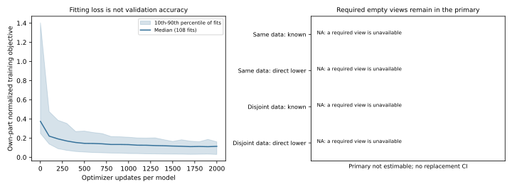

# Source-Separated Neural Critics

I tested whether a risk estimator trained on different source groups could
make neural interventions more useful and reliable. This experiment is
complete, but the strategy is **not deployable**. I kept the original 2%
risk limit, support requirements, required views and old failures. No
analytic identity-fallback certification was added.

## What I Trained

There are 108 new Torch cost heads, each with 28,229 parameters and 2,000
saved optimizer updates. Fitting labels and all learned preprocessing belong
only to that model's own inner source part. For a held part, one other part
provides the proposer and its same-data seed control; the remaining part
provides the disjoint critic. Both proposer/critic orientations are retained.
All weights froze before new validation scores were read.

This is cost learning over fixed EqMotion proposals, not a new trajectory
dynamics, JEPA or generative model. All 23 source groups remain exposed
development, not independent confirmation.

## Complete Outcome

Each veto is compared with its own causal control, matching the count of
every amplitude within every query. Positive values would favor the veto.
These are baseline-normalized percentage-point differences, not raw FDE
percentages or measurements in metres.

|Veto|Registered nonempty primary|Complete-strategy known pp [95% CI], secondary|Complete-strategy direct lower pp [95% CI], secondary|
|---|---|---:|---:|
|Same data, different cost seed|NA: 6/276 required source views empty|-0.373 [-0.672, -0.151]|-0.877 [-1.370, -0.477]|
|Disjoint fitting sources|NA: 18/276 required source views empty|-0.563 [-1.095, -0.193]|-1.274 [-2.089, -0.586]|

The unavailable primary remains unavailable. The negative secondary is
reported in full, not used as a replacement primary. Intervals use 3,000
source resamples after averaging repeated producer/seed/orientation views;
the 276 source views and 696 recording views are not independent samples.

The disjoint critic reduces known harm by 0.213 pp [0.093, 0.346], but loses
0.776 pp [0.356, 1.325] of benefit using the same full-strategy denominator.
Both matched strategies switch 26.961% on a source-macro basis. Lower harm
alone is not evidence of a more useful selection mechanism.

Only 44/696 recording views meet the original full-policy risk/support
contract. There are 443 known all-risk violations, 448 known easy-risk
violations and 173 unavailable selected easy-risk views. The worst defined
record-level signed easy-net degradation is 477.76%, not a dataset-wide mean.
On identical selected known rows, actual harm and easy-harm masses are
122.85 and 553.27 times their estimates. These are descriptive pooled ratios,
not confidence bounds. Separating fitting sources has not fixed risk learning.

## Losses And Reproduction



Training loss falls, but that does not establish validation accuracy or
safety. The band describes variability across separately normalized fits,
not a confidence interval for generalization. All 216 unique validation
arrays, 108 policy blocks and 1,620 cost cells replay exactly. The first full
model refit and all six pilot resume checks also match. Twenty scoped tests
pass; this is not a rerun of the entire historical test suite.

Saved primary fitter times sum to 8,822.70 s. An interruption retained 71 full
models and a step-100 partial checkpoint. Its cause and exit code are unknown.
The terminal resumed attempt took 2,760.31 s and exited 0; this is a different
timing definition, not an extra number to add to the fitting sum. The wall gap
is not compute time. Weights and raw/cache data remain outside Git.

With the existing legal local assets, this command can be run repeatedly:

```sh
.venv-pytorch/bin/python scripts/replay_m3w_source_separated_critics.py
```

It re-infers and compares all saved scientific results without changing
existing public study files. Its real run completed in 311.18 s with exit 0;
private heartbeat/log updates are allowed. It neither trains nor opens H.

## Evidence And Scope

- [Prospective protocol](protocol.md) and [frozen registration](registration.json).
- [Generated primary/risk readout](readout.md) and [complete metrics](analysis.json).
- [All source groups](per_source.md), [benefit/harm decomposition](benefit_harm_decomposition.json) and [selected cost estimates](pooled_cost_diagnostics.json).
- [Failure analysis](failure_analysis.md), [model card](model_card.md) and [data card](data_card.md).
- [Training recovery](runtime_recovery.md), [read-only command verification](replay_command_verification.json) and [Chinese operating guide](operation_zh.md).
- [Literature positioning](related_work_positioning.md), [project gap](project_gap.md) and [Chinese result summary](summary_zh.md).

The task is native observation eight / prediction twelve with available-label
pixel ADE. It is not complete-horizon, verified sensor-as-of, metric or
seconds-level evaluation. The original 24-source primary is still not
estimable. No independent test, new deployment, CCF-A readiness, true 3D,
foundation, human-gold, Stage5C execution or SMC claim follows.
